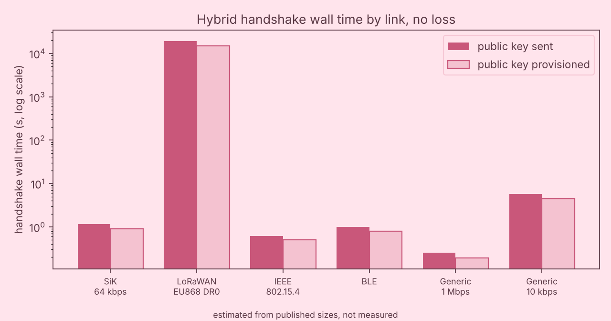

# Reference Design: Post Quantum Command and Telemetry Link for Drones and Robots

Author: Huda Mueen

Status: conceptual and defensive reference design. All timing and size figures are **estimated from published sizes, not measured**. No cryptographic code was written or run. The simulator in `linksim/` performs size and timing arithmetic only.

## 1. Purpose

Small vehicles and robots exchange commands and telemetry over narrow radio links. Today the tag on each message is a short symmetric value (MAVLink 2 signing adds a 13 B field containing a 6 B truncated tag, per `data/raw/S3_robotics.md` lines 19 to 20). The weak point for the quantum era is how the shared secret is established and authenticated, not the per message tag.

This design uses a two layer pattern:

1. **Session start:** a hybrid key establishment (X25519 together with ML-KEM-768) and a post quantum signature (ML-DSA-44) that authenticates the vehicle side.
2. **Session body:** a short symmetric tag on every message, keyed from the session secret.

The purpose of this document and the simulator is to answer a practical question: what does the session start cost in bytes, fragments, air time and wall time on each realistic link, and does a tag of 13 B or 16 B change the answer in any meaningful way.

## 2. Threat model (defensive)

Assets: command integrity (a vehicle must act only on authentic commands), telemetry integrity, the confidentiality of recorded sessions over their useful life, and the availability of the link.

Adversaries considered:

| Adversary | Capability | Design response |
|---|---|---|
| Passive recorder | Stores radio traffic today, may hold a future quantum computer | Hybrid key establishment so that a break of one component alone does not expose the session key |
| Active forger or replayer | Injects, modifies or replays frames | Per message tag with a monotonic counter bound to the session; receiver rejects stale or repeated counters |
| Downgrade attacker | Tries to force the classical only suite | The suite identifier is covered by the transcript signature; the receiver policy refuses a classical only suite once the vehicle is provisioned for hybrid |
| Resource exhaustion | Floods unauthenticated handshake fragments, or burns a duty cycle budget | Bounded reassembly buffers, fragment timeouts, rate limit on new handshakes, and a rule that no fragment buffer is allocated before the first flight header parses |
| Vehicle capture | Physical access to a recovered vehicle | Session keys are ephemeral and wiped on teardown; the long term material on the vehicle is a public verification key and a signing key kept in the vehicle only if the vehicle must sign |

Out of scope: implementation side channels and fault attacks, radio jamming, and any offensive technique. Side channel hardening is a separate design topic and is only noted here as a risk class.

Important caution on the in band public key variant: if the ML-DSA-44 public key (1312 B) is sent inside the handshake, the receiver must still compare it with a value provisioned in advance (the key or a pinned digest of it). A key accepted without such a check authenticates nothing. This is why the provisioned variant is the recommended one and the in band variant is a bootstrap option.

## 3. Message flow

Roles: A is the ground side (initiator). B is the vehicle (responder).

| Step | Direction | Content | Bytes |
|---|---|---|---|
| F1 | A to B | Suite identifier, X25519 share (32 B), ML-KEM-768 encapsulation key (1184 B) | 1216 |
| F2 | B to A | X25519 share (32 B), ML-KEM-768 ciphertext (1088 B), ML-DSA-44 signature over the transcript (2420 B), optionally the ML-DSA-44 public key (1312 B) | 4852 or 3540 |
| F3 | A to B | Key confirmation (assumed 16 B) | 16 |
| Session | both | Message plus tag (13 B field or hypothetical 16 B tag) | per message |

Sizes come from `linksim/params.csv`. Each flight is carried as fragments (Section 6). The suite identifier and framing bytes are not counted in F1 and F2, which is an optimistic simplification (Section 9).

Authentication of the ground side is by a provisioned shared value mixed into the session key schedule and proven by F3. This keeps a second post quantum signature off the narrow link. It is a design choice, not a simulated component.

## 4. State machine

States (identical on both sides unless noted):

| State | Meaning | Exits |
|---|---|---|
| IDLE | No session | On start request (A) or on valid F1 (B) go to the next state |
| HS_SENT (A) | F1 sent, awaiting F2 | F2 complete and signature valid to CONFIRMING; timeout after retries to FAILED |
| HS_RECV (B) | F1 received, F2 being sent | All F2 fragments acknowledged to WAIT_CONFIRM; timeout to FAILED |
| CONFIRMING (A) | F3 being sent | F3 acknowledged to ESTABLISHED |
| WAIT_CONFIRM (B) | Awaiting F3 | Valid F3 to ESTABLISHED; invalid or timeout to FAILED |
| ESTABLISHED | Tagged messages flow | Counter exhaustion, age limit or operator request to REKEY; tag failure threshold to FAILED |
| REKEY | New handshake while the old keys remain valid for a short grace period | Success to ESTABLISHED with new keys; failure to FAILED |
| FAILED | Keys wiped, fragment buffers freed | Backoff timer, then IDLE |

Rules: a vehicle in flight never drops to FAILED without a defined safe behaviour (for example continue a stored mission or return), because the link state must not become a single point of loss of control. Specifying that behaviour belongs to the vehicle safety case.

## 5. Message size table

The table below is generated by `linksim/make_tables.py`. It also appears in `docs/link_tables.md`.

<!-- BEGIN size -->

| item | bytes | source or formula |
|---|---|---|
| X25519 share | 32 | S3_robotics.md:157 |
| ML-KEM-768 encapsulation key | 1184 | S2-0399 |
| ML-KEM-768 ciphertext | 1088 | S2-0401 |
| Hybrid initiator share (X25519 + ML-KEM-768 key) | 1216 | sum |
| Hybrid responder share (X25519 + ML-KEM-768 ciphertext) | 1120 | sum |
| ML-DSA-44 signature | 2420 | S2-0407 |
| ML-DSA-44 public key | 1312 | S2-0406 |
| Key confirmation (assumption) | 16 | ASSUMPTION |
| Handshake total, public key sent | 6084 | 1216 + 4852 + 16 |
| Handshake total, public key provisioned | 4772 | 1216 + 3540 + 16 |
| Classical baseline (X25519, Ed25519) | 176 | 32 + 128 + 16 |
| MAVLink 2 signing field | 13 | S3_robotics.md:19-20 (1 link ID + 6 timestamp + 6 tag) |
| Hypothetical symmetric tag | 16 | HYPOTHETICAL |
| PQ image header (wolfBoot LMS example) | 5288 | S3_robotics.md:121 |

_estimated from published sizes, not measured_

<!-- END size -->

## 6. Fragmentation table

Fragment capacity per link: MAVLink FILE_TRANSFER_PROTOCOL carries 239 data bytes per message (S3 line 61); LoRaWAN EU868 DR0 51 B; IEEE 802.15.4 81 B worst case with link layer security (RFC 4919 as cited in S3 line 76); BLE 23 B (S3 line 77). The two generic links reuse the MAVLink framing.

<!-- BEGIN frag -->

| object | bytes | SiK 64 kbps (239 B) | LoRaWAN EU868 DR0 (51 B) | IEEE 802.15.4 (81 B) | BLE (23 B) | Generic 1 Mbps (239 B) | Generic 10 kbps (239 B) |
|---|---|---|---|---|---|---|---|
| Initiator share | 1216 | 6 | 24 | 16 | 53 | 6 | 6 |
| Responder share | 1120 | 5 | 22 | 14 | 49 | 5 | 5 |
| ML-DSA-44 signature | 2420 | 11 | 48 | 30 | 106 | 11 | 11 |
| ML-DSA-44 public key | 1312 | 6 | 26 | 17 | 58 | 6 | 6 |
| Flight F1 | 1216 | 6 | 24 | 16 | 53 | 6 | 6 |
| Flight F2 (key sent) | 4852 | 21 | 96 | 60 | 211 | 21 | 21 |
| Flight F2 (key provisioned) | 3540 | 15 | 70 | 44 | 154 | 15 | 15 |
| PQ image header | 5288 | 23 | 104 | 66 | 230 | 23 | 23 |
| Firmware 256 kB | 256000 | 1072 | 5020 | 3161 | 11131 | 1072 | 1072 |
| Firmware 1 MB | 1000000 | 4185 | 19608 | 12346 | 43479 | 4185 | 4185 |
| 1 MB + PQ header | 1005288 | 4207 | 19712 | 12411 | 43709 | 4207 | 4207 |

_estimated from published sizes, not measured_

<!-- END frag -->

Reading the table: the 802.15.4 handshake needs 16 fragments for F1 and 60 for F2 (76 for the two key bearing flights, 77 with the confirmation). A single concatenated object of 6068 B would need 75. The difference arises because each flight is fragmented separately.

## 7. Added latency per message and per session

### 7.1 Per message tag

A 30 B payload is assumed. The MAVLink 2 message is 10 B header, 2 B checksum, 30 B payload, giving 42 B; 55 B with the 13 B field; 58 B with the hypothetical 16 B tag. On LoRaWAN DR0 (51 B payload) both tagged forms no longer fit one frame, so the table also shows channel occupancy including duty cycle silence.

The 16 B tag is **hypothetical**. It is not a MAVLink field. It assumes that the replay counter is held as shared state at both ends rather than sent on the wire.

<!-- BEGIN latency -->

| link | rate bit/s | 13 B field | 16 B hypothetical tag | 16 B occupancy incl. duty cycle |
|---|---|---|---|---|
| SiK 64 kbps | 57600 | 1.8 ms | 2.2 ms | 2.2 ms |
| LoRaWAN EU868 DR0 | 250 | 416.0 ms | 512.0 ms | 51.20 s |
| IEEE 802.15.4 | 250000 | 0.4 ms | 0.5 ms | 0.5 ms |
| BLE | 1000000 | 0.1 ms | 0.2 ms | 0.2 ms |
| Generic 1 Mbps | 1000000 | 0.1 ms | 0.1 ms | 0.1 ms |
| Generic 10 kbps | 10000 | 10.4 ms | 12.8 ms | 12.8 ms |

_estimated from published sizes, not measured_

<!-- END latency -->

### 7.2 Handshake wall time, no loss

Stop and wait acknowledges every fragment. Selective repeat sends 16 fragments per block acknowledgement and polls by resending the last fragment.

<!-- BEGIN hs -->

| link | wall, stop and wait | wall, selective repeat | fragments | data air time |
|---|---|---|---|---|
| SiK 64 kbps | 2.45 s | 1.16 s | 28 | 938.3 ms |
| LoRaWAN EU868 DR0 | 5.36 h | 5.36 h | 121 | 3.2 min |
| IEEE 802.15.4 | 4.28 s | 618.0 ms | 77 | 308.0 ms |
| BLE | 13.32 s | 1.01 s | 265 | 57.2 ms |
| Generic 1 Mbps | 1.46 s | 255.0 ms | 28 | 54.0 ms |
| Generic 10 kbps | 7.43 s | 5.70 s | 28 | 5.40 s |

_estimated from published sizes, not measured_

<!-- END hs -->

Provisioned public key variant:

<!-- BEGIN hsprov -->

| link | wall, stop and wait | wall, selective repeat | fragments | data air time |
|---|---|---|---|---|
| SiK 64 kbps | 1.92 s | 898.6 ms | 22 | 736.1 ms |
| LoRaWAN EU868 DR0 | 4.19 h | 4.20 h | 95 | 2.5 min |
| IEEE 802.15.4 | 3.39 s | 500.8 ms | 61 | 242.5 ms |
| BLE | 10.46 s | 796.0 ms | 208 | 44.8 ms |
| Generic 1 Mbps | 1.15 s | 193.1 ms | 22 | 42.4 ms |
| Generic 10 kbps | 5.83 s | 4.46 s | 22 | 4.24 s |

_estimated from published sizes, not measured_

<!-- END hsprov -->

With 10 percent per fragment loss:

<!-- BEGIN hsloss -->

| link | wall, stop and wait | wall, selective repeat | fragments | data air time |
|---|---|---|---|---|
| SiK 64 kbps | 3.38 s | 1.49 s | 28 | 938.3 ms |
| LoRaWAN EU868 DR0 | 6.76 h | 6.13 h | 121 | 3.2 min |
| IEEE 802.15.4 | 6.49 s | 927.5 ms | 77 | 308.0 ms |
| BLE | 19.63 s | 1.63 s | 265 | 57.2 ms |
| Generic 1 Mbps | 2.14 s | 444.1 ms | 28 | 54.0 ms |
| Generic 10 kbps | 9.64 s | 6.79 s | 28 | 5.40 s |

_estimated from published sizes, not measured_

<!-- END hsloss -->

### 7.3 Firmware update wall time

The image carrying a post quantum signature header uses the 5288 B header from the wolfBoot LMS example (S3 line 121). That value is an example configuration value, not a measurement. The ML-DSA-44 example in the same source uses a 4840 B header (S4 line 85).

<!-- BEGIN fw -->

| link | 256 kB sw | 256 kB sr | 1 MB sw | 1 MB sr | 1 MB + header sw | 1 MB + header sr |
|---|---|---|---|---|---|---|
| SiK 64 kbps | 96.90 s | 42.76 s | 6.3 min | 2.8 min | 6.3 min | 2.8 min |
| LoRaWAN EU868 DR0 | 9.5 d | 9.5 d | 37.0 d | 37.0 d | 37.2 d | 37.2 d |
| IEEE 802.15.4 | 2.9 min | 23.07 s | 11.5 min | 90.06 s | 11.5 min | 90.53 s |
| BLE | 9.3 min | 37.26 s | 36.4 min | 2.4 min | 36.6 min | 2.4 min |
| Generic 1 Mbps | 56.09 s | 5.62 s | 3.6 min | 21.97 s | 3.7 min | 22.06 s |
| Generic 10 kbps | 5.0 min | 3.8 min | 19.7 min | 15.0 min | 19.8 min | 15.1 min |

_estimated from published sizes, not measured_

<!-- END fw -->

<!-- BEGIN fwloss -->

| link | 256 kB sw | 256 kB sr | 1 MB sw | 1 MB sr | 1 MB + header sw | 1 MB + header sr |
|---|---|---|---|---|---|---|
| SiK 64 kbps | 2.2 min | 49.07 s | 8.7 min | 3.2 min | 8.7 min | 3.2 min |
| LoRaWAN EU868 DR0 | 11.8 d | 10.6 d | 45.9 d | 41.6 d | 46.1 d | 41.8 d |
| IEEE 802.15.4 | 4.3 min | 31.02 s | 16.6 min | 2.0 min | 16.7 min | 2.0 min |
| BLE | 13.7 min | 59.05 s | 53.4 min | 3.8 min | 53.7 min | 3.8 min |
| Generic 1 Mbps | 80.33 s | 7.62 s | 5.3 min | 31.24 s | 5.4 min | 31.27 s |
| Generic 10 kbps | 6.4 min | 4.3 min | 25.6 min | 16.9 min | 25.7 min | 17.0 min |

_estimated from published sizes, not measured_

<!-- END fwloss -->

Figure: `docs/figures/linksim_handshake.png` (generated by `python -m linksim.make_plots`).



_estimated from published sizes, not measured_

### 7.4 Headline results

Default parameters, seed 1.

| Quantity | Value |
|---|---|
| Handshake payload bytes (F1 + F2 + F3) | 6084 B (6068 B without the assumed confirmation) |
| SiK at 57.6 kbps effective, payload only arithmetic | 0.843 s (8 x 6068 / 57600) |
| SiK handshake, with MAVLink FTP framing, data air time | 0.938 s |
| SiK handshake, wall time with acknowledgements, selective repeat / stop and wait | 1.16 s / 2.45 s |
| LoRaWAN DR0 handshake, data air time | 194.7 s (3.2 min); 196.4 s including acknowledgements |
| LoRaWAN DR0 handshake, wall time with 1 percent duty cycle | about 19,300 s (5.36 h) |
| 802.15.4 handshake fragments | 76 for F1 and F2 (77 with F3) |
| 1 MB firmware at 57.6 kbps, no loss, raw bits only | 138.9 s |
| 1 MB firmware at 57.6 kbps, no loss, with framing, selective repeat / stop and wait | 167.0 s / 378.4 s |
| 1 MB firmware at 57.6 kbps, 10 percent loss, stop and wait, mean of seeds 1 to 5 | about 518 s |
| Same, selective repeat | about 194 s |

_estimated from published sizes, not measured_

## 8. Sensitivity summary

Each ASSUMPTION parameter was varied by minus and plus 50 percent; loss was swept over 0, 1, 5 and 10 percent. Cited parameters were not varied.

<!-- BEGIN sens -->

Base ordering (fastest first) at zero loss:

| metric | ordering |
|---|---|
| hs_sr | 1 Mbps < 802.15.4 < BLE < SiK < 10 kbps < LoRaWAN |
| hs_sw | 1 Mbps < SiK < 802.15.4 < 10 kbps < BLE < LoRaWAN |
| fw_sr | 1 Mbps < 802.15.4 < BLE < SiK < 10 kbps < LoRaWAN |
| fw_sw | 1 Mbps < SiK < 802.15.4 < 10 kbps < BLE < LoRaWAN |
| tag16 | 1 Mbps < BLE < 802.15.4 < SiK < 10 kbps < LoRaWAN |

Each assumption varied by minus and plus 50 percent (absolute probe if the base is zero):

| assumption | largest relative change | where | ordering changes |
|---|---|---|---|
| sr_window_frames | 116.7% | hs_sr on ble at -50%, loss 0.05 | fw_sr +50% loss 0.05; fw_sr -50% loss 0; hs_sr -50% loss 0 ... |
| generic_fast_rate_bps | 100.0% | tag16 on generic1m at -50%, loss 0 | tag16 -50% loss 0 |
| generic_slow_rate_bps | 100.0% | tag16 on generic10k at -50%, loss 0 | hs_sw -50% loss 0 |
| ble_rate_bps | 100.0% | tag16 on ble at -50%, loss 0 | tag16 +50% loss 0 |
| lorawan_phy_mac_overhead_bytes | 62.5% | tag16 on lorawan at probe, loss 0 | none |
| turnaround_s | 49.7% | hs_sw on ble at -50%, loss 0.05 | fw_sr +50% loss 0; fw_sr -50% loss 0.05; hs_sr +50% loss 0 ... |
| frag_hdr_bytes | 25.0% | tag16 on lorawan at probe, loss 0 | fw_sr probe loss 0 |
| msg_payload_bytes | 20.0% | tag16 on ble at -50%, loss 0 | tag16 -50% loss 0 |
| rto_factor | 12.7% | hs_sr on generic1m at -50%, loss 0.05 | fw_sr -50% loss 0.05 |
| ack_payload_bytes | 0.7% | hs_sw on generic10k at +50%, loss 0.05 | none |
| confirm_bytes | 0.4% | hs_sw on ble at +50%, loss 0 | none |
| turnaround_lorawan_s | 0.0% | hs_sr on lorawan at +50%, loss 0 | none |

Loss sweep (mean of 3 seeds, 256000 B firmware), ordering unchanged versus zero loss: 
1%: yes; 5%: no (fw_sr); 10%: no (hs_sr, fw_sr)

| loss | metric | SiK | LoRaWAN | 802.15.4 | BLE | 1 Mbps | 10 kbps |
|---|---|---|---|---|---|---|---|
| 1% | hs_sr time vs no loss | x1.01 | x1.01 | x1.03 | x1.07 | x1.00 | x1.01 |
| 1% | hs_sw time vs no loss | x1.02 | x1.02 | x1.02 | x1.04 | x1.02 | x1.02 |
| 1% | fw_sr time vs no loss | x1.01 | x1.01 | x1.03 | x1.06 | x1.02 | x1.01 |
| 1% | fw_sw time vs no loss | x1.03 | x1.02 | x1.04 | x1.05 | x1.04 | x1.03 |
| 5% | hs_sr time vs no loss | x1.23 | x1.09 | x1.40 | x1.22 | x1.55 | x1.16 |
| 5% | hs_sw time vs no loss | x1.23 | x1.15 | x1.33 | x1.22 | x1.28 | x1.18 |
| 5% | fw_sr time vs no loss | x1.08 | x1.06 | x1.16 | x1.27 | x1.20 | x1.06 |
| 5% | fw_sw time vs no loss | x1.17 | x1.11 | x1.21 | x1.22 | x1.21 | x1.13 |
| 10% | hs_sr time vs no loss | x1.32 | x1.14 | x1.57 | x1.69 | x1.76 | x1.22 |
| 10% | hs_sw time vs no loss | x1.35 | x1.26 | x1.52 | x1.44 | x1.42 | x1.28 |
| 10% | fw_sr time vs no loss | x1.15 | x1.12 | x1.34 | x1.58 | x1.36 | x1.12 |
| 10% | fw_sw time vs no loss | x1.35 | x1.24 | x1.45 | x1.47 | x1.43 | x1.28 |

_estimated from published sizes, not measured_

_estimated from published sizes, not measured_

<!-- END sens -->

Findings:

1. The link ordering is robust for the slow end: LoRaWAN DR0 is last for every metric in all 220 variation and metric combinations tested, because its duty cycle (1 percent) and 250 bit/s rate dominate every other effect by two to three orders of magnitude.
2. The ordering among the fast links (generic 1 Mbps, 802.15.4, BLE, SiK) is **not** robust. It changes with the selective repeat window size, the receiver turnaround time, and the assumed BLE rate, because on fast links the wall time is dominated by acknowledgement round trips rather than by air time.
3. Among non rate assumptions, the selective repeat window size moves results most, followed by the turnaround time. Rate assumptions scale their own link inversely by construction.
4. Loss at 1 percent leaves the ordering unchanged. At 5 and 10 percent the selective repeat orderings shift. Selective repeat is faster than stop and wait at every loss level tested on every link. On LoRaWAN the two are equal at zero loss because duty cycle silence dominates, and selective repeat is about 10 percent faster at 10 percent loss (1 MB: about 41.6 days against 45.9 days).
5. The extra 16 B versus 13 B for a tag is small on every link except LoRaWAN, where it costs about 0.1 s more air time per message and, under the duty cycle, about 9.6 s of additional occupancy.

## 9. Limitations

* **Not measured.** Everything is arithmetic on published sizes and cited link parameters. No radio, no flight controller and no cryptographic library was run.
* The suite identifier, protocol version, length fields and transcript framing are not counted. The assumed key confirmation of 16 B is the only extra handshake byte count. Real totals will be somewhat larger.
* The LoRaWAN PHY and MAC overhead is not in the data files and is ignored; air time is computed on the application payload at the cited 250 bit/s. This understates LoRaWAN air time. The 1 percent duty cycle model is a strict silence of air x 99 after each transmission per transmitter.
* BLE rate (1 Mbps), the generic link rates, acknowledgement size, turnaround times, retransmission timeout, window size and retry limit are assumptions (all labelled in `linksim/params.csv`).
* Loss is independent per fragment and equal for data and acknowledgements. Real radio loss is bursty.
* SiK usable fraction of 0.9 is cited (S3 line 69). It applies to one direction without error correction; with ECC the cited rate halves. The simulator treats the link as half duplex and does not model time division sync or competing telemetry.
* The 802.15.4 wire frame is taken as 127 B for 81 B of data (RFC 4919 as cited). PHY synchronisation bytes are ignored. BLE wire frame is the 27 B link layer unit; preamble and CRC are ignored.
* The 5288 B image header comes from an LMS example, not from an ML-DSA header, and is an example configuration value.
* Computation time for key establishment and signature verification is not included. Benchmark rows in `data/evidence.csv` cover that and are a separate input.
* One handshake at a time, a single peer pair, no contention. Rekeying cost is the same as the first handshake in this model.
* Handshake security properties (binding of the transcript, key schedule, anti replay design) are described conceptually and have not been analysed formally.

## 10. Reproduction

```
python -m unittest discover -s linksim/tests -t .
python -m linksim.cli --scenario handshake --link sik
python -m linksim.sensitivity
python -m linksim.make_tables
python -m linksim.make_plots
```

**Estimated from published sizes, not measured.**
