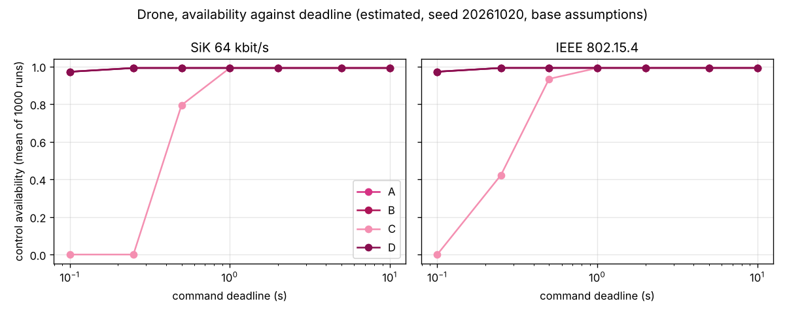
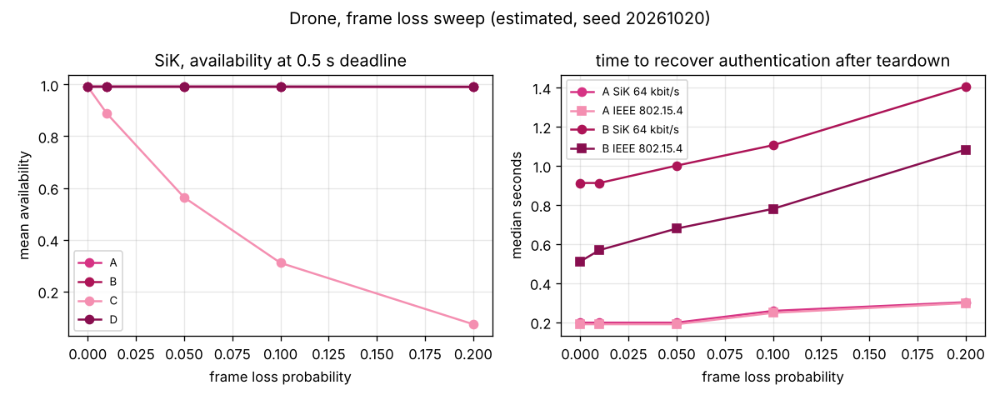
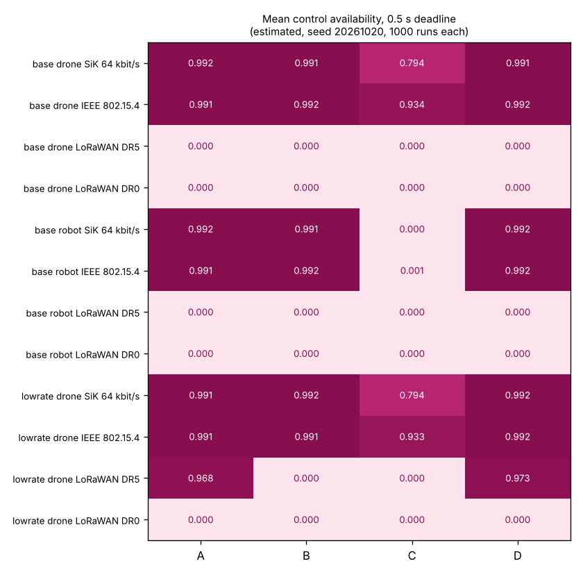

# Mission Study: Authenticated Command Channel for a Drone and a Ground Robot

Author: Huda Mueen

Status: **estimated**. A seeded discrete event simulation built on published message sizes, published cycle counts, cited link parameters and labelled assumptions. Nothing was measured on a radio or a flight controller and nothing cryptographic was implemented. The link model has only weak validation (Section 8). Generated by `python3 -m mission.run_all`; do not edit by hand.

Seed 20261020; 1000 runs per configuration; availability is reported as the mean over runs and other metrics as the median over runs, each with a bootstrap 95 percent percentile interval (2000 resamples).

## 1. Question

Which of four authentication architectures can keep an authenticated command channel available on four narrow links during a whole mission (preflight, takeoff, cruise, link loss and recovery, landing), and where does each one stop working?

## 2. Architectures

| architecture | handshake bytes on air | tag bytes per message | extra bytes per command | resists a future quantum adversary (design intent, not analysed) |
|---|---|---|---|---|
| A classical (X25519 + Ed25519, MAVLink 2 signing) | 224 | 13 | 0 | no |
| B hybrid (X25519 + ML-KEM-768, ML-DSA-44 transcript signatures of both sides, symmetric tag) | 7208 | 13 | 0 | yes |
| C ML-DSA-44 signature on every command | 0 | 0 | 2420 | yes |
| D LMS signed firmware plus provisioned session keys | 0 | 13 | 0 | yes |

A: handshake flights 32 B, 32 B, 80 B, 80 B (the last two each an Ed25519 signature of 64 B plus a 16 B key confirmation tag), then MAVLink 2 signing. B: flights 1216 B, 1120 B, 2436 B, 2436 B: the ground station signs the transcript with ML-DSA-44 (verified by the vehicle against a pinned key) and, with design change F1 of `docs/FORMAL_VERIFICATION.md`, the vehicle signs the transcript with its own ML-DSA-44 key pinned at the ground station; each side sends a key confirmation tag; then the same 13 B field. A has the same structure with Ed25519 so that A and B stay comparable (the formal check covers B only). C: no session; each command carries a 2420 B ML-DSA-44 signature, carried in file transfer style chunks of 239 B. D: firmware verified at boot with LMS; session keys are provisioned over a wired link before flight and renewed locally, so nothing about keys crosses the radio. Sizes, cycle counts and the clock come from `data/shared_inputs.csv` (one value and one source per parameter shared with another study).

## 3. Inputs

### 3.1 Traffic

Message payload lengths are host measured from pymavlink 2.4.50 (`mission/payload_lengths.csv`); rates are in `mission/traffic.csv`: HEARTBEAT at 1 Hz is published, the other stream rates are assumptions because the retrieved ArduPilot and PX4 pages do not state defaults (`data/raw/S12_traffic_sources.md`). The drone command probe is SET_POSITION_TARGET_GLOBAL_INT at 1 Hz; the robot probe is SET_POSITION_TARGET_LOCAL_NED at 5 Hz. The PX4 TELEM1 default budget of 1200 B/s (published) is a cross check: the assumed drone downlink with 13 B signing fields is 662 B/s (derived), inside that budget.

### 3.2 Compute

Reference board: STM32F405 class flight controller at 168 MHz (Cortex-M4F, the same core family as the pqm4 rows; `data/raw/S5_benchmark_plan_facts.md` line 77). A 480 MHz Cortex-M7 board (Pixhawk 6C, line 75) is a sensitivity case only, because M4 cycle counts do not transfer directly to an M7. A wait state factor (base 1.0, swept to 1.5) is applied only to rows measured under zero wait state conditions (see below).

| operation | cycles used | published range min | published range max | wait state factor applied | label | source |
|---|---|---|---|---|---|---|
| x25519_two_mults | 1.10e+06 | 9.53e+05 | 2.07e+06 | False | derived from published | S12A-332+S12A-332; X25519, two scalar multiplications (key generation plus shared secret), Emill integer version, board and clock not stated |
| ed25519_verify | 7.22e+05 | 7.22e+05 | 1.46e+06 | True | published | S12A-331; Ed25519 verify, Owens et al., STM32F407 at 24 MHz |
| ed25519_sign | 2.39e+05 | 2.39e+05 | 5.49e+05 | True | published | S12A-330; Ed25519 sign, Owens et al., STM32F407 at 24 MHz |
| mlkem768_encaps | 6.59e+05 | 6.59e+05 | 6.59e+05 | True | published | S2-0023; ML-KEM-768 encaps, pqm4 m4fspeed |
| mldsa44_verify | 1.42e+06 | 1.42e+06 | 1.42e+06 | True | published | S2-0033; ML-DSA-44 verify, pqm4 m4f |
| mldsa44_sign | 3.94e+06 | 3.94e+06 | 3.94e+06 | True | published | S2-0032; ML-DSA-44 sign, pqm4 m4f (mean of a variable signing time) |
| lms_verify | 2.66e+06 | 2.66e+06 | 2.66e+06 | False | published | S8-026; LMS w=16 h=10 SHA-256 verify, Cortex-M4 (Campos et al.), clock not stated |


| arch | operation | cycles | cycles_with_wait_state_factor | ms_at_168MHz | ms_at_480MHz | label |
|---|---|---|---|---|---|---|
| A | handshake or rekey | 2.06e+06 | 2.06e+06 | 12.254 | 4.289 | derived from published |
| B | handshake or rekey | 7.12e+06 | 7.12e+06 | 42.388 | 14.836 | derived from published |
| C | per command check | 1.42e+06 | 1.42e+06 | 8.462 | 2.962 | derived from published |
| D | boot verify | 2.66e+06 | 2.66e+06 | 15.827 | 5.539 | derived from published |

Classical rows are the same as in the energy study so that the two agree: X25519 uses S12A-332 (Emill X25519-Cortex-M4 README, integer only version, board and clock not stated), counted twice (key generation and shared secret), which is conservative because a fixed base key generation can be faster; Ed25519 verify and sign use S12A-331 and S12A-330 (Owens et al., STM32F407 at 24 MHz); ML-DSA-44 sign (vehicle signature of design change F1) uses S2-0032. The chosen row of every operation is read from `data/shared_inputs.csv`. The published range over all double read rows is shown beside each value (X25519 S12A-317, S12A-321, S12A-325, S12A-332, S12A-333; Ed25519 verify S12A-320, S12A-324, S12A-328, S12A-331). Earlier versions of this study used an ECDH secp256r1 proxy and then S12A-325 and S12A-328 (84 MHz rows); both are replaced.

Flash wait states: the wait state factor is applied only to rows measured under zero wait state conditions, so that a penalty is not counted twice. These are the pqm4 rows (zero wait states derived from the pqm4 code) and S12A-331 (24 MHz, treated as zero wait state conditions as in the energy study; the row does not state the setting). Rows whose clock or wait state setting is not stated (S12A-332 and the LMS row S8-026, which replaces the S2-0316 slide row of earlier versions so that every study uses one LMS row) are used as published without the factor, which may understate their cost at 168 MHz. The per message tag cost is derived from published SHA-256 throughput (`data/shared_inputs.csv`) and used without the factor. The largest median compute share in any base configuration is 0.0397 of the cycle budget.

### 3.3 Assumptions

| name | value |
|---|---|
| frame_loss | 0.020 |
| outage_rate_per_h | 6.000 |
| outage_mean_s | 5.000 |
| session_timeout_s | 10.000 |
| rekey_interval_s | 300.000 |
| grace_s | 30.000 |
| deadline_s | 0.500 |
| mac_cycles | 24406.780 |
| wait_state_factor | 1.000 |
| feasible_availability | 0.990 |

All except mac_cycles are labelled `assumption` in `mission/assumptions.csv`; mac_cycles is the shared value mac_cycles_per_message of `data/shared_inputs.csv` (derived from published). All are swept where they matter. Outages are a Poisson process with exponential durations; an outage longer than the session timeout tears the session down and forces a new handshake after the link returns.

## 4. Base results (estimated)

Control availability is the share of commands issued in flight that reach the vehicle authenticated within the deadline (0.5 s), over an unbroken link, with a valid key. Added latency is the median extra delivery time against the same command without authentication (same random draws). Utilisation is the share of air time on the shared channel (SiK, 802.15.4) or the share of the ground transmitter duty cycle budget (LoRaWAN; above 1 means overloaded). Compute share is vehicle cycles spent on authentication over the mission divided by available cycles at 168 MHz. Time to recover is from link return to a new valid session after a teardown (A and B only).

### 4.1 Drone

| Link | arch | availability | unauthenticated | availability minus unauthenticated (paired) | added ms | utilisation | compute share | recover s | first session s |
|---|---|---|---|---|---|---|---|---|---|
| SiK 64 kbit/s | A | 0.9916 [0.9910, 0.9923] | 0.9917 | -0.00007 | 1.95 [1.95, 1.95] | 0.107 [0.107, 0.107] | 0.0021 [0.0021, 0.0021] | 0.27 [0.27, 0.27] | 0.3 [0.3, 0.3] |
| SiK 64 kbit/s | B | 0.9914 [0.9907, 0.9921] | 0.9918 | -0.00032 | 1.95 [1.95, 1.95] | 0.111 [0.111, 0.111] | 0.0023 [0.0023, 0.0023] | 1.45 [1.42, 1.45] | 1.5 [1.4, 1.5] |
| SiK 64 kbit/s | C | 0.7943 [0.7932, 0.7953] | 0.9920 | -0.19776 | 379.57 [379.57, 379.57] | 0.429 [0.429, 0.429] | 0.0078 [0.0078, 0.0078] | n/a [n/a, n/a] | 0.0 [0.0, 0.0] |
| SiK 64 kbit/s | D | 0.9912 [0.9905, 0.9920] | 0.9912 | -1.45e-06 | 1.95 [1.95, 1.95] | 0.107 [0.107, 0.107] | 0.0021 [0.0021, 0.0021] | n/a [n/a, n/a] | 0.0 [0.0, 0.0] |
| IEEE 802.15.4 | A | 0.9909 [0.9901, 0.9916] | 0.9909 | -0.00006 | 0.15 [0.15, 0.15] | 0.059 [0.059, 0.059] | 0.0021 [0.0021, 0.0021] | 0.25 [0.25, 0.25] | 0.3 [0.3, 0.3] |
| IEEE 802.15.4 | B | 0.9922 [0.9915, 0.9929] | 0.9924 | -0.00016 | 0.15 [0.15, 0.15] | 0.061 [0.061, 0.061] | 0.0023 [0.0023, 0.0023] | 0.87 [0.87, 0.87] | 0.9 [0.9, 0.9] |
| IEEE 802.15.4 | C | 0.9337 [0.9329, 0.9345] | 0.9919 | -0.05820 | 287.28 [287.28, 287.28] | 0.215 [0.215, 0.215] | 0.0078 [0.0078, 0.0078] | n/a [n/a, n/a] | 0.0 [0.0, 0.0] |
| IEEE 802.15.4 | D | 0.9916 [0.9909, 0.9923] | 0.9916 | 0.00000 | 0.15 [0.15, 0.15] | 0.059 [0.059, 0.059] | 0.0021 [0.0021, 0.0021] | n/a [n/a, n/a] | 0.0 [0.0, 0.0] |
| LoRaWAN DR5 | A | 5.80e-05 [4.06e-05, 7.54e-05] | 5.94e-05 | -1.45e-06 | 19.16 [19.16, 19.16] | 19.509 [19.509, 19.511] | 0.0021 [0.0021, 0.0021] | 4.73 [4.73, 4.73] | 4.7 [4.7, 4.7] |
| LoRaWAN DR5 | B | 0.0000 [0.0000, 0.0000] | 0.0000 | 0.00000 | n/a [n/a, n/a] | 20.268 [20.267, 20.268] | 0.0022 [0.0022, 0.0022] | n/a [n/a, n/a] | 1237.1 [1236.4, 1238.0] |
| LoRaWAN DR5 | C | 0.0000 [0.0000, 0.0000] | 7.54e-05 | -0.00008 | n/a [n/a, n/a] | 418.217 [418.170, 418.253] | 0.0078 [0.0078, 0.0078] | n/a [n/a, n/a] | 0.0 [0.0, 0.0] |
| LoRaWAN DR5 | D | 5.94e-05 [4.20e-05, 7.83e-05] | 6.09e-05 | -1.45e-06 | 19.16 [19.16, 19.16] | 19.367 [19.367, 19.367] | 0.0021 [0.0021, 0.0021] | n/a [n/a, n/a] | 0.0 [0.0, 0.0] |
| LoRaWAN DR0 | A | 0.0000 [0.0000, 0.0000] | 0.0000 | 0.00000 | n/a [n/a, n/a] | 464.064 [463.962, 464.166] | 0.0021 [0.0021, 0.0021] | n/a [n/a, n/a] | 1243.3 [1242.6, 1243.9] |
| LoRaWAN DR0 | B | 0.0000 [0.0000, 0.0000] | 0.0000 | 0.00000 | n/a [n/a, n/a] | 486.165 [486.054, 486.285] | 0.0022 [0.0022, 0.0022] | n/a [n/a, n/a] | 32901.8 [32898.7, 32904.1] |
| LoRaWAN DR0 | C | 0.0000 [0.0000, 0.0000] | 0.0000 | 0.00000 | n/a [n/a, n/a] | 10790.778 [10790.238, 10791.388] | 0.0078 [0.0078, 0.0078] | n/a [n/a, n/a] | 0.0 [0.0, 0.0] |
| LoRaWAN DR0 | D | 0.0000 [0.0000, 0.0000] | 0.0000 | 0.00000 | n/a [n/a, n/a] | 462.822 [462.720, 462.891] | 0.0021 [0.0021, 0.0021] | n/a [n/a, n/a] | 0.0 [0.0, 0.0] |

_estimated (computed from published sizes and cycle counts plus labelled assumptions; not measured); seed 20261020_

### 4.2 Robot

| Link | arch | availability | unauthenticated | availability minus unauthenticated (paired) | added ms | utilisation | compute share | recover s | first session s |
|---|---|---|---|---|---|---|---|---|---|
| SiK 64 kbit/s | A | 0.9918 [0.9913, 0.9924] | 0.9919 | -0.00006 | 1.95 [1.95, 1.95] | 0.128 [0.128, 0.128] | 0.0023 [0.0023, 0.0023] | 0.27 [0.27, 0.27] | 0.3 [0.3, 0.3] |
| SiK 64 kbit/s | B | 0.9912 [0.9906, 0.9918] | 0.9916 | -0.00033 | 1.95 [1.95, 1.95] | 0.132 [0.132, 0.133] | 0.0024 [0.0024, 0.0024] | 1.45 [1.36, 1.45] | 1.4 [1.4, 1.5] |
| SiK 64 kbit/s | C | 0.0002 [0.0002, 0.0002] | 0.9916 | -0.99141 | 379.57 [379.57, 379.57] | 1.875 [1.875, 1.875] | 0.0397 [0.0397, 0.0397] | n/a [n/a, n/a] | 0.0 [0.0, 0.0] |
| SiK 64 kbit/s | D | 0.9920 [0.9915, 0.9926] | 0.9920 | -2.89e-06 | 1.95 [1.95, 1.95] | 0.128 [0.128, 0.128] | 0.0022 [0.0022, 0.0022] | n/a [n/a, n/a] | 0.0 [0.0, 0.0] |
| IEEE 802.15.4 | A | 0.9911 [0.9905, 0.9918] | 0.9912 | -0.00006 | 0.15 [0.15, 0.15] | 0.062 [0.062, 0.062] | 0.0023 [0.0023, 0.0023] | 0.25 [0.25, 0.25] | 0.3 [0.3, 0.3] |
| IEEE 802.15.4 | B | 0.9916 [0.9910, 0.9922] | 0.9918 | -0.00020 | 0.15 [0.15, 0.15] | 0.064 [0.064, 0.064] | 0.0024 [0.0024, 0.0024] | 0.87 [0.87, 0.88] | 0.9 [0.9, 0.9] |
| IEEE 802.15.4 | C | 0.0010 [0.0010, 0.0011] | 0.9913 | -0.99026 | 340.85 [334.21, 355.50] | 0.859 [0.859, 0.859] | 0.0397 [0.0397, 0.0397] | n/a [n/a, n/a] | 0.0 [0.0, 0.0] |
| IEEE 802.15.4 | D | 0.9921 [0.9916, 0.9927] | 0.9921 | 0.00000 | 0.15 [0.15, 0.15] | 0.062 [0.062, 0.062] | 0.0022 [0.0022, 0.0022] | n/a [n/a, n/a] | 0.0 [0.0, 0.0] |
| LoRaWAN DR5 | A | 6.22e-06 [4.00e-06, 8.67e-06] | 6.89e-06 | -6.67e-07 | 19.16 [19.16, 19.16] | 70.684 [70.670, 70.692] | 0.0023 [0.0023, 0.0023] | 4.73 [4.73, 4.73] | 4.7 [4.7, 4.7] |
| LoRaWAN DR5 | B | 0.0000 [0.0000, 0.0000] | 0.0000 | 0.00000 | n/a [n/a, n/a] | 71.240 [71.226, 71.247] | 0.0023 [0.0023, 0.0023] | n/a [n/a, n/a] | 1239.7 [1238.6, 1240.3] |
| LoRaWAN DR5 | C | 0.0000 [0.0000, 0.0000] | 1.09e-05 | -0.00001 | n/a [n/a, n/a] | 2110.553 [2110.481, 2110.631] | 0.0397 [0.0397, 0.0397] | n/a [n/a, n/a] | 0.0 [0.0, 0.0] |
| LoRaWAN DR5 | D | 9.56e-06 [6.89e-06, 1.22e-05] | 1.02e-05 | -6.67e-07 | 19.16 [19.16, 19.16] | 70.535 [70.521, 70.549] | 0.0022 [0.0022, 0.0022] | n/a [n/a, n/a] | 0.0 [0.0, 0.0] |
| LoRaWAN DR0 | A | 0.0000 [0.0000, 0.0000] | 0.0000 | 0.00000 | n/a [n/a, n/a] | 1743.023 [1742.823, 1743.210] | 0.0022 [0.0022, 0.0022] | n/a [n/a, n/a] | 1244.8 [1244.1, 1245.6] |
| LoRaWAN DR0 | B | 0.0000 [0.0000, 0.0000] | 0.0000 | 0.00000 | n/a [n/a, n/a] | 1760.253 [1760.102, 1760.475] | 0.0023 [0.0023, 0.0023] | n/a [n/a, n/a] | 32901.6 [32898.7, 32904.2] |
| LoRaWAN DR0 | C | 0.0000 [0.0000, 0.0000] | 0.0000 | 0.00000 | n/a [n/a, n/a] | 54535.457 [54534.040, 54536.545] | 0.0397 [0.0397, 0.0397] | n/a [n/a, n/a] | 0.0 [0.0, 0.0] |
| LoRaWAN DR0 | D | 0.0000 [0.0000, 0.0000] | 0.0000 | 0.00000 | n/a [n/a, n/a] | 1742.227 [1742.053, 1742.400] | 0.0022 [0.0022, 0.0022] | n/a [n/a, n/a] | 0.0 [0.0, 0.0] |

_estimated (computed from published sizes and cycle counts plus labelled assumptions; not measured); seed 20261020_

"unauthenticated" is the mean availability of the same command stream with no authentication bytes or compute, which isolates the share lost to the link itself. n/a means no run produced a value (for example no teardown, or no delivered command).

**Draws are not shared between architectures.** Each configuration has its own random generator derived from the seed (`mission/sim.py` rng_for, keyed by the configuration), so architectures on the same link and vehicle see different outages and frame losses. The unauthenticated availability of the same command stream therefore differs between architectures on one link by up to 0.0015 (drone, IEEE 802.15.4); 0.0010 (robot, IEEE 802.15.4), which is as large as the differences in availability between A, B and D. Differences between architectures in the availability column are within draw noise. The paired column (availability minus the unauthenticated availability of the same runs) removes the draws of the link; it has no interval here, because only run means are stored. A rerun with common random numbers across architectures, which would give a paired interval, was not done: it needs the full mission study rerun.



_Figure 1. Drone, mean availability against deadline. Estimated, seed 20261020, base assumptions, 1000 runs per point._

## 5. Sensitivity (estimated)

One factor at a time around the base, drone, links SiK, 802.15.4 and LoRaWAN DR5, 1000 runs per point. Values are mean availability at the 0.5 s deadline.

### frame_loss

Base value 0.02.

| link | frame_loss | A | B | C | D |
|---|---|---|---|---|---|
| IEEE 802.15.4 | 0.000 | 0.992 | 0.991 | 0.991 | 0.992 |
| IEEE 802.15.4 | 0.010 | 0.992 | 0.992 | 0.981 | 0.992 |
| IEEE 802.15.4 | 0.050 | 0.992 | 0.991 | 0.615 | 0.992 |
| IEEE 802.15.4 | 0.100 | 0.992 | 0.991 | 0.157 | 0.992 |
| IEEE 802.15.4 | 0.200 | 0.992 | 0.991 | 7.25e-06 | 0.991 |
| LoRaWAN DR5 | 0.000 | 6.81e-05 | 0.000 | 0.000 | 6.23e-05 |
| LoRaWAN DR5 | 0.010 | 6.23e-05 | 0.000 | 0.000 | 4.49e-05 |
| LoRaWAN DR5 | 0.050 | 4.64e-05 | 0.000 | 0.000 | 5.65e-05 |
| LoRaWAN DR5 | 0.100 | 4.78e-05 | 0.000 | 0.000 | 4.06e-05 |
| LoRaWAN DR5 | 0.200 | 4.35e-05 | 0.000 | 0.000 | 4.49e-05 |
| SiK 64 kbit/s | 0.000 | 0.992 | 0.992 | 0.992 | 0.992 |
| SiK 64 kbit/s | 0.010 | 0.991 | 0.991 | 0.887 | 0.991 |
| SiK 64 kbit/s | 0.050 | 0.991 | 0.991 | 0.563 | 0.992 |
| SiK 64 kbit/s | 0.100 | 0.992 | 0.991 | 0.310 | 0.992 |
| SiK 64 kbit/s | 0.200 | 0.991 | 0.991 | 0.073 | 0.991 |

Median time to recover authentication after a teardown (s):

| link | frame_loss | A | B |
|---|---|---|---|
| IEEE 802.15.4 | 0.000 | 0.253 | 0.754 |
| IEEE 802.15.4 | 0.010 | 0.253 | 0.813 |
| IEEE 802.15.4 | 0.050 | 0.253 | 0.997 |
| IEEE 802.15.4 | 0.100 | 0.311 | 1.152 |
| IEEE 802.15.4 | 0.200 | 0.427 | 1.492 |
| LoRaWAN DR5 | 0.000 | 4.726 | n/a |
| LoRaWAN DR5 | 0.010 | 4.726 | n/a |
| LoRaWAN DR5 | 0.050 | 4.726 | n/a |
| LoRaWAN DR5 | 0.100 | 6.811 | n/a |
| LoRaWAN DR5 | 0.200 | 7.153 | n/a |
| SiK 64 kbit/s | 0.000 | 0.266 | 1.362 |
| SiK 64 kbit/s | 0.010 | 0.266 | 1.362 |
| SiK 64 kbit/s | 0.050 | 0.266 | 1.526 |
| SiK 64 kbit/s | 0.100 | 0.326 | 1.686 |
| SiK 64 kbit/s | 0.200 | 0.430 | 2.081 |

_estimated (computed from published sizes and cycle counts plus labelled assumptions; not measured); seed 20261020_

### rekey_interval_s

Base value 300.0.

| link | rekey_interval_s | A | B |
|---|---|---|---|
| IEEE 802.15.4 | 60.000 | 0.992 | 0.991 |
| IEEE 802.15.4 | 900.000 | 0.992 | 0.991 |
| IEEE 802.15.4 | inf | 0.992 | 0.991 |
| LoRaWAN DR5 | 60.000 | 6.52e-05 | 0.000 |
| LoRaWAN DR5 | 900.000 | 6.52e-05 | 0.000 |
| LoRaWAN DR5 | inf | 7.54e-05 | 0.000 |
| SiK 64 kbit/s | 60.000 | 0.992 | 0.991 |
| SiK 64 kbit/s | 900.000 | 0.992 | 0.991 |
| SiK 64 kbit/s | inf | 0.992 | 0.991 |

Median time to recover authentication after a teardown (s):

| link | rekey_interval_s | A | B |
|---|---|---|---|
| IEEE 802.15.4 | 60.000 | 0.253 | 0.871 |
| IEEE 802.15.4 | 900.000 | 0.253 | 0.871 |
| IEEE 802.15.4 | inf | 0.253 | 0.871 |
| LoRaWAN DR5 | 60.000 | 4.726 | n/a |
| LoRaWAN DR5 | 900.000 | 4.726 | n/a |
| LoRaWAN DR5 | inf | 4.726 | n/a |
| SiK 64 kbit/s | 60.000 | 0.266 | 1.451 |
| SiK 64 kbit/s | 900.000 | 0.266 | 1.451 |
| SiK 64 kbit/s | inf | 0.266 | 1.407 |

_estimated (computed from published sizes and cycle counts plus labelled assumptions; not measured); seed 20261020_

### outage_rate_per_h

Base value 6.0.

| link | outage_rate_per_h | A | B | C | D |
|---|---|---|---|---|---|
| IEEE 802.15.4 | 0.000 | 1.000 | 1.000 | 0.942 | 1.000 |
| IEEE 802.15.4 | 2.000 | 0.997 | 0.997 | 0.940 | 0.997 |
| IEEE 802.15.4 | 20.000 | 0.972 | 0.972 | 0.916 | 0.972 |
| IEEE 802.15.4 | 60.000 | 0.920 | 0.918 | 0.863 | 0.921 |
| LoRaWAN DR5 | 0.000 | 5.80e-05 | 0.000 | 0.000 | 5.36e-05 |
| LoRaWAN DR5 | 2.000 | 4.93e-05 | 0.000 | 0.000 | 4.64e-05 |
| LoRaWAN DR5 | 20.000 | 5.65e-05 | 0.000 | 0.000 | 4.06e-05 |
| LoRaWAN DR5 | 60.000 | 4.64e-05 | 0.000 | 0.000 | 7.10e-05 |
| SiK 64 kbit/s | 0.000 | 1.000 | 1.000 | 0.801 | 1.000 |
| SiK 64 kbit/s | 2.000 | 0.997 | 0.997 | 0.798 | 0.997 |
| SiK 64 kbit/s | 20.000 | 0.972 | 0.972 | 0.778 | 0.972 |
| SiK 64 kbit/s | 60.000 | 0.918 | 0.916 | 0.730 | 0.921 |

_estimated (computed from published sizes and cycle counts plus labelled assumptions; not measured); seed 20261020_

### outage_mean_s

Base value 5.0.

| link | outage_mean_s | A | B | C | D |
|---|---|---|---|---|---|
| IEEE 802.15.4 | 2.000 | 0.997 | 0.997 | 0.938 | 0.997 |
| IEEE 802.15.4 | 30.000 | 0.950 | 0.950 | 0.896 | 0.950 |
| LoRaWAN DR5 | 2.000 | 5.22e-05 | 0.000 | 0.000 | 5.22e-05 |
| LoRaWAN DR5 | 30.000 | 4.64e-05 | 0.000 | 0.000 | 4.64e-05 |
| SiK 64 kbit/s | 2.000 | 0.997 | 0.996 | 0.797 | 0.996 |
| SiK 64 kbit/s | 30.000 | 0.953 | 0.951 | 0.760 | 0.953 |

Median time to recover authentication after a teardown (s):

| link | outage_mean_s | A | B |
|---|---|---|---|
| IEEE 802.15.4 | 2.000 | 0.282 | 0.871 |
| IEEE 802.15.4 | 30.000 | 0.253 | 0.871 |
| LoRaWAN DR5 | 2.000 | 4.726 | n/a |
| LoRaWAN DR5 | 30.000 | 4.726 | n/a |
| SiK 64 kbit/s | 2.000 | 0.266 | 1.362 |
| SiK 64 kbit/s | 30.000 | 0.266 | 1.415 |

_estimated (computed from published sizes and cycle counts plus labelled assumptions; not measured); seed 20261020_

### clock_hz

Base value 168000000.0.

| link | clock_hz | A | B | C | D |
|---|---|---|---|---|---|
| IEEE 802.15.4 | 4.80e+08 | 0.992 | 0.992 | 0.935 | 0.992 |
| LoRaWAN DR5 | 4.80e+08 | 5.80e-05 | 0.000 | 0.000 | 4.06e-05 |
| SiK 64 kbit/s | 4.80e+08 | 0.992 | 0.991 | 0.795 | 0.991 |

Median compute share:

| link | clock_hz | A | B | C | D |
|---|---|---|---|---|---|
| IEEE 802.15.4 | 4.80e+08 | 7.50e-04 | 7.93e-04 | 0.003 | 7.41e-04 |
| LoRaWAN DR5 | 4.80e+08 | 7.50e-04 | 7.53e-04 | 0.003 | 7.41e-04 |
| SiK 64 kbit/s | 4.80e+08 | 7.50e-04 | 7.93e-04 | 0.003 | 7.41e-04 |

_estimated (computed from published sizes and cycle counts plus labelled assumptions; not measured); seed 20261020_

### wait_state_factor

Base value 1.0.

| link | wait_state_factor | A | B | C | D |
|---|---|---|---|---|---|
| IEEE 802.15.4 | 1.500 | 0.992 | 0.991 | 0.933 | 0.992 |
| LoRaWAN DR5 | 1.500 | 5.22e-05 | 0.000 | 0.000 | 5.65e-05 |
| SiK 64 kbit/s | 1.500 | 0.991 | 0.991 | 0.793 | 0.991 |

Median compute share:

| link | wait_state_factor | A | B | C | D |
|---|---|---|---|---|---|
| IEEE 802.15.4 | 1.500 | 0.002 | 0.002 | 0.012 | 0.002 |
| LoRaWAN DR5 | 1.500 | 0.002 | 0.002 | 0.012 | 0.002 |
| SiK 64 kbit/s | 1.500 | 0.002 | 0.002 | 0.012 | 0.002 |

_estimated (computed from published sizes and cycle counts plus labelled assumptions; not measured); seed 20261020_

### mac_cycles

Base value 24406.77966101695.

| link | mac_cycles | A | B | C | D |
|---|---|---|---|---|---|
| IEEE 802.15.4 | 2000.000 | 0.992 | 0.992 | 0.935 | 0.991 |
| IEEE 802.15.4 | 50000.000 | 0.991 | 0.991 | 0.937 | 0.992 |
| LoRaWAN DR5 | 2000.000 | 6.09e-05 | 0.000 | 0.000 | 5.65e-05 |
| LoRaWAN DR5 | 50000.000 | 5.07e-05 | 0.000 | 0.000 | 6.38e-05 |
| SiK 64 kbit/s | 2000.000 | 0.991 | 0.991 | 0.794 | 0.992 |
| SiK 64 kbit/s | 50000.000 | 0.992 | 0.992 | 0.792 | 0.992 |

Median compute share:

| link | mac_cycles | A | B | C | D |
|---|---|---|---|---|---|
| IEEE 802.15.4 | 2000.000 | 2.21e-04 | 3.41e-04 | 0.008 | 1.93e-04 |
| IEEE 802.15.4 | 50000.000 | 0.004 | 0.004 | 0.008 | 0.004 |
| LoRaWAN DR5 | 2000.000 | 2.21e-04 | 2.28e-04 | 0.008 | 1.93e-04 |
| LoRaWAN DR5 | 50000.000 | 0.004 | 0.004 | 0.008 | 0.004 |
| SiK 64 kbit/s | 2000.000 | 2.21e-04 | 3.41e-04 | 0.008 | 1.93e-04 |
| SiK 64 kbit/s | 50000.000 | 0.004 | 0.004 | 0.008 | 0.004 |

_estimated (computed from published sizes and cycle counts plus labelled assumptions; not measured); seed 20261020_



_Figure 2. Drone, frame loss sweep: availability on SiK (left) and recovery time after teardown (right). Estimated, seed 20261020._

### Morris screening

Elementary effects (SALib Morris, 10 trajectories, 4 levels, 200 runs per point, seed 20261020) on mean availability, drone on SiK. Inputs and ranges: frame loss 0 to 0.2, outage rate 0 to 30 per hour, outage mean 1 to 30 s, rekey interval 60 to 1800 s, tag cycles 2000 to 50000, wait state factor 1 to 1.5, deadline 0.1 to 2 s.

| arch | input | mu_star | sigma | mu_star_conf |
|---|---|---|---|---|
| A | outage_mean_s | 0.105 | 0.078 | 0.044 |
| A | outage_rate_per_h | 0.102 | 0.084 | 0.054 |
| A | frame_loss | 0.066 | 0.096 | 0.050 |
| A | deadline_s | 0.049 | 0.083 | 0.046 |
| A | rekey_interval_s | 0.009 | 0.014 | 0.007 |
| A | wait_state_factor | 0.007 | 0.009 | 0.005 |
| A | mac_cycles | 0.004 | 0.005 | 0.003 |
| B | outage_mean_s | 0.104 | 0.078 | 0.044 |
| B | outage_rate_per_h | 0.104 | 0.085 | 0.054 |
| B | frame_loss | 0.064 | 0.098 | 0.050 |
| B | deadline_s | 0.046 | 0.081 | 0.045 |
| B | rekey_interval_s | 0.010 | 0.014 | 0.008 |
| B | wait_state_factor | 0.007 | 0.012 | 0.005 |
| B | mac_cycles | 0.004 | 0.008 | 0.004 |
| C | deadline_s | 0.706 | 0.604 | 0.345 |
| C | outage_rate_per_h | 0.078 | 0.093 | 0.058 |
| C | frame_loss | 0.047 | 0.108 | 0.061 |
| C | outage_mean_s | 0.047 | 0.067 | 0.038 |
| C | rekey_interval_s | 0.006 | 0.009 | 0.005 |
| C | wait_state_factor | 0.005 | 0.007 | 0.003 |
| C | mac_cycles | 0.002 | 0.004 | 0.002 |

_estimated (computed from published sizes and cycle counts plus labelled assumptions; not measured); seed 20261020_

## 6. Rekey and link loss interplay

A rekey that is interrupted by an outage keeps the old key for the grace period; if the transfer does not finish within it, commands are refused until it does. A long outage tears the session down regardless of rekeying. Handshakes per run and runs with at least one teardown (drone, SiK):

| arch | rekey interval s | handshakes per run | share of runs with a teardown | mean availability |
|---|---|---|---|---|
| A | 60.000 | 13.065 | 0.157 | 0.992 |
| A | 300.000 | 3.088 | 0.153 | 0.992 |
| A | 900.000 | 1.159 | 0.146 | 0.992 |
| A | inf | 1.161 | 0.147 | 0.992 |
| B | 60.000 | 13.031 | 0.149 | 0.991 |
| B | 300.000 | 3.092 | 0.154 | 0.991 |
| B | 900.000 | 1.193 | 0.176 | 0.991 |
| B | inf | 1.173 | 0.159 | 0.991 |

_estimated (computed from published sizes and cycle counts plus labelled assumptions; not measured); seed 20261020_

Null result: across rekey intervals from 60 s to once per arming, mean availability changes by at most 0.0007 (A 0.0003, B 0.0007), while the number of handshakes per mission changes by an order of magnitude. With a 30 s grace period, rekeying and link loss do not interact strongly in this model; teardowns from outages longer than the 10 s session timeout dominate.

## 7. Design envelope

Feasible means mean availability at least 0.99 and utilisation at most 1 (assumption). Base traffic profile:

**drone**

| link | arch | 0.1 s | 0.25 s | 0.5 s | 1 s | 2 s | 5 s | 10 s |
|---|---|---|---|---|---|---|---|---|
| IEEE 802.15.4 | A | deadline missed or link loss | feasible | feasible | feasible | feasible | feasible | feasible |
| IEEE 802.15.4 | B | deadline missed or link loss | feasible | feasible | feasible | feasible | feasible | feasible |
| IEEE 802.15.4 | C | deadline missed or link loss | deadline missed or link loss | deadline missed or link loss | feasible | feasible | feasible | feasible |
| IEEE 802.15.4 | D | deadline missed or link loss | feasible | feasible | feasible | feasible | feasible | feasible |
| LoRaWAN DR0 | A | link overloaded | link overloaded | link overloaded | link overloaded | link overloaded | link overloaded | link overloaded |
| LoRaWAN DR0 | B | link overloaded | link overloaded | link overloaded | link overloaded | link overloaded | link overloaded | link overloaded |
| LoRaWAN DR0 | C | link overloaded | link overloaded | link overloaded | link overloaded | link overloaded | link overloaded | link overloaded |
| LoRaWAN DR0 | D | link overloaded | link overloaded | link overloaded | link overloaded | link overloaded | link overloaded | link overloaded |
| LoRaWAN DR5 | A | link overloaded | link overloaded | link overloaded | link overloaded | link overloaded | link overloaded | link overloaded |
| LoRaWAN DR5 | B | link overloaded | link overloaded | link overloaded | link overloaded | link overloaded | link overloaded | link overloaded |
| LoRaWAN DR5 | C | link overloaded | link overloaded | link overloaded | link overloaded | link overloaded | link overloaded | link overloaded |
| LoRaWAN DR5 | D | link overloaded | link overloaded | link overloaded | link overloaded | link overloaded | link overloaded | link overloaded |
| SiK 64 kbit/s | A | deadline missed or link loss | feasible | feasible | feasible | feasible | feasible | feasible |
| SiK 64 kbit/s | B | deadline missed or link loss | feasible | feasible | feasible | feasible | feasible | feasible |
| SiK 64 kbit/s | C | deadline missed or link loss | deadline missed or link loss | deadline missed or link loss | feasible | feasible | feasible | feasible |
| SiK 64 kbit/s | D | deadline missed or link loss | feasible | feasible | feasible | feasible | feasible | feasible |


**robot**

| link | arch | 0.1 s | 0.25 s | 0.5 s | 1 s | 2 s | 5 s | 10 s |
|---|---|---|---|---|---|---|---|---|
| IEEE 802.15.4 | A | deadline missed or link loss | feasible | feasible | feasible | feasible | feasible | feasible |
| IEEE 802.15.4 | B | deadline missed or link loss | feasible | feasible | feasible | feasible | feasible | feasible |
| IEEE 802.15.4 | C | deadline missed or link loss | deadline missed or link loss | deadline missed or link loss | deadline missed or link loss | deadline missed or link loss | deadline missed or link loss | deadline missed or link loss |
| IEEE 802.15.4 | D | deadline missed or link loss | feasible | feasible | feasible | feasible | feasible | feasible |
| LoRaWAN DR0 | A | link overloaded | link overloaded | link overloaded | link overloaded | link overloaded | link overloaded | link overloaded |
| LoRaWAN DR0 | B | link overloaded | link overloaded | link overloaded | link overloaded | link overloaded | link overloaded | link overloaded |
| LoRaWAN DR0 | C | link overloaded | link overloaded | link overloaded | link overloaded | link overloaded | link overloaded | link overloaded |
| LoRaWAN DR0 | D | link overloaded | link overloaded | link overloaded | link overloaded | link overloaded | link overloaded | link overloaded |
| LoRaWAN DR5 | A | link overloaded | link overloaded | link overloaded | link overloaded | link overloaded | link overloaded | link overloaded |
| LoRaWAN DR5 | B | link overloaded | link overloaded | link overloaded | link overloaded | link overloaded | link overloaded | link overloaded |
| LoRaWAN DR5 | C | link overloaded | link overloaded | link overloaded | link overloaded | link overloaded | link overloaded | link overloaded |
| LoRaWAN DR5 | D | link overloaded | link overloaded | link overloaded | link overloaded | link overloaded | link overloaded | link overloaded |
| SiK 64 kbit/s | A | deadline missed or link loss | feasible | feasible | feasible | feasible | feasible | feasible |
| SiK 64 kbit/s | B | deadline missed or link loss | feasible | feasible | feasible | feasible | feasible | feasible |
| SiK 64 kbit/s | C | link overloaded | link overloaded | link overloaded | link overloaded | link overloaded | link overloaded | link overloaded |
| SiK 64 kbit/s | D | deadline missed or link loss | feasible | feasible | feasible | feasible | feasible | feasible |


Low rate profile (one command per 60 s, telemetry off), drone, to show what LoRaWAN can carry at all:

| Link | arch | availability 5 s | availability 10 s | utilisation | first session s |
|---|---|---|---|---|---|
| SiK 64 kbit/s | A | 0.991 | 0.991 | 3.72e-04 [3.72e-04, 3.72e-04] | 0.3 [0.3, 0.3] |
| SiK 64 kbit/s | B | 0.992 | 0.992 | 0.005 [0.005, 0.005] | 1.5 [1.4, 1.5] |
| SiK 64 kbit/s | C | 0.992 | 0.992 | 0.006 [0.006, 0.006] | 0.0 [0.0, 0.0] |
| SiK 64 kbit/s | D | 0.992 | 0.992 | 1.59e-04 [1.59e-04, 1.59e-04] | 0.0 [0.0, 0.0] |
| IEEE 802.15.4 | A | 0.991 | 0.991 | 2.28e-04 [2.22e-04, 2.28e-04] | 0.3 [0.3, 0.3] |
| IEEE 802.15.4 | B | 0.991 | 0.991 | 0.002 [0.002, 0.002] | 0.9 [0.9, 0.9] |
| IEEE 802.15.4 | C | 0.989 | 0.989 | 0.003 [0.003, 0.003] | 0.0 [0.0, 0.0] |
| IEEE 802.15.4 | D | 0.992 | 0.992 | 5.96e-05 [5.96e-05, 5.96e-05] | 0.0 [0.0, 0.0] |
| LoRaWAN DR5 | A | 0.970 | 0.970 | 0.338 [0.338, 0.338] | 4.7 [4.7, 4.7] |
| LoRaWAN DR5 | B | 0.000 | 0.000 | 1.096 [1.096, 1.096] | 1237.4 [1236.6, 1238.2] |
| LoRaWAN DR5 | C | 0.000 | 0.000 | 6.581 [6.580, 6.590] | 0.0 [0.0, 0.0] |
| LoRaWAN DR5 | D | 0.973 | 0.973 | 0.195 [0.195, 0.195] | 0.0 [0.0, 0.0] |
| LoRaWAN DR0 | A | 0.000 | 0.000 | 6.089 [6.089, 6.089] | 1243.6 [1243.0, 1244.3] |
| LoRaWAN DR0 | B | 0.000 | 0.000 | 28.279 [28.279, 28.279] | 32899.1 [32897.2, 32901.3] |
| LoRaWAN DR0 | C | 0.000 | 0.000 | 170.347 [170.261, 170.441] | 0.0 [0.0, 0.0] |
| LoRaWAN DR0 | D | 0.000 | 0.000 | 4.881 [4.881, 4.881] | 0.0 [0.0, 0.0] |

_estimated (computed from published sizes and cycle counts plus labelled assumptions; not measured); seed 20261020_



_Figure 3. Mean availability at the 0.5 s deadline for every configuration. Estimated, seed 20261020, 1000 runs each._

## 8. Validation and limits

There is no measured mission, radio trace or flight controller timing to calibrate against, so no calibration and validation split was possible; this is a null result for validation and is stated as such. The only check is a model to model comparison of the no loss handshake time of the mission transfer model against the earlier `linksim` table (`docs/LINK_REFERENCE_DESIGN.md` section 7.2, provisioned key variant), using the first three flights of B (the handshake before design change F1, with the same bytes as that table), and of the full handshake with design change F1 against the protocol simulation on SiK (`linksim/results/protocols_grid.csv`). Both are estimates built from the same cited link parameters, so agreement shows consistency, not accuracy.

| link | structure | mission_model_s | reference_s | relative_difference | reference | label |
|---|---|---|---|---|---|---|
| sik | round4 three flights | 0.893 | 0.899 | -0.006 | docs/LINK_REFERENCE_DESIGN.md section 7.2 (linksim selective repeat) | estimated |
| ieee802154 | round4 three flights | 0.491 | 0.501 | -0.019 | docs/LINK_REFERENCE_DESIGN.md section 7.2 (linksim selective repeat) | estimated |
| sik | design change F1 four flights | 1.320 | 1.328 | -0.006 | linksim/results/protocols_grid.csv (mavlink2_pq hybrid, zero loss) | estimated |

The difference arises because this model acknowledges each flight once, while `linksim` acknowledges every 16 fragments. Further limits:

- The link parameters are those of linksim (`linksim/params.csv`). A later check in ns-3 (`docs/NETSIM_STUDY.md`, label simulated (network)) found the single hop IEEE 802.15.4 transfer of 50 kB faster in ns-3 than in linksim (5.72 s against 7.12 s), but multi hop store and forward optimistic in linksim (55.20 s in ns-3 against 21.37 s in linksim at 3 hops); this study models one hop.
- Loss is independent per frame; real loss is bursty. Outages are Poisson with exponential durations; both rates are assumptions.
- The 13 B LoRaWAN frame overhead is counted but the PHY preamble and header are not (nominal bit rate model, understates air time), and class A receive windows are not modelled; the 1 percent duty cycle is applied per transmitter.
- The robot uses MAVLink framing; ROS 2 DDS Security per message overhead could not be verified (`data/raw/S12_traffic_sources.md`).
- X25519 and Ed25519 cycles come from Cortex-M4 rows (S12A-332 with clock not stated, S12A-331 at 24 MHz) and are applied at 168 MHz; the wait state factor is applied only to the zero wait state rows; the per message tag cost has no published row; it is derived from published SHA-256 throughput as one HMAC-SHA256 over a 64 B message (`data/shared_inputs.csv` mac_cycles_per_message) and swept.
- Ground station compute is ignored. One vehicle, one ground station, no contention from other users of the band.
- Security properties of the session and update design were checked only in an abstract model (`docs/FORMAL_VERIFICATION.md`); it does not cover timing, side channels, implementation or denial of service.
- Message counts come from the traffic table, not from a simulator. A later software in the loop study with ArduPilot (`docs/SITL_STUDY.md`) compares the latency and availability of this study with a flight stack behind an emulated link.

## 9. Reproduction

```
<python with pymavlink> mission/measure_payloads.py   # optional, needs pymavlink outside the repository
python3 -m mission.run_all
python3 -m unittest discover -s mission/tests -t .
```
