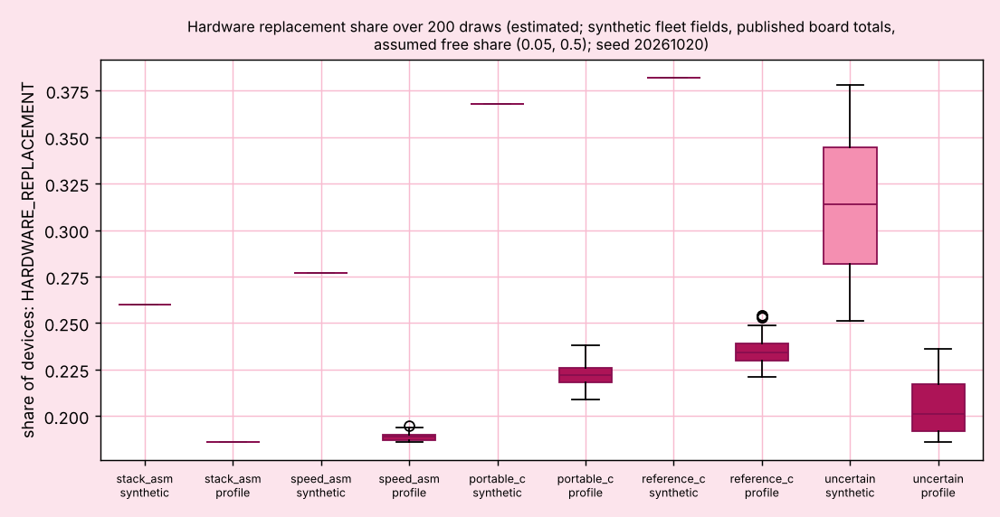
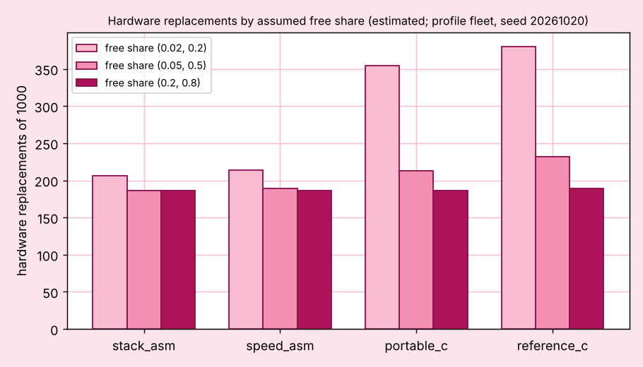
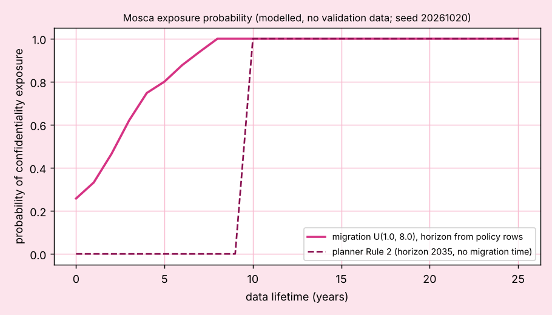
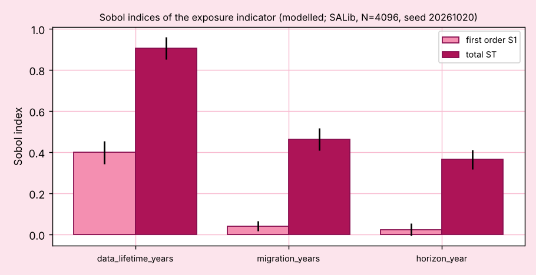
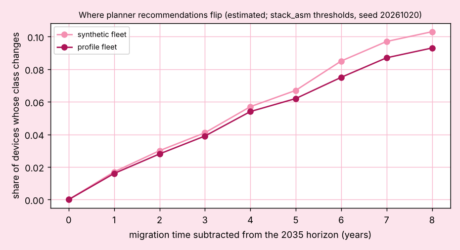

# Planner study on synthetic fleets

Author: Huda Mueen. Generated by `cd planner && python fleetstudy.py`; do not edit by hand. Label: **estimated**. Every fleet is **SYNTHETIC**: invented devices from five invented hardware classes (`planner/results/hardware_classes.csv`), seed 20261016 plus the fleet size. Not a real fleet, not measured. The planner supports planning; it is not a security guarantee.

**Headline.** How many devices need new hardware depends on which implementation the memory thresholds assume. On the 1000 device fleet it ranges from 260 (stack optimised assembly (pqm4 m4fstack, published)) to 382 (reference C (pqm4 clean, published)); 126 devices (12.6 percent) change class between those two scenarios. The answer is the range, not one figure.

## 1. Threshold scenarios

Each scenario takes the four memory thresholds from one implementation, derived as in `docs/PLANNER_RULES.md`. Three come from published pqm4 rows of `data/evidence.csv` (stack optimised assembly, speed optimised assembly as the middle case, reference C); one from this repository's own portable C build as run in the emulator. The violation count is an internal consistency check against the thresholds in force, not evidence that code fits a real device.

| devices | scenario | basis | sig flash kB | sig RAM kB | KEM flash kB | KEM RAM kB | violations | FIRMWARE_UPDATE | HYBRID | HARDWARE_REPLACEMENT | NO_ACTION_BEFORE_RETIREMENT | UNKNOWN |
|---|---|---|---|---|---|---|---|---|---|---|---|---|
| 10 | stack optimised assembly (pqm4 m4fstack, published) | S2-0036, S2-0027 | 30 | 7 | 14 | 9 | 0 | 4 | 1 | 2 | 2 | 1 |
| 10 | speed optimised assembly (pqm4 m4f and m4fspeed, published; middle case) | S2-0033, S2-0024 | 25 | 13 | 17 | 13 | 0 | 4 | 1 | 2 | 2 | 1 |
| 10 | portable C (repository build, emulated) | bench/mcu/qemu_results | 29 | 34 | 20 | 25 | 0 | 4 | 0 | 3 | 2 | 1 |
| 10 | reference C (pqm4 clean, published) | S2-0030, S2-0021 | 14 | 41 | 6 | 21 | 0 | 4 | 0 | 3 | 2 | 1 |
| 100 | stack optimised assembly (pqm4 m4fstack, published) | S2-0036, S2-0027 | 30 | 7 | 14 | 9 | 0 | 42 | 14 | 35 | 7 | 2 |
| 100 | speed optimised assembly (pqm4 m4f and m4fspeed, published; middle case) | S2-0033, S2-0024 | 25 | 13 | 17 | 13 | 0 | 40 | 14 | 37 | 7 | 2 |
| 100 | portable C (repository build, emulated) | bench/mcu/qemu_results | 29 | 34 | 20 | 25 | 0 | 34 | 10 | 47 | 7 | 2 |
| 100 | reference C (pqm4 clean, published) | S2-0030, S2-0021 | 14 | 41 | 6 | 21 | 0 | 32 | 9 | 50 | 7 | 2 |
| 1000 | stack optimised assembly (pqm4 m4fstack, published) | S2-0036, S2-0027 | 30 | 7 | 14 | 9 | 0 | 427 | 158 | 260 | 105 | 50 |
| 1000 | speed optimised assembly (pqm4 m4f and m4fspeed, published; middle case) | S2-0033, S2-0024 | 25 | 13 | 17 | 13 | 0 | 413 | 155 | 277 | 105 | 50 |
| 1000 | portable C (repository build, emulated) | bench/mcu/qemu_results | 29 | 34 | 20 | 25 | 0 | 350 | 129 | 368 | 105 | 48 |
| 1000 | reference C (pqm4 clean, published) | S2-0030, S2-0021 | 14 | 41 | 6 | 21 | 0 | 342 | 123 | 382 | 105 | 48 |

Range of hardware replacements, and devices that change class between the scenario with the fewest and the scenario with the most replacements:

| devices | fewest | most | hardware replacements | devices that change class |
|---|---|---|---|---|
| 10 | speed_asm | reference_c | 2 to 3 | 1 (10.0%) |
| 100 | stack_asm | reference_c | 35 to 50 | 17 (17.0%) |
| 1000 | stack_asm | reference_c | 260 to 382 | 126 (12.6%) |

Seed to seed variation: 5 fleets of 1000 devices (seeds 20262016 to 20262020; the first is the fleet above), hardware replacements per scenario (`planner/results/seed_variation.csv`):

| scenario | lowest | highest |
|---|---|---|
| stack_asm | 239 | 276 |
| speed_asm | 253 | 299 |
| portable_c | 366 | 389 |
| reference_c | 382 | 407 |

Neighbouring scenarios overlap between draws (stack_asm and speed_asm; portable_c and reference_c), so their order is not settled by one fleet; the two extremes do not overlap.

## 2. Tornado sensitivity per scenario and fleet size

Share of devices whose class changes when one input moves to its low or high value with the other inputs at the scenario's values. Rule parameters move by minus and plus 50 percent (horizon years by 2 years); device fields are scaled or shifted across the whole fleet. Full table: `planner/results/tornado.csv`. Shown: the three inputs with the largest swing.

| devices | scenario | first | second | third |
|---|---|---|---|---|
| 10 | stack_asm | sig_horizon_year 10.0% | conf_horizon_year 10.0% | free_ram_kb 10.0% |
| 10 | speed_asm | sig_horizon_year 10.0% | conf_horizon_year 10.0% | sig_ram_kb 10.0% |
| 10 | portable_c | sig_horizon_year 10.0% | conf_horizon_year 10.0% | sig_ram_kb 10.0% |
| 10 | reference_c | sig_horizon_year 10.0% | conf_horizon_year 10.0% | free_ram_kb 10.0% |
| 100 | stack_asm | sig_horizon_year 17.0% | service_life_remaining_years 17.0% | free_ram_kb 6.0% |
| 100 | speed_asm | sig_horizon_year 16.0% | service_life_remaining_years 16.0% | free_ram_kb 7.0% |
| 100 | portable_c | sig_horizon_year 17.0% | service_life_remaining_years 17.0% | free_ram_kb 11.0% |
| 100 | reference_c | sig_horizon_year 16.0% | service_life_remaining_years 16.0% | free_ram_kb 14.0% |
| 1000 | stack_asm | sig_horizon_year 11.2% | service_life_remaining_years 11.2% | free_flash_kb 4.2% |
| 1000 | speed_asm | sig_horizon_year 11.1% | service_life_remaining_years 11.1% | free_ram_kb 5.8% |
| 1000 | portable_c | free_ram_kb 12.0% | sig_horizon_year 10.8% | service_life_remaining_years 10.8% |
| 1000 | reference_c | free_ram_kb 13.3% | sig_horizon_year 11.3% | service_life_remaining_years 11.3% |

## 3. Scale and the memory limit property (stack optimised thresholds)

| devices | seed | classify time (s) | violations | FIRMWARE_UPDATE | HYBRID | HARDWARE_REPLACEMENT | NO_ACTION_BEFORE_RETIREMENT | UNKNOWN |
|---|---|---|---|---|---|---|---|---|
| 10 | 20261026 | 0.002 | 0 | 4 | 1 | 2 | 2 | 1 |
| 100 | 20261116 | 0.014 | 0 | 42 | 14 | 35 | 7 | 2 |
| 1000 | 20262016 | 0.133 | 0 | 427 | 158 | 260 | 105 | 50 |

Times are host wall time of the classifier on this machine.

## 4. Staged migration (1000 device fleet, stack optimised thresholds, waves 2026 to 2030)

Each wave classifies the devices not yet migrated with the wave year as the planning year and remaining service life reduced by the years elapsed. FIRMWARE_UPDATE and HYBRID devices are migrated in that wave, HARDWARE_REPLACEMENT devices are replaced, and the rest carry over.

| year | devices in wave | FIRMWARE_UPDATE | HYBRID | HARDWARE_REPLACEMENT | NO_ACTION_BEFORE_RETIREMENT | UNKNOWN | migrated in wave | migrated total |
|---|---|---|---|---|---|---|---|---|
| 2026 | 1000 | 427 | 158 | 260 | 105 | 50 | 845 | 845 |
| 2027 | 155 | 11 | 0 | 3 | 89 | 52 | 14 | 859 |
| 2028 | 141 | 7 | 0 | 4 | 77 | 53 | 11 | 870 |
| 2029 | 130 | 7 | 0 | 3 | 66 | 54 | 10 | 880 |
| 2030 | 120 | 12 | 0 | 2 | 51 | 55 | 14 | 894 |

## Limits

1. The hardware classes, their shares and every distribution are invented; every count here depends on them. A real inventory would change every number.
2. The tornado moves one input at a time; interactions are not explored.
3. The thresholds use one parameter set per family (ML-DSA-44, ML-KEM-768); a fleet that must use ML-DSA-87 or ML-KEM-1024 needs more.
4. The staged model assumes every action in a wave succeeds and that replaced hardware leaves the fleet; it does not model budgets, downtime or partial rollouts.
5. Each fleet is one draw from invented distributions; the seed table in section 1 shows how far the counts move between draws.

_This tool supports planning. It is not a security guarantee._

<!-- profile study: generated by planner/profile_study.py, start -->
## 5. What changes when the profiles are real

Generated by `cd planner && python profile_study.py` (seed 20261020, 200 draws per configuration); `fleetstudy.py` keeps this block when it rewrites the file. Labels: board totals **published** (`data/reference_profiles.csv`, 9 boards, retrieval log `data/raw/S12_profiles_sources.md`); thresholds **derived from published** rows; the profile mix, free memory shares, lifetimes, links and boot fields are **synthetic** or **assumption**; every count and probability is **estimated** or **modelled** and has no validation data. Configuration: `planner/results/profile_config.csv`.

**Method.** The round 3 fleet (1000 synthetic devices, seed 20262016) is kept device by device: lifetimes, links and boot fields stay as they were. Only memory changes: each device is given one of the published board profiles with equal shares (synthetic mix), its total flash and RAM become the published totals, and its free memory becomes the total times a uniform share in an assumed range. Devices whose free memory was blank in round 3 stay blank.

### 5.1 Round 3 reproduced first

| scenario | hardware replacements (round 3 fleet, seed 20262016) |
|---|---|
| stack_asm | 260 |
| speed_asm | 277 |
| portable_c | 368 |
| reference_c | 382 |

The range 260 to 382 matches `planner/results/scenario_range.csv`; the script stops if it does not.

### 5.2 Published totals alone decide almost nothing

No retrieved page gives a flight stack image size or run time RAM use for any board, so no free budget could be derived (gap list in `data/raw/S12_profiles_sources.md`). Every published total is above every need, so Rule 5 cannot rule a device out on totals. With free memory left unknown:

| scenario | UNKNOWN | HARDWARE_REPLACEMENT | NO_ACTION_BEFORE_RETIREMENT |
|---|---|---|---|
| stack_asm | 709 | 186 | 105 |
| speed_asm | 709 | 186 | 105 |
| portable_c | 709 | 186 | 105 |
| reference_c | 709 | 186 | 105 |

This is a null result and the main finding of the section: on real boards the class depends on free memory, which vendors and flight stack projects do not publish. The remaining hardware replacements here come only from Rule 6 (no updatable verifier and no updatable stage), which does not look at memory.

### 5.3 With an assumed free share (0.05, 0.5)

One seeded profile fleet (seed 20261020). Wilson 95 percent intervals are for the share within this one fleet; the Monte Carlo below adds the variation between draws.

| scenario | round 3 synthetic | profile fleet | share | Wilson 95% | UNKNOWN | violations |
|---|---|---|---|---|---|---|
| stack_asm | 260 | 186 | 0.186 | 0.163 to 0.211 | 50 | 0 |
| speed_asm | 277 | 189 | 0.189 | 0.166 to 0.214 | 50 | 0 |
| portable_c | 368 | 213 | 0.213 | 0.189 to 0.239 | 50 | 0 |
| reference_c | 382 | 232 | 0.232 | 0.207 to 0.259 | 50 | 0 |

On the profile fleet the hardware replacement count runs from 186 to 232 across the four scenarios, against 260 to 382 on the synthetic round 3 fleet; 46 devices change class between stack_asm and reference_c (round 3: 126). The published boards carry far more memory than the invented classes H1 and H2, so memory is rarely the deciding limit; what is left is driven by Rule 6 and by the two smallest profiles.

Hardware replacement share by board (stack_asm and reference_c, same fleet; `planner/results/profile_per_board.csv`):

| board | devices | stack_asm | reference_c |
|---|---|---|---|
| Holybro Pixhawk 6X (FMUv6X) | 114 | 0.132 | 0.132 |
| Holybro Pixhawk 6C | 123 | 0.195 | 0.195 |
| CubePilot Cube Orange | 116 | 0.155 | 0.155 |
| Matek H743 (Wing / Slim / Mini) | 107 | 0.168 | 0.168 |
| Holybro Durandal | 118 | 0.246 | 0.246 |
| Holybro Pixhawk 4 (FMUv5) | 110 | 0.218 | 0.264 |
| Matek F405-Wing (F4 class) | 93 | 0.247 | 0.452 |
| Raspberry Pi Pico (companion) | 112 | 0.107 | 0.250 |
| ESP32-WROOM-32E module (companion) | 107 | 0.215 | 0.271 |

### 5.4 Uncertainty on every memory threshold

In the configuration `uncertain`, each of the four memory thresholds is drawn uniformly between the smallest and largest value the published pqm4 Cortex-M4 rows give, derived as in `docs/PLANNER_RULES.md` and rounded up to whole kB (`planner/results/profile_threshold_ranges.csv`):

| threshold | low (B) | high (B) | rows |
|---|---|---|---|
| sig_flash_kb | 13052 | 29684 | S2-0030 S2-0033 S2-0036 S2-0174 S2-0177 |
| sig_ram_kb | 6444 | 40040 | S2-0030 S2-0033 S2-0036 S2-0174 S2-0177 |
| kem_flash_kb | 5120 | 16016 | S2-0021 S2-0024 S2-0027 |
| kem_ram_kb | 8848 | 20484 | S2-0021 S2-0024 S2-0027 |

The emulated portable C build gives KEM flash 20 kB and KEM RAM 25 kB, outside these published ranges, so `portable_c` is kept as its own scenario. The CHERIoT row S2-0363 is left out (RISC-V, simulated). The four thresholds are drawn independently, which ignores the trade between code size and stack within one implementation; the four named scenarios keep that pairing.

Share of hardware replacements over 200 draws: median, 2.5 and 97.5 percentiles of the draws, and a bootstrap 95 percent interval for the median (`planner/results/profile_mc_summary.csv`). Profile fleet draws use seeds 20262020 to 20262219; threshold draws seed 20261021.

| fleet | thresholds | draws | median | 2.5 to 97.5 percentile | median 95% CI |
|---|---|---|---|---|---|
| synthetic | stack_asm | 1 | 0.260 | 0.260 to 0.260 | 0.260 to 0.260 |
| synthetic | speed_asm | 1 | 0.277 | 0.277 to 0.277 | 0.277 to 0.277 |
| synthetic | portable_c | 1 | 0.368 | 0.368 to 0.368 | 0.368 to 0.368 |
| synthetic | reference_c | 1 | 0.382 | 0.382 to 0.382 | 0.382 to 0.382 |
| synthetic | uncertain | 200 | 0.314 | 0.262 to 0.374 | 0.305 to 0.325 |
| profile | stack_asm | 200 | 0.186 | 0.186 to 0.186 | 0.186 to 0.186 |
| profile | speed_asm | 200 | 0.189 | 0.186 to 0.192 | 0.188 to 0.189 |
| profile | portable_c | 200 | 0.222 | 0.211 to 0.234 | 0.221 to 0.223 |
| profile | reference_c | 200 | 0.234 | 0.223 to 0.248 | 0.233 to 0.235 |
| profile | uncertain | 200 | 0.201 | 0.186 to 0.232 | 0.199 to 0.206 |

The synthetic rows for the four named scenarios are the single round 3 fleet (one draw), so they carry no interval here; section 1 gives their seed to seed spread.

*Figure: hardware replacement share per threshold configuration, synthetic round 3 fleet against the profile fleet; estimated; seed 20261020; 200 draws.*

### 5.5 The free share assumption carries the result

| free share | stack_asm | speed_asm | portable_c | reference_c |
|---|---|---|---|---|
| low (0.02, 0.2) | 206 | 214 | 354 | 380 |
| mid (0.05, 0.5) | 186 | 189 | 213 | 232 |
| high (0.2, 0.8) | 186 | 186 | 186 | 189 |

*Figure: hardware replacements by assumed free share; estimated; profile fleet seed 20261020.*

### 5.6 Confidentiality exposure as a probability (Mosca)

Rule 2 gives one answer: exposed when data lifetime exceeds the years to 2035. The Mosca form adds the migration time y: exposed when data lifetime x plus y exceeds z, the years from 2026 to a policy horizon. Inputs (all **assumption**): x uniform in (1.0, 25.0) years; y uniform in (1.0, 8.0) years (upper end from the EU roadmap risk logic of about 8 years, `data/raw/S1_standards.md` row 40); the horizon drawn from the dated completion milestones of `data/policy_timeline.csv` (rows P02, P05, P06, P07, P09, P10, P12, P13, P18, P19, P22; years 2030, 2030, 2031, 2031, 2031, 2031, 2035, 2035, 2035, 2035, 2035; see `docs/POLICY_TIMELINE.md`). Policy end dates stand in for z; they are not forecasts of a quantum computer.

Probability of exposure over the whole input space: 0.920 (Wilson 95 percent 0.916 to 0.923, 20000 draws, seed 20261020). Under Rule 2 alone, with x uniform in the same range, the exposed share would be 0.667.

Sobol indices of the exposure indicator (SALib Saltelli sampling, N = 4096, 20480 evaluations, horizon taken as uniform between 2030 and 2036 for this analysis; `planner/results/mosca_sobol.csv`):

| input | range | S1 | S1 95% conf | ST | ST 95% conf |
|---|---|---|---|---|---|
| data_lifetime_years | 1.0 to 25.0 | 0.399 | 0.055 | 0.906 | 0.055 |
| migration_years | 1.0 to 8.0 | 0.041 | 0.025 | 0.464 | 0.054 |
| horizon_year | 2030 to 2036 | 0.023 | 0.030 | 0.365 | 0.048 |

The input with the largest total index is `data_lifetime_years`. Data lifetime spans 24 years against 7 for migration and 6 for the horizon, so its weight follows from these assumed ranges; a fleet whose data lifetimes are known would move the weight to migration time and horizon.

*Figure: probability of exposure against data lifetime, migration time and horizon uncertain; dashed: the planner's single answer; modelled; seed 20261020.*

*Figure: first order and total Sobol indices; modelled; seed 20261020.*

### 5.7 Where recommendations flip

Data lifetime above which the Mosca condition holds, x* = horizon year minus 2026 minus migration time (`planner/results/mosca_flip_lifetimes.csv`); a value below 0 means every data lifetime is exposed:

| migration years | horizon 2030 | horizon 2031 | horizon 2035 |
|---|---|---|---|
| 0 | 4 | 5 | 9 |
| 1 | 3 | 4 | 8 |
| 2 | 2 | 3 | 7 |
| 4 | 0 | 1 | 5 |
| 6 | -2 | -1 | 3 |
| 8 | -4 | -3 | 1 |

Planner classes that change when the confidentiality horizon is moved earlier by the migration time (stack_asm thresholds, compared with 2035; `planner/results/mosca_planner_flips.csv`):

| migration years | horizon | synthetic fleet changed | to HARDWARE_REPLACEMENT | profile fleet changed | to HARDWARE_REPLACEMENT |
|---|---|---|---|---|---|
| 0 | 2035 | 0 (0.0%) | 0 | 0 (0.0%) | 0 |
| 1 | 2034 | 17 (1.7%) | 4 | 16 (1.6%) | 0 |
| 2 | 2033 | 30 (3.0%) | 9 | 28 (2.8%) | 0 |
| 3 | 2032 | 41 (4.1%) | 12 | 39 (3.9%) | 0 |
| 4 | 2031 | 57 (5.7%) | 15 | 54 (5.4%) | 0 |
| 5 | 2030 | 67 (6.7%) | 21 | 62 (6.2%) | 0 |
| 6 | 2029 | 85 (8.5%) | 29 | 75 (7.5%) | 0 |
| 7 | 2028 | 97 (9.7%) | 35 | 87 (8.7%) | 0 |
| 8 | 2027 | 103 (10.3%) | 39 | 93 (9.3%) | 0 |

Per device on the profile fleet: 400 of 1000 devices have an exposure probability strictly between 0.05 and 0.95, so their single Rule 2 answer hides real doubt; 425 devices that Rule 2 calls not exposed have a probability above 0.5, and 536 have one above 0.05.

*Figure: share of devices whose planner class changes as migration time shortens the horizon; estimated; stack_asm thresholds; round 3 fleet seed 20262016, profile fleet seed 20261020.*

### 5.8 Property checks on the real profiles

`planner/tests/test_profile_study.py` checks, on fleets built from the published profiles under drawn thresholds, that no FIRMWARE_UPDATE or HYBRID device has free memory below the need in force or above its published total, and that raising a device's free memory never gives a worse class (FIRMWARE_UPDATE, then HYBRID, then HARDWARE_REPLACEMENT). In this run the limit check found 0 violations over 20 threshold draws on the main profile fleet.

### 5.9 Limits of this section

1. Free memory is assumed, not derived; section 5.5 shows the counts move with that assumption more than with the threshold scenario. A published image size per board would replace the assumption.
2. The profile mix (equal shares) is invented; real fleets would weight boards differently.
3. Boot fields, links and lifetimes are the synthetic round 3 values; nothing here says whether these boards have an updatable verifier.
4. Totals for the Matek H743 and the ESP32 module are lower bounds (family minimum, smallest module option).
5. The Mosca ranges are assumptions, and the horizon set gives equal weight to each completion row, so jurisdictions with more rows weigh more.

_This tool supports planning. It is not a security guarantee._
<!-- profile study: generated by planner/profile_study.py, end -->
