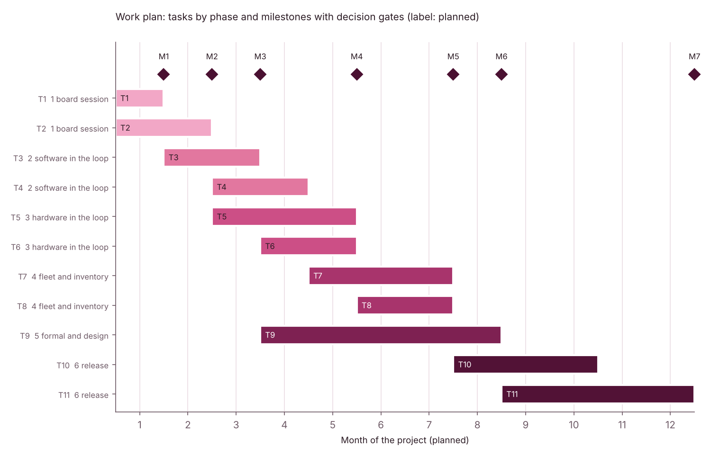

# Proposal: a post quantum ready command and update channel for drones and ground robots, from model to hardware in the loop

Author: Huda Mueen. Generated by `scripts/build_paper.py` from `scripts/proposal_texts.py` and `data/proposal/`; every number below is read from a result file and checked by `scripts/check_numbers.py`.

This is a student research proposal and a seed for discussion. It is not a deployment, it has no relationship with or endorsement by any organisation named, and organisation facts come only from the public pages listed in `docs/CONTEXT_ENTITIES.md`, cited by their id.

## 1. Problem

Unmanned aircraft and ground robots accept commands and firmware over narrow radio links, authenticated today with classical public key cryptography on microcontroller flight computers. The post quantum replacements are standardised, and some buyers and national policies have set duties or dates (`docs/POLICY_TIMELINE.md`). An operator still cannot answer three practical questions from evidence: will the new algorithms fit and run fast enough on the flight controller it has; will the link carry the larger messages without hurting control; and which of its devices must be replaced rather than updated.

## 2. Preliminary results (this repository)

1. **Evidence.** A provenance controlled table of 1,562 published rows, every new row read by two independent readers (`docs/VERIFICATION5.md`, `docs/VERIFICATION6.md`).
2. **Flight stack memory and the corrected fleet answer.** 10 default builds of PX4 and ArduPilot for 7 board classes (host measured, linker output) leave 6.0 to 45.9 kB of application flash free in the PX4 builds; the smallest free static RAM is 111.2 kB, an upper bound because run time heap is not visible in a build. With these measured values the fleet study's median hardware replacement share rises from 0.186 to 0.398 with stack optimised thresholds, and from 0.201 to 0.300 with uncertain thresholds (estimated; `docs/FLIGHTSTACK_STUDY.md`). The round 4 answer, which assumed free memory, was too optimistic.
3. **Causes of the 802.15.4 gap (ns-3).** A 50 kB transfer over one hop with ns-3 defaults takes 5.72 s (simulated (network)) against 7.12 s in the link model (modelled) and a published 30 to 60 s. Each of these single causes brings ns-3 into the published range: 3 hops (55.2 s), 16 loaded neighbours (33.2 s) or a minimum backoff exponent of 8, a cited and allowed setting (40.1 s). The paper states none of these settings, so they are sufficient causes, not the proven cause; ns-3 also shows that the link model's multi hop forwarding is optimistic (`docs/NETSIM_STUDY.md`). Before this check the link model was 4.2 times too fast with no explanation.
4. **Formal verification.** ProVerif checked 17 model files with 57 queries: 39 proved, 17 counterexamples (stated designs and deliberate controls) and 1 that the tool could not prove (modelled; `docs/FORMAL_VERIFICATION.md`). Design findings F1 to F3 were each removed by a design change that was then proved; the reference architecture adopts them (section 2.1).
5. **Cycle model and its transfer limits.** The trace driven model predicts held out pqm4 Cortex-M4 rows with a median error of 1.0 percent (signing misses by up to 23 percent), but leaving out a whole implementation family gives 1.8 percent and leaving out a whole scheme 9.8 percent (2.9 percent for the reduced model), and a cluster aware prediction interval is 1.68 times as wide as the registered one (modelled; `docs/STATISTICS_V5.md`). It is an interpolation within one code base, not a general predictor.
6. **Open core spread.** The same RV32IMC program takes 1.33 to 1.47 times as many cycles on one open core as on the other over 6 ML-KEM and ML-DSA parameter sets (RTL simulated; `docs/RTL_SIM_RESULTS.md`), so a figure for one core is not a figure for another of the same instruction set.
7. **Mission and boot.** A hybrid session keeps a drone's command availability on a telemetry radio at a mean of 0.991, while a post quantum signature on every command lowers it to 0.794 and adds about 380 ms per command; verifying a 1 MB image with LMS takes about 470 ms with a software hash and 30 ms with hash hardware on a 168 MHz Cortex-M4 (estimated; `docs/MISSION_STUDY.md`, `docs/BOOT_UPDATE_STUDY.md`).
8. **Board kit ready, predictions registered.** The kit builds images for NUCLEO-L4R5ZI and NUCLEO-L552ZE-Q with a tested option that switches caches and prefetch off; 36 out of sample predictions for the caches off pass are hashed in `docs/PREDICTIONS_V5_BOARD.md`, and the bench plan keeps both boards within one afternoon of about 153 minutes (estimated; `bench/board_kit/ONE_AFTERNOON.md`). Nothing has yet been measured on a microcontroller.

### 2.1 Formal verification: properties, results and design changes

Read from `formal/results/proverif_results.csv` (label: modelled; abstract perfect primitives under a Dolev Yao attacker; not a test of any implementation).

| Property (model id) | Stated design (modelled) | Design change | After the change (modelled) |
|---|---|---|---|
| Ground station authenticates the vehicle (A2) | counterexample (non injective form counterexample) | F1: the vehicle signs the transcript; both sides confirm the key | proved |
| Ground station session key stays secret (S2) | counterexample | F1 | proved |
| Ground station rekeyed key stays secret (S4) | counterexample | F1 | proved |
| Vehicle accepts each command once, only if sent (C1) | proved | none needed | proved |
| Vehicle session key secret with one component broken (S1) | not run on the stated design | none needed (hybrid key derivation) | proved with the classical part broken; proved with the KEM part broken |
| Provisioned key fallback: no replay after a power cycle (C1) | counterexample (non injective form proved) | F2: fresh nonces from both sides at every session start | proved |
| Provisioned key fallback: earlier sessions secret after key theft (FS) | counterexample | none possible without a key exchange; keys kept short lived | same as stated |
| Firmware: no downgrade to an older signed image (D1) | counterexample | F3: signed version and a monotonic counter in protected storage | proved |
| Published MAVLink timestamp rule with gaps (C1) | cannot be proved (non injective form proved) | modelling limit, not a design finding; other models use the next sequence number | same as stated |

### 2.2 Software in the loop comparison (to be filled by the lead)

Placeholder. This section will hold the comparison of the session layer in software in the loop (label: SITL measured) with the mission study (label: estimated): configurations, missions per configuration, seeds, added latency per command, handshake time and the error against the mission study. No number is stated here until the result files exist.

| Configuration | Missions | Added latency per command | Handshake time | Error against the mission study |
|---|---|---|---|---|
| to be filled | to be filled | to be filled | to be filled | to be filled |

## 3. Aim, hypotheses and measurable success criteria

Aim: test the models of this repository against measurements, turn them into a measured, reusable reference design for an authenticated command and update channel on a real flight controller, and publish the measurements with their provenance. Every hypothesis is hashed before its experiment, and misses stay.

| ID | Hypothesis and measurable success criterion | Refuted if | Registered in |
|---|---|---|---|
| H1 | On the Cortex-M4 board, caches off, the board mean of at least four fifths of the 18 harness rows lies inside its registered interval, and the signed errors do not share one sign | more than a third of the rows miss, or more than four fifths of the signed errors share one sign; only rows whose log shows the caches off conditions count; the Cortex-M33 board is scored apart and tests transfer only | `docs/PREDICTIONS_V5_BOARD.md` (rules 1 to 4); round 4 rows under `docs/PREDICTIONS_V4_BOARD_NOTES.md` notes 5 to 9 |
| H2 | On a borrowed SiK class radio pair at default settings, the median hybrid handshake (with design change F1) lies between half and twice the modelled first session time of 1.45 s (estimated) | the measured median lies outside that range | this proposal; to be hashed before the radio session |
| H3 | With the session layer in software in the loop, the added latency per command stays near the modelled 2.0 ms and inside the 0.5 s command deadline of the mission study | the command stream misses its deadline more often with the session layer than without it | this proposal; to be hashed before the software in the loop runs |
| H4 | Run time free RAM after the flight stack (heap included) stays above the signature plus KEM RAM thresholds of `planner/results/flightstack_thresholds.csv` on every built board class; the static upper bound is now 111.2 kB at the smallest | a built board class has less run time free RAM than a threshold; flash is already known to be short on default PX4 builds (section 2) | this proposal; to be hashed before the runs |

H1 follows the registered rules exactly; the four fifths criterion is a stricter success target stated here, not a change of the registered refutation rule. The round 4 board predictions are scored under their own notes and reported beside H1.

## 4. Readiness

Scale: Horizon 2020 Work Programme 2014-2015, General Annexes, G. Technology readiness levels (TRL), retrieved on 2026-10-21 from the public European Commission page recorded in `data/proposal/trl_scale.csv`. The levels are the author's conservative reading of the evidence in each file named; no level rests on a measurement that has not been made.

| Component | Now (estimated) | Evidence now | End of project (planned) | Evidence needed |
|---|---|---|---|---|
| Hybrid session command channel (architecture B with design change F1) | TRL 2 (technology concept formulated) | design and abstract formal model only: docs/REFERENCE_ARCHITECTURE.md; docs/FORMAL_VERIFICATION.md (modelled); mission and ns-3 timings are estimated or simulated (network); nothing runs on a flight controller | TRL 4 (technology validated in lab) | software in the loop with a pinned flight stack (T3) and hardware in the loop on a borrowed board with a borrowed radio pair (T5); the lab is the only environment tested |
| Signed firmware update with a signed version and a monotonic counter (design change F3) | TRL 2 (technology concept formulated) | boot model (estimated: docs/BOOT_UPDATE_STUDY.md) and a formal downgrade check (modelled: docs/FORMAL_VERIFICATION.md F3); no bootloader runs it | TRL 3 (experimental proof of concept) | LMS verification time and the counter check measured on the borrowed board with an existing pinned library (T1 and T2); no field update |
| Cycle prediction method for a new microcontroller build | TRL 3 (experimental proof of concept) | held out error within one code base and leave one group out (modelled: docs/STATISTICS_V5.md); open core runs (RTL simulated: docs/RTL_SIM_RESULTS.md); board predictions registered (docs/PREDICTIONS_V5_BOARD.md) | TRL 4 (technology validated in lab) | scored against board measured cycles on both boards (T2); stays at the present level if H1 is refuted |
| Fleet migration planner with measured flight stack memory | TRL 3 (experimental proof of concept) | planner runs on real board classes with host measured free memory for the board classes built (docs/FLIGHTSTACK_STUDY.md); fleets are synthetic | TRL 4 (technology validated in lab) | run time memory from software in the loop or a board (T4) and one partner profile (T7); fleets stay synthetic unless a partner supplies one |

## 5. Plan

Figure generated by `scripts/make_gantt.py` from `data/proposal/plan.csv` and `data/proposal/milestones.csv` (label: planned).

| Task | Phase | Work | Months | Deliverable |
|---|---|---|---|---|
| T1 | 1 board session | Borrowed NUCLEO-L4R5ZI and NUCLEO-L552ZE-Q: run the caches off and caches on passes of bench/board_kit/ONE_AFTERNOON.md | 1 | D1 |
| T2 | 1 board session | Score docs/PREDICTIONS_V4_BOARD.md and docs/PREDICTIONS_V5_BOARD.md by script; energy block with a borrowed multimeter | 1 to 2 | D1 |
| T3 | 2 software in the loop | Session layer in front of the command stream of a pinned flight stack in software in the loop; fill the comparison with the mission study | 2 to 3 | D3 |
| T4 | 2 software in the loop | Run time heap and stack use of the flight stack with the session layer (software in the loop first) | 3 to 4 | D4 |
| T5 | 3 hardware in the loop | Borrowed SiK class radio pair: handshake rekey and update transfer timing | 3 to 5 | D2 |
| T6 | 3 hardware in the loop | ns-3 rerun with the four flight handshake and comparison with the radio measurement | 4 to 5 | D2 |
| T7 | 4 fleet and inventory | Partner flight controller profile or a board run with the flight stack; rerun the fleet study and the inventory template | 5 to 7 | D4 |
| T8 | 4 fleet and inventory | Acquisition checklist: free memory and clock thresholds per device class | 6 to 7 | D5 |
| T9 | 5 formal and design | Formal model of the rekey grace period and timestamp window; update the session design note | 4 to 8 | D3 |
| T10 | 6 release | Reference design note and dataset release with provenance | 8 to 10 | D6 |
| T11 | 6 release | Paper and teaching note | 9 to 12 | D6 |

### 5.1 Milestones and decision gates

| Milestone | Month | What is shown | Evidence file | Decision gate |
|---|---|---|---|---|
| M1 | 1 | Board logs of both cache passes parsed with no unrecognised line | `bench/board_kit/ONE_AFTERNOON.md` | go if every counted row shows the caches off conditions; otherwise report a check of conditions only and book a second session |
| M2 | 2 | Board predictions scored by script | `docs/PREDICTIONS_V5_BOARD.md` | if H1 is refuted on the Cortex-M4 board then refit the cycle model on board data before any further cycle claim |
| M3 | 3 | Software in the loop comparison filled | `docs/PROPOSAL_ROBOTICS.md` | if the added latency misses the control deadline (H3) then stop and redesign the session layer before hardware in the loop |
| M4 | 5 | Radio handshake measured | `docs/NETSIM_STUDY.md` | if H2 is refuted then model the radio MAC from the measurements before the fleet rerun |
| M5 | 7 | Fleet rerun with a run time memory profile | `docs/FLIGHTSTACK_STUDY.md` | if H4 is refuted then the design note recommends hardware replacement for that board class |
| M6 | 8 | Design note updated with the second formal pass | `docs/FORMAL_VERIFICATION.md` | a new counterexample blocks the release until a design change is proved |
| M7 | 12 | Dataset release and paper submitted | `docs/PROPOSAL_ROBOTICS.md` | supervisor review |

### 5.2 Risk register

| Id | Risk | Likelihood | Impact | Trigger | Mitigation |
|---|---|---|---|---|---|
| R1 | No board can be borrowed | medium | high | no lab slot by the end of month 1 | continue with emulators and open core simulation; the board session is one afternoon by design (bench/board_kit/ONE_AFTERNOON.md) |
| R2 | The caches cannot be switched off on a board | low | high | a log without cache_off_applied set | report the session as a check of conditions only (docs/PREDICTIONS_V5_BOARD.md rule 3) |
| R3 | The cycle model is refuted on the board | medium | medium | H1 refutation rule met | that is a result: refit on board data and report both fits |
| R4 | No radio pair can be borrowed | medium | medium | no radio by month 3 | keep the ns-3 and linksim results and mark H2 as not tested |
| R5 | Run time memory cannot be read without a partner profile | medium | medium | no profile by month 5 | use the software in the loop heap figures and state them as an upper bound |
| R6 | Flight log reuse is not licensed | high | low | no licensed log source found | keep synthetic traffic in the mission study (docs/FLIGHTSTACK_STUDY.md section 4) |
| R7 | Scope creep into implementing cryptography | low | high | any request for new cryptographic code | only pinned existing libraries are integrated and measured as benchmark subjects |
| R8 | A collaborator reads the proposal as an endorsement | low | medium | any public use of an organisation name | every variant carries the seed note and cites organisation facts by id only |

## 6. Resources

### 6.1 Borrowed equipment (purchases: 0)

| Item | Quantity | Source | Purchases | Used in |
|---|---|---|---|---|
| NUCLEO-L4R5ZI development board with USB cable | 1 | borrowed from a university or partner lab | 0 | T1 T2 |
| NUCLEO-L552ZE-Q development board with USB cable | 1 | borrowed from a university or partner lab | 0 | T1 |
| Digital multimeter with a mA range and two leads with jumper sockets | 1 | borrowed from a university or partner lab | 0 | T2 |
| SiK class telemetry radio pair | 1 | borrowed from a university or partner lab | 0 | T5 |
| Flight controller of a board class in data/reference_profiles.csv | 1 | borrowed (optional; a partner profile can replace it) | 0 | T7 |
| Laptop with free tools (OpenOCD or st-flash; Python; ns-3; ProVerif) | 1 | owned by the author | 0 | T1 to T11 |

### 6.2 Data management plan

No personal data is collected: the measurements are cycle counts, currents, timings and memory figures of devices. Third party code is fetched at pinned versions by scripts and never committed; its licences are listed in `docs/LICENSES.md`.

| Data | What is stored | Where | Format | Licence | Retention | Personal data |
|---|---|---|---|---|---|---|
| Board logs | raw serial logs of each power cycle with their META lines and the parsed tables | bench/mcu/board_results/<date>/ in this repository | text and CSV | repository terms (LICENSE; all rights reserved until a licence is agreed) | kept for the life of the repository; never edited after commit | none |
| Energy readings | meter averages per operation phase entered in a copy of ENERGY_TEMPLATE.csv | bench/mcu/board_results/<date>/energy.csv | CSV | repository terms (LICENSE) | kept for the life of the repository | none |
| Radio timing | handshake and transfer timings with radio settings and seeds | a new results folder next to netsim/results | CSV | repository terms (LICENSE) | kept for the life of the repository | none |
| Software in the loop runs | timings and counts with the pinned flight stack version and seeds | a new sitl/results folder | CSV | repository terms (LICENSE); flight stack code is fetched by script and never committed (docs/LICENSES.md) | kept for the life of the repository | none |
| Partner profile | core clock free flash and RAM after the flight stack and link type of one board class | data/reference_profiles.csv as one row with its source | CSV | as agreed with the partner before use; omitted if sharing is not agreed | as agreed with the partner | none (device facts only; no names of people) |
| Third party code | pinned commits of libraries flight stacks and simulators | a third party folder outside the repository (fetched by scripts) | source | each project's own licence listed in docs/LICENSES.md | not stored in the repository | none |

## 7. Fit with section 6.1 of the national encryption policy and with public entity facts

Source of the quoted terms: UAE National Encryption Policy, Version 1.0, Cyber Security Council, section 6.1 "General Requirements" (supplied PDF; source note `data/raw/S12_policy_sources.md`, item 4; timeline row P24 of `data/policy_timeline.csv`). Section 6.1 places duties on entities; this project does not fulfil any entity's duty. It produces public inputs that an entity could use when it carries out its own duties. Entity facts are cited by id only; their wording and sources are in `docs/CONTEXT_ENTITIES.md`.

| Deliverable | Policy section | Policy term (quoted) | Printed page | Public entity facts (ids) | Scope note |
|---|---|---|---|---|---|
| D1: Board measured cycle and energy table on two boards with both cache passes | 6.1.2 | "test the new post quantum cryptographic standard in a lab environment" | 36 | TII-02, TII-03, EDGE-02 | lab test of standardised algorithms on target class hardware; not a test of any entity's product |
| D2: Measured handshake and update transfer timing on a borrowed telemetry radio pair with the ns-3 comparison | 6.1.3 | "Validation and testing of products" | 36 | TII-04, TII-05, EDGE-04 | validation of link cost for unmanned command links; no product of any entity is tested |
| D3: Session layer and update design note with the formal model and findings F1 to F3 | 6.1.3 | "plan for transitioning systems" | 36 | TII-04, TII-06, EDGE-05 | design input to a transition plan; ordering of systems is not decided here |
| D4: Inventory template for flight controllers and the fleet planner with measured memory | 6.1.1 | "inventory of all systems and applications that use public key cryptography" | 36 | TII-06, ADEO-03 | template and planner only; no inventory of any entity is held or requested |
| D4: Inventory template for flight controllers and the fleet planner with measured memory | 6.1.3 | "Decommission of old technology" | 36 | TII-06, ADEO-04 | the planner flags boards that need hardware replacement under stated assumptions |
| D5: Acquisition checklist of free memory and clock thresholds per device class | 6.1.4 | "acquisition policies for post quantum cryptography" | 36 | EDGE-01, EDGE-03 | thresholds derived from published rows and measured builds; no vendor is assessed |
| D5: Acquisition checklist of free memory and clock thresholds per device class | 6.1.4 | "surveying vendors" | 36 | EDGE-01, EDGE-02 | questions a buyer can put to a vendor; no survey is run |
| D6: Dataset release with provenance and a paper | 6.1.5 | "alert IT departments and vendors" | 36 | TII-07, ADEO-02 | public evidence an entity may use in its own notices |
| D6: Teaching note on the measurements and the design findings | 6.1.6 | "educate its workforce" | 36 | TII-07, TII-08 | material for training; no training is delivered on behalf of any entity |

## 8. Deliverables

D1 to D6 as in section 7: a board measured table labelled apart from published values, a measured link timing dataset, a session and update design note with its formal model, an inventory template and planner rerun, an acquisition checklist, and a dataset release with a paper and a teaching note. Code and data stay with the author until a licence is agreed.

## 9. Ethics and safety

Defensive work only: no attack code and no side channel guidance; existing pinned libraries are benchmark subjects only. Flights, if any, follow the host lab's safety rules; hardware in the loop work needs no flight.

## 10. The ask

Supervision; a few hours of lab access to the two development boards, a multimeter and a telemetry radio pair (equipment list in section 6); and one representative flight controller profile from a partner (core, clock, free flash and RAM after the flight stack, link type), which replaces the largest remaining assumption in the fleet study. No purchase is required.
