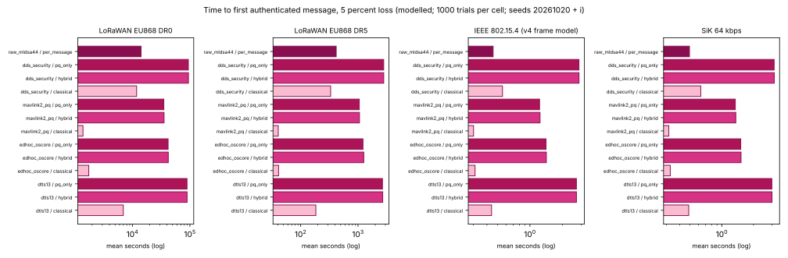
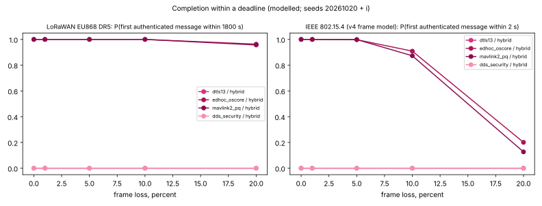
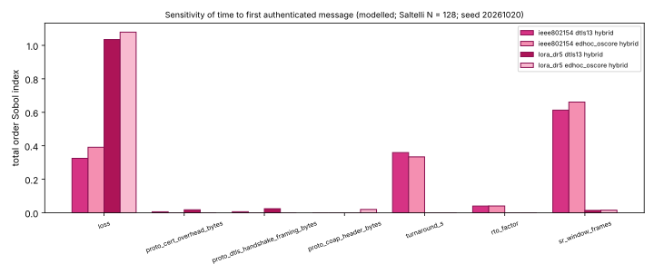

# Protocol simulation over narrow links (fourth round)

Author: Huda Mueen. Generated by `python -m linksim.protocols_report` from `linksim/results/protocols_*.csv`, which `python -m linksim.protocols` writes; do not edit by hand. Label of every result: **modelled**. Each cell with loss uses 1000 seeded trials (seed of trial i is 20261020 + i); zero loss cells are deterministic single runs. Intervals are 95 percent: mean plus or minus 1.96 standard errors, Wilson score for proportions. Messages are byte counts; no cryptography is computed and no protocol is implemented. Configuration: `linksim/results/protocols_config.csv`.

The link models carry the validation status of Section 4.4 of `docs/LINKSIM_STUDY.md`: the LoRa time on air formula matches 4 published examples within 1 percent; the IEEE 802.15.4 frame model is still a factor of 4.2 faster than the only published 802.15.4 figure found (a prose statement in ePrint 2021/781), so 802.15.4 times here are optimistic; duty cycle and loss handling are checked only against closed forms, not against measurements.

## Summary (5 percent loss)

- LoRaWAN EU868 DR0: fastest hybrid profile mavlink2_pq (11.6 h), slowest dds_security (26.2 h), a ratio of 2.3. Hybrid over classical time ratio by profile: dtls13 12.8, edhoc_oscore 24.1, mavlink2_pq 26.2, dds_security 8.0. One raw ML-DSA-44 signed command alone takes 3.9 h.
- LoRaWAN EU868 DR5: fastest hybrid profile mavlink2_pq (20.4 min), slowest dds_security (46.8 min), a ratio of 2.3. Hybrid over classical time ratio by profile: dtls13 14.6, edhoc_oscore 30.5, mavlink2_pq 27.7, dds_security 8.4. One raw ML-DSA-44 signed command alone takes 7.0 min.
- IEEE 802.15.4 (v4 frame model): fastest hybrid profile edhoc_oscore (1.42 s), slowest dds_security (2.85 s), a ratio of 2.0. Hybrid over classical time ratio by profile: dtls13 6.1, edhoc_oscore 4.6, mavlink2_pq 4.0, dds_security 5.1. One raw ML-DSA-44 signed command alone takes 456 ms.
- SiK 64 kbps: fastest hybrid profile edhoc_oscore (1.52 s), slowest dds_security (3.15 s), a ratio of 2.1. Hybrid over classical time ratio by profile: dtls13 6.2, edhoc_oscore 4.7, mavlink2_pq 4.1, dds_security 5.0. One raw ML-DSA-44 signed command alone takes 494 ms.

## 1. Profiles and message sizes

Variants: classical (X25519 and Ed25519), hybrid (X25519 plus ML-KEM-768 shares, `data/evidence.csv` S3-018 and S3-019, with ML-DSA-44 signatures), post quantum only (ML-KEM-768 and ML-DSA-44, S2-0399, S2-0401, S2-0406, S2-0407), and raw ML-DSA-44 signature per message (no session) as the infeasible bound. Profiles are simplified: DTLS 1.3 with mutual certificate authentication and no cookie exchange; EDHOC signature method with credentials by reference (message sizes from draft-ietf-lake-edhoc-17 Figure 1, `data/raw/S12_link_sources.md` line 79, with the 32 B share and 64 B signature replaced by the variant's); a MAVLink 2 style signed stream whose session key comes from a four flight post quantum handshake with pinned keys, the same handshake as the mission study and the formal models with design change F1 of `docs/FORMAL_VERIFICATION.md` (ground and vehicle each sign the transcript and send a key confirmation tag; earlier rounds used three flights with one signature and the public key on the air); and a DDS Security style three message authentication handshake carrying certificates both ways. Certificate overhead, DTLS, OSCORE, CoAP and DDS framing are ASSUMPTIONS (`linksim/params.csv`) swept in Section 6. Sizes and link parameters shared with other studies come from `data/shared_inputs.csv`. Every flight uses the selective repeat transport of `linksim/sim.py`.

| protocol | variant | handshake flights and first command, bytes (A ground, B vehicle) | rekey flights, bytes |
|---|---|---|---|
| dtls13 | classical | A ClientHello 152; B ServerHello to Finished 512; A client Certificate to Finished 480; A authenticated command 71 | A 61; B 77 |
| dtls13 | hybrid | A ClientHello 1336; B ServerHello to Finished 7592; A client Certificate to Finished 6472; A authenticated command 71 | A 1245; B 1165 |
| dtls13 | pq_only | A ClientHello 1304; B ServerHello to Finished 7560; A client Certificate to Finished 6472; A authenticated command 71 | A 1213; B 1133 |
| edhoc_oscore | classical | A EDHOC message_1 45; B EDHOC message_2 110; A EDHOC message_3 85; A authenticated command 58 | A 48; B 64 |
| edhoc_oscore | hybrid | A EDHOC message_1 1229; B EDHOC message_2 3554; A EDHOC message_3 2441; A authenticated command 58 | A 1232; B 1152 |
| edhoc_oscore | pq_only | A EDHOC message_1 1197; B EDHOC message_2 3522; A EDHOC message_3 2441; A authenticated command 58 | A 1200; B 1120 |
| mavlink2_pq | classical | A F1 key share 32; B F2 key share 32; A F3 ground signature and confirmation 80; B F4 vehicle signature and confirmation 80; A authenticated command 55 | A 45; B 61 |
| mavlink2_pq | hybrid | A F1 key share 1216; B F2 key share 1120; A F3 ground signature and confirmation 2436; B F4 vehicle signature and confirmation 2436; A authenticated command 55 | A 1229; B 1149 |
| mavlink2_pq | pq_only | A F1 key share 1184; B F2 key share 1088; A F3 ground signature and confirmation 2436; B F4 vehicle signature and confirmation 2436; A authenticated command 55 | A 1197; B 1117 |
| dds_security | classical | A HandshakeRequest 728; B HandshakeReply 792; A HandshakeFinal 464; A authenticated command 86 | A 76; B 92 |
| dds_security | hybrid | A HandshakeRequest 5548; B HandshakeReply 7872; A HandshakeFinal 2820; A authenticated command 86 | A 1260; B 1180 |
| dds_security | pq_only | A HandshakeRequest 5516; B HandshakeReply 7840; A HandshakeFinal 2820; A authenticated command 86 | A 1228; B 1148 |
| raw_mldsa44 | per_message | A authenticated command 2462 | n/a |

Links: LoRaWAN EU868 DR0 and DR5 with the time on air formula, 13 B LoRaWAN frame overhead and a 1 percent duty cycle per side; IEEE 802.15.4 with the fourth round frame model (PHY header, 6LoWPAN fragmentation, MAC acknowledgement, inter frame spacing, CCA and mean backoff, turnaround); SiK at the 64 kbps air rate of `linksim/params.csv`. No Wi-Fi or cellular profile is simulated, because no parameters for them were retrieved.

## 2. Time to first authenticated message

Handshake followed by one authenticated command (42 B MAVLink 2 command plus the protocol's protection overhead). Loss 5 percent. Duty budget is the air time of the busier side divided by the 1 percent budget of one hour (1.0 means a full hour of budget); utilisation is air time (including MAC timing on 802.15.4) over wall time.

| link | protocol / variant | handshake mean | first message mean (95% interval) | p95 | completed | P within 10 s | P within 600 s | duty budget hours | utilisation |
|---|---|---|---|---|---|---|---|---|---|
| LoRaWAN EU868 DR0 | dtls13 / classical | 107.2 min | 115.9 min (115.6 min to 116.2 min) | 2.1 h | 100.0% | 0.0% | 0.0% | 1.23 | 0.01 |
| LoRaWAN EU868 DR0 | dtls13 / hybrid | 24.7 h | 24.8 h (24.8 h to 24.8 h) | 25.4 h | 100.0% | 0.0% | 0.0% | 13.1 | 0.01 |
| LoRaWAN EU868 DR0 | dtls13 / pq_only | 24.6 h | 24.7 h (24.7 h to 24.8 h) | 25.3 h | 100.0% | 0.0% | 0.0% | 13.1 | 0.01 |
| LoRaWAN EU868 DR0 | edhoc_oscore / classical | 20.2 min | 29.1 min (29.0 min to 29.3 min) | 34.2 min | 100.0% | 0.0% | 0.0% | 0.4 | 0.01 |
| LoRaWAN EU868 DR0 | edhoc_oscore / hybrid | 11.5 h | 11.7 h (11.7 h to 11.7 h) | 12.1 h | 100.0% | 0.0% | 0.0% | 6.27 | 0.01 |
| LoRaWAN EU868 DR0 | edhoc_oscore / pq_only | 11.4 h | 11.6 h (11.6 h to 11.6 h) | 12.0 h | 100.0% | 0.0% | 0.0% | 6.21 | 0.01 |
| LoRaWAN EU868 DR0 | mavlink2_pq / classical | 19.2 min | 26.5 min (26.3 min to 26.7 min) | 31.4 min | 100.0% | 0.0% | 0.0% | 0.416 | 0.02 |
| LoRaWAN EU868 DR0 | mavlink2_pq / hybrid | 11.4 h | 11.6 h (11.5 h to 11.6 h) | 11.9 h | 100.0% | 0.0% | 0.0% | 6.26 | 0.01 |
| LoRaWAN EU868 DR0 | mavlink2_pq / pq_only | 11.4 h | 11.5 h (11.5 h to 11.5 h) | 11.9 h | 100.0% | 0.0% | 0.0% | 6.23 | 0.01 |
| LoRaWAN EU868 DR0 | dds_security / classical | 3.2 h | 3.3 h (3.3 h to 3.3 h) | 3.5 h | 100.0% | 0.0% | 0.0% | 2.18 | 0.01 |
| LoRaWAN EU868 DR0 | dds_security / hybrid | 26.0 h | 26.2 h (26.2 h to 26.2 h) | 26.8 h | 100.0% | 0.0% | 0.0% | 14.1 | 0.01 |
| LoRaWAN EU868 DR0 | dds_security / pq_only | 26.0 h | 26.1 h (26.1 h to 26.1 h) | 26.7 h | 100.0% | 0.0% | 0.0% | 14 | 0.01 |
| LoRaWAN EU868 DR0 | raw_mldsa44 / per_message | n/a | 3.9 h (3.9 h to 3.9 h) | 4.2 h | 100.0% | 0.0% | 0.0% | 3.98 | 0.01 |
| LoRaWAN EU868 DR5 | dtls13 / classical | 2.8 min | 3.1 min (3.1 min to 3.1 min) | 3.7 min | 100.0% | 0.0% | 100.0% | 0.0394 | 0.01 |
| LoRaWAN EU868 DR5 | dtls13 / hybrid | 44.6 min | 45.0 min (44.9 min to 45.0 min) | 47.1 min | 100.0% | 0.0% | 0.0% | 0.394 | 0.01 |
| LoRaWAN EU868 DR5 | dtls13 / pq_only | 44.1 min | 44.5 min (44.4 min to 44.6 min) | 46.5 min | 100.0% | 0.0% | 0.0% | 0.392 | 0.01 |
| LoRaWAN EU868 DR5 | edhoc_oscore / classical | 31.70 s | 41.39 s (40.72 s to 42.07 s) | 63.76 s | 100.0% | 0.0% | 100.0% | 0.0143 | 0.02 |
| LoRaWAN EU868 DR5 | edhoc_oscore / hybrid | 20.4 min | 21.0 min (21.0 min to 21.1 min) | 22.4 min | 100.0% | 0.0% | 0.0% | 0.19 | 0.01 |
| LoRaWAN EU868 DR5 | edhoc_oscore / pq_only | 19.7 min | 20.4 min (20.3 min to 20.4 min) | 21.8 min | 100.0% | 0.0% | 0.0% | 0.187 | 0.01 |
| LoRaWAN EU868 DR5 | mavlink2_pq / classical | 35.68 s | 44.24 s (43.60 s to 44.87 s) | 65.84 s | 100.0% | 0.0% | 100.0% | 0.0149 | 0.02 |
| LoRaWAN EU868 DR5 | mavlink2_pq / hybrid | 19.8 min | 20.4 min (20.3 min to 20.4 min) | 21.8 min | 100.0% | 0.0% | 0.0% | 0.19 | 0.01 |
| LoRaWAN EU868 DR5 | mavlink2_pq / pq_only | 19.3 min | 19.9 min (19.8 min to 19.9 min) | 21.4 min | 100.0% | 0.0% | 0.0% | 0.188 | 0.01 |
| LoRaWAN EU868 DR5 | dds_security / classical | 5.4 min | 5.6 min (5.5 min to 5.6 min) | 6.3 min | 100.0% | 0.0% | 100.0% | 0.0675 | 0.01 |
| LoRaWAN EU868 DR5 | dds_security / hybrid | 46.3 min | 46.8 min (46.7 min to 46.9 min) | 49.0 min | 100.0% | 0.0% | 0.0% | 0.419 | 0.01 |
| LoRaWAN EU868 DR5 | dds_security / pq_only | 46.2 min | 46.8 min (46.7 min to 46.8 min) | 48.8 min | 100.0% | 0.0% | 0.0% | 0.418 | 0.01 |
| LoRaWAN EU868 DR5 | raw_mldsa44 / per_message | n/a | 7.0 min (6.9 min to 7.0 min) | 7.5 min | 100.0% | 0.0% | 100.0% | 0.121 | 0.01 |
| IEEE 802.15.4 (v4 frame model) | dtls13 / classical | 368 ms | 441 ms (435 ms to 447 ms) | 632 ms | 100.0% | 100.0% | 100.0% | n/a | 0.36 |
| IEEE 802.15.4 (v4 frame model) | dtls13 / hybrid | 2.62 s | 2.70 s (2.69 s to 2.71 s) | 3.03 s | 100.0% | 100.0% | 100.0% | n/a | 0.61 |
| IEEE 802.15.4 (v4 frame model) | dtls13 / pq_only | 2.62 s | 2.70 s (2.68 s to 2.71 s) | 3.02 s | 100.0% | 100.0% | 100.0% | n/a | 0.61 |
| IEEE 802.15.4 (v4 frame model) | edhoc_oscore / classical | 239 ms | 310 ms (305 ms to 315 ms) | 483 ms | 100.0% | 100.0% | 100.0% | n/a | 0.19 |
| IEEE 802.15.4 (v4 frame model) | edhoc_oscore / hybrid | 1.35 s | 1.42 s (1.41 s to 1.43 s) | 1.68 s | 100.0% | 100.0% | 100.0% | n/a | 0.56 |
| IEEE 802.15.4 (v4 frame model) | edhoc_oscore / pq_only | 1.34 s | 1.41 s (1.40 s to 1.42 s) | 1.67 s | 100.0% | 100.0% | 100.0% | n/a | 0.55 |
| IEEE 802.15.4 (v4 frame model) | mavlink2_pq / classical | 293 ms | 365 ms (359 ms to 370 ms) | 534 ms | 100.0% | 100.0% | 100.0% | n/a | 0.16 |
| IEEE 802.15.4 (v4 frame model) | mavlink2_pq / hybrid | 1.38 s | 1.45 s (1.45 s to 1.46 s) | 1.69 s | 100.0% | 100.0% | 100.0% | n/a | 0.54 |
| IEEE 802.15.4 (v4 frame model) | mavlink2_pq / pq_only | 1.38 s | 1.45 s (1.44 s to 1.46 s) | 1.69 s | 100.0% | 100.0% | 100.0% | n/a | 0.54 |
| IEEE 802.15.4 (v4 frame model) | dds_security / classical | 475 ms | 557 ms (550 ms to 564 ms) | 775 ms | 100.0% | 100.0% | 100.0% | n/a | 0.44 |
| IEEE 802.15.4 (v4 frame model) | dds_security / hybrid | 2.77 s | 2.85 s (2.84 s to 2.86 s) | 3.16 s | 100.0% | 100.0% | 100.0% | n/a | 0.61 |
| IEEE 802.15.4 (v4 frame model) | dds_security / pq_only | 2.76 s | 2.85 s (2.83 s to 2.86 s) | 3.16 s | 100.0% | 100.0% | 100.0% | n/a | 0.61 |
| IEEE 802.15.4 (v4 frame model) | raw_mldsa44 / per_message | n/a | 456 ms (451 ms to 461 ms) | 635 ms | 100.0% | 100.0% | 100.0% | n/a | 0.59 |
| SiK 64 kbps | dtls13 / classical | 404 ms | 486 ms (480 ms to 492 ms) | 655 ms | 100.0% | 100.0% | 100.0% | n/a | 0.48 |
| SiK 64 kbps | dtls13 / hybrid | 2.92 s | 3.00 s (2.98 s to 3.01 s) | 3.28 s | 100.0% | 100.0% | 100.0% | n/a | 0.85 |
| SiK 64 kbps | dtls13 / pq_only | 2.91 s | 2.99 s (2.97 s to 3.00 s) | 3.27 s | 100.0% | 100.0% | 100.0% | n/a | 0.85 |
| SiK 64 kbps | edhoc_oscore / classical | 247 ms | 325 ms (320 ms to 330 ms) | 515 ms | 100.0% | 100.0% | 100.0% | n/a | 0.25 |
| SiK 64 kbps | edhoc_oscore / hybrid | 1.45 s | 1.52 s (1.52 s to 1.53 s) | 1.78 s | 100.0% | 100.0% | 100.0% | n/a | 0.80 |
| SiK 64 kbps | edhoc_oscore / pq_only | 1.44 s | 1.51 s (1.51 s to 1.52 s) | 1.78 s | 100.0% | 100.0% | 100.0% | n/a | 0.79 |
| SiK 64 kbps | mavlink2_pq / classical | 313 ms | 391 ms (385 ms to 396 ms) | 568 ms | 100.0% | 100.0% | 100.0% | n/a | 0.22 |
| SiK 64 kbps | mavlink2_pq / hybrid | 1.52 s | 1.59 s (1.59 s to 1.60 s) | 1.86 s | 100.0% | 100.0% | 100.0% | n/a | 0.76 |
| SiK 64 kbps | mavlink2_pq / pq_only | 1.50 s | 1.58 s (1.57 s to 1.59 s) | 1.84 s | 100.0% | 100.0% | 100.0% | n/a | 0.76 |
| SiK 64 kbps | dds_security / classical | 548 ms | 632 ms (626 ms to 639 ms) | 844 ms | 100.0% | 100.0% | 100.0% | n/a | 0.59 |
| SiK 64 kbps | dds_security / hybrid | 3.07 s | 3.15 s (3.14 s to 3.16 s) | 3.44 s | 100.0% | 100.0% | 100.0% | n/a | 0.85 |
| SiK 64 kbps | dds_security / pq_only | 3.06 s | 3.14 s (3.13 s to 3.15 s) | 3.43 s | 100.0% | 100.0% | 100.0% | n/a | 0.85 |
| SiK 64 kbps | raw_mldsa44 / per_message | n/a | 494 ms (489 ms to 499 ms) | 668 ms | 100.0% | 100.0% | 100.0% | n/a | 0.83 |

Loss sweep, mean time to first authenticated message (hybrid variants and the raw bound):

| link | protocol / variant | loss 0% | loss 1% | loss 5% | loss 10% | loss 20% |
|---|---|---|---|---|---|---|
| LoRaWAN EU868 DR0 | dtls13 / hybrid | 23.5 h | 23.8 h | 24.8 h | 26.3 h | 30.0 h |
| LoRaWAN EU868 DR0 | edhoc_oscore / hybrid | 11.1 h | 11.2 h | 11.7 h | 12.4 h | 14.2 h |
| LoRaWAN EU868 DR0 | mavlink2_pq / hybrid | 10.9 h | 11.1 h | 11.6 h | 12.3 h | 14.1 h |
| LoRaWAN EU868 DR0 | dds_security / hybrid | 24.8 h | 25.1 h | 26.2 h | 27.8 h | 31.7 h |
| LoRaWAN EU868 DR0 | raw_mldsa44 / per_message | 3.7 h | 3.8 h | 3.9 h | 4.2 h | 4.8 h |
| LoRaWAN EU868 DR5 | dtls13 / hybrid | 42.8 min | 43.2 min | 45.0 min | 47.6 min | 54.2 min |
| LoRaWAN EU868 DR5 | edhoc_oscore / hybrid | 19.9 min | 20.1 min | 21.0 min | 22.3 min | 25.7 min |
| LoRaWAN EU868 DR5 | mavlink2_pq / hybrid | 19.4 min | 19.6 min | 20.4 min | 21.8 min | 25.4 min |
| LoRaWAN EU868 DR5 | dds_security / hybrid | 44.3 min | 44.8 min | 46.8 min | 49.8 min | 57.2 min |
| LoRaWAN EU868 DR5 | raw_mldsa44 / per_message | 6.8 min | 6.8 min | 7.0 min | 7.3 min | 8.4 min |
| IEEE 802.15.4 (v4 frame model) | dtls13 / hybrid | 2.34 s | 2.40 s | 2.70 s | 3.15 s | 4.34 s |
| IEEE 802.15.4 (v4 frame model) | edhoc_oscore / hybrid | 1.24 s | 1.27 s | 1.42 s | 1.67 s | 2.36 s |
| IEEE 802.15.4 (v4 frame model) | mavlink2_pq / hybrid | 1.24 s | 1.28 s | 1.45 s | 1.73 s | 2.47 s |
| IEEE 802.15.4 (v4 frame model) | dds_security / hybrid | 2.42 s | 2.50 s | 2.85 s | 3.31 s | 4.58 s |
| IEEE 802.15.4 (v4 frame model) | raw_mldsa44 / per_message | 398 ms | 408 ms | 456 ms | 538 ms | 757 ms |
| SiK 64 kbps | dtls13 / hybrid | 2.70 s | 2.76 s | 3.00 s | 3.32 s | 4.18 s |
| SiK 64 kbps | edhoc_oscore / hybrid | 1.34 s | 1.37 s | 1.52 s | 1.75 s | 2.29 s |
| SiK 64 kbps | mavlink2_pq / hybrid | 1.39 s | 1.43 s | 1.59 s | 1.84 s | 2.46 s |
| SiK 64 kbps | dds_security / hybrid | 2.88 s | 2.93 s | 3.15 s | 3.49 s | 4.37 s |
| SiK 64 kbps | raw_mldsa44 / per_message | 433 ms | 446 ms | 494 ms | 564 ms | 736 ms |

_Figure 1. Mean time to first authenticated message at 5 percent loss, log scale; modelled, 1000 trials per cell, seeds 20261020 + i._

_Figure 2. Probability that the first authenticated message arrives within the deadline, hybrid variants; modelled, seeds 20261020 + i._

## 3. Rekey inside a session

A fresh ephemeral key exchange without certificates or signatures (ASSUMPTION for every profile), loss 5 percent.

| link | protocol / variant | bytes | mean (95% interval) | completed | duty budget hours |
|---|---|---|---|---|---|
| LoRaWAN EU868 DR0 | dtls13 / classical | 138 | 12.6 min (12.5 min to 12.7 min) | 100.0% | 0.186 |
| LoRaWAN EU868 DR0 | dtls13 / hybrid | 2410 | 3.8 h (3.8 h to 3.8 h) | 100.0% | 2.12 |
| LoRaWAN EU868 DR0 | dtls13 / pq_only | 2346 | 3.7 h (3.7 h to 3.7 h) | 100.0% | 2.06 |
| LoRaWAN EU868 DR0 | edhoc_oscore / classical | 112 | 8.0 min (7.9 min to 8.1 min) | 100.0% | 0.173 |
| LoRaWAN EU868 DR0 | edhoc_oscore / hybrid | 2384 | 3.8 h (3.8 h to 3.8 h) | 100.0% | 2.11 |
| LoRaWAN EU868 DR0 | edhoc_oscore / pq_only | 2320 | 3.6 h (3.6 h to 3.7 h) | 100.0% | 2.04 |
| LoRaWAN EU868 DR0 | mavlink2_pq / classical | 106 | 7.9 min (7.8 min to 8.0 min) | 100.0% | 0.168 |
| LoRaWAN EU868 DR0 | mavlink2_pq / hybrid | 2378 | 3.8 h (3.8 h to 3.8 h) | 100.0% | 2.1 |
| LoRaWAN EU868 DR0 | mavlink2_pq / pq_only | 2314 | 3.6 h (3.6 h to 3.7 h) | 100.0% | 2.04 |
| LoRaWAN EU868 DR0 | dds_security / classical | 168 | 12.9 min (12.7 min to 13.0 min) | 100.0% | 0.202 |
| LoRaWAN EU868 DR0 | dds_security / hybrid | 2440 | 3.9 h (3.9 h to 3.9 h) | 100.0% | 2.14 |
| LoRaWAN EU868 DR0 | dds_security / pq_only | 2376 | 3.8 h (3.8 h to 3.8 h) | 100.0% | 2.1 |
| LoRaWAN EU868 DR5 | dtls13 / classical | 138 | 16.13 s (15.75 s to 16.52 s) | 100.0% | 0.00666 |
| LoRaWAN EU868 DR5 | dtls13 / hybrid | 2410 | 6.5 min (6.5 min to 6.6 min) | 100.0% | 0.0647 |
| LoRaWAN EU868 DR5 | dtls13 / pq_only | 2346 | 6.5 min (6.5 min to 6.5 min) | 100.0% | 0.0633 |
| LoRaWAN EU868 DR5 | edhoc_oscore / classical | 112 | 13.82 s (13.48 s to 14.16 s) | 100.0% | 0.00597 |
| LoRaWAN EU868 DR5 | edhoc_oscore / hybrid | 2384 | 6.5 min (6.5 min to 6.5 min) | 100.0% | 0.0642 |
| LoRaWAN EU868 DR5 | edhoc_oscore / pq_only | 2320 | 6.5 min (6.4 min to 6.5 min) | 100.0% | 0.0627 |
| LoRaWAN EU868 DR5 | mavlink2_pq / classical | 106 | 13.76 s (13.43 s to 14.10 s) | 100.0% | 0.00583 |
| LoRaWAN EU868 DR5 | mavlink2_pq / hybrid | 2378 | 6.5 min (6.5 min to 6.5 min) | 100.0% | 0.0641 |
| LoRaWAN EU868 DR5 | mavlink2_pq / pq_only | 2314 | 6.5 min (6.4 min to 6.5 min) | 100.0% | 0.0626 |
| LoRaWAN EU868 DR5 | dds_security / classical | 168 | 18.46 s (18.04 s to 18.89 s) | 100.0% | 0.00736 |
| LoRaWAN EU868 DR5 | dds_security / hybrid | 2440 | 6.6 min (6.5 min to 6.6 min) | 100.0% | 0.0655 |
| LoRaWAN EU868 DR5 | dds_security / pq_only | 2376 | 6.5 min (6.5 min to 6.5 min) | 100.0% | 0.0639 |
| IEEE 802.15.4 (v4 frame model) | dtls13 / classical | 138 | 148 ms (145 ms to 152 ms) | 100.0% | n/a |
| IEEE 802.15.4 (v4 frame model) | dtls13 / hybrid | 2410 | 518 ms (513 ms to 524 ms) | 100.0% | n/a |
| IEEE 802.15.4 (v4 frame model) | dtls13 / pq_only | 2346 | 470 ms (465 ms to 475 ms) | 100.0% | n/a |
| IEEE 802.15.4 (v4 frame model) | edhoc_oscore / classical | 112 | 147 ms (144 ms to 151 ms) | 100.0% | n/a |
| IEEE 802.15.4 (v4 frame model) | edhoc_oscore / hybrid | 2384 | 479 ms (474 ms to 485 ms) | 100.0% | n/a |
| IEEE 802.15.4 (v4 frame model) | edhoc_oscore / pq_only | 2320 | 469 ms (464 ms to 475 ms) | 100.0% | n/a |
| IEEE 802.15.4 (v4 frame model) | mavlink2_pq / classical | 106 | 147 ms (144 ms to 151 ms) | 100.0% | n/a |
| IEEE 802.15.4 (v4 frame model) | mavlink2_pq / hybrid | 2378 | 479 ms (474 ms to 484 ms) | 100.0% | n/a |
| IEEE 802.15.4 (v4 frame model) | mavlink2_pq / pq_only | 2314 | 469 ms (464 ms to 474 ms) | 100.0% | n/a |
| IEEE 802.15.4 (v4 frame model) | dds_security / classical | 168 | 157 ms (153 ms to 160 ms) | 100.0% | n/a |
| IEEE 802.15.4 (v4 frame model) | dds_security / hybrid | 2440 | 520 ms (514 ms to 525 ms) | 100.0% | n/a |
| IEEE 802.15.4 (v4 frame model) | dds_security / pq_only | 2376 | 479 ms (474 ms to 484 ms) | 100.0% | n/a |
| SiK 64 kbps | dtls13 / classical | 138 | 162 ms (158 ms to 166 ms) | 100.0% | n/a |
| SiK 64 kbps | dtls13 / hybrid | 2410 | 553 ms (547 ms to 559 ms) | 100.0% | n/a |
| SiK 64 kbps | dtls13 / pq_only | 2346 | 543 ms (537 ms to 549 ms) | 100.0% | n/a |
| SiK 64 kbps | edhoc_oscore / classical | 112 | 158 ms (154 ms to 162 ms) | 100.0% | n/a |
| SiK 64 kbps | edhoc_oscore / hybrid | 2384 | 549 ms (543 ms to 555 ms) | 100.0% | n/a |
| SiK 64 kbps | edhoc_oscore / pq_only | 2320 | 539 ms (533 ms to 545 ms) | 100.0% | n/a |
| SiK 64 kbps | mavlink2_pq / classical | 106 | 157 ms (153 ms to 161 ms) | 100.0% | n/a |
| SiK 64 kbps | mavlink2_pq / hybrid | 2378 | 548 ms (542 ms to 554 ms) | 100.0% | n/a |
| SiK 64 kbps | mavlink2_pq / pq_only | 2314 | 538 ms (533 ms to 544 ms) | 100.0% | n/a |
| SiK 64 kbps | dds_security / classical | 168 | 167 ms (163 ms to 170 ms) | 100.0% | n/a |
| SiK 64 kbps | dds_security / hybrid | 2440 | 558 ms (552 ms to 563 ms) | 100.0% | n/a |
| SiK 64 kbps | dds_security / pq_only | 2376 | 548 ms (542 ms to 553 ms) | 100.0% | n/a |

## 4. Firmware update transfer

Image of 50000 B (ASSUMPTION) plus one signature (Ed25519 64 B or ML-DSA-44 2,420 B), one transfer, no resumption across sessions.

| link | signature | loss | mean (95% interval) | completed | P within 3600 s | duty budget hours |
|---|---|---|---|---|---|---|
| LoRaWAN EU868 DR0 | Ed25519 | 0% | 76.1 h (76.1 h to 76.1 h) | 100.0% | 0.0% | 76.2 |
| LoRaWAN EU868 DR0 | Ed25519 | 5% | 80.4 h (80.4 h to 80.4 h) | 100.0% | 0.0% | 80.5 |
| LoRaWAN EU868 DR0 | Ed25519 | 20% | 97.0 h (96.9 h to 97.1 h) | 100.0% | 0.0% | 97.1 |
| LoRaWAN EU868 DR0 | ML-DSA-44 | 0% | 79.7 h (79.7 h to 79.7 h) | 100.0% | 0.0% | 79.8 |
| LoRaWAN EU868 DR0 | ML-DSA-44 | 5% | 84.2 h (84.1 h to 84.2 h) | 100.0% | 0.0% | 84.3 |
| LoRaWAN EU868 DR0 | ML-DSA-44 | 20% | 101.6 h (101.5 h to 101.7 h) | 100.0% | 0.0% | 102 |
| LoRaWAN EU868 DR5 | Ed25519 | 0% | 2.3 h (2.3 h to 2.3 h) | 100.0% | 0.0% | 2.31 |
| LoRaWAN EU868 DR5 | Ed25519 | 5% | 2.4 h (2.4 h to 2.4 h) | 100.0% | 0.0% | 2.44 |
| LoRaWAN EU868 DR5 | Ed25519 | 20% | 2.9 h (2.9 h to 2.9 h) | 100.0% | 0.0% | 2.94 |
| LoRaWAN EU868 DR5 | ML-DSA-44 | 0% | 2.4 h (2.4 h to 2.4 h) | 100.0% | 0.0% | 2.42 |
| LoRaWAN EU868 DR5 | ML-DSA-44 | 5% | 2.6 h (2.5 h to 2.6 h) | 100.0% | 0.0% | 2.56 |
| LoRaWAN EU868 DR5 | ML-DSA-44 | 20% | 3.1 h (3.1 h to 3.1 h) | 100.0% | 0.0% | 3.08 |
| IEEE 802.15.4 (v4 frame model) | Ed25519 | 0% | 7.13 s (7.13 s to 7.13 s) | 100.0% | 100.0% | n/a |
| IEEE 802.15.4 (v4 frame model) | Ed25519 | 5% | 8.09 s (8.08 s to 8.11 s) | 100.0% | 100.0% | n/a |
| IEEE 802.15.4 (v4 frame model) | Ed25519 | 20% | 12.44 s (12.39 s to 12.49 s) | 100.0% | 100.0% | n/a |
| IEEE 802.15.4 (v4 frame model) | ML-DSA-44 | 0% | 7.51 s (7.51 s to 7.51 s) | 100.0% | 100.0% | n/a |
| IEEE 802.15.4 (v4 frame model) | ML-DSA-44 | 5% | 8.47 s (8.46 s to 8.49 s) | 100.0% | 100.0% | n/a |
| IEEE 802.15.4 (v4 frame model) | ML-DSA-44 | 20% | 13.01 s (12.96 s to 13.07 s) | 100.0% | 100.0% | n/a |
| SiK 64 kbps | Ed25519 | 0% | 8.41 s (8.41 s to 8.41 s) | 100.0% | 100.0% | n/a |
| SiK 64 kbps | Ed25519 | 5% | 9.02 s (9.01 s to 9.04 s) | 100.0% | 100.0% | n/a |
| SiK 64 kbps | Ed25519 | 20% | 11.73 s (11.69 s to 11.77 s) | 100.0% | 100.0% | n/a |
| SiK 64 kbps | ML-DSA-44 | 0% | 8.77 s (8.77 s to 8.77 s) | 100.0% | 100.0% | n/a |
| SiK 64 kbps | ML-DSA-44 | 5% | 9.45 s (9.44 s to 9.47 s) | 100.0% | 100.0% | n/a |
| SiK 64 kbps | ML-DSA-44 | 20% | 12.28 s (12.23 s to 12.32 s) | 100.0% | 100.0% | n/a |

## 5. Added latency per authenticated command after the handshake

Mean delivery time of the protected command minus the unprotected 42 B command on the same seeds.

| link | protocol | overhead B | loss 0% | loss 1% | loss 5% | loss 10% | loss 20% |
|---|---|---|---|---|---|---|---|
| LoRaWAN EU868 DR0 | dtls13 | 29 | 4.6 min | 4.7 min | 4.7 min | 4.8 min | 5.2 min |
| LoRaWAN EU868 DR0 | edhoc_oscore | 16 | 4.6 min | 4.6 min | 4.6 min | 4.5 min | 4.5 min |
| LoRaWAN EU868 DR0 | mavlink2_pq | 13 | 4.6 min | 4.6 min | 4.6 min | 4.5 min | 4.5 min |
| LoRaWAN EU868 DR0 | dds_security | 44 | 4.7 min | 4.7 min | 4.8 min | 5.1 min | 5.9 min |
| LoRaWAN EU868 DR0 | raw_mldsa44 | 2420 | 3.7 h | 3.8 h | 3.9 h | 4.2 h | 4.7 h |
| LoRaWAN EU868 DR5 | dtls13 | 29 | 41 ms | 143 ms | 520 ms | 1.10 s | 2.52 s |
| LoRaWAN EU868 DR5 | edhoc_oscore | 16 | 20 ms | 72 ms | 260 ms | 549 ms | 1.26 s |
| LoRaWAN EU868 DR5 | mavlink2_pq | 13 | 15 ms | 54 ms | 195 ms | 412 ms | 945 ms |
| LoRaWAN EU868 DR5 | dds_security | 44 | 61 ms | 215 ms | 780 ms | 1.65 s | 3.78 s |
| LoRaWAN EU868 DR5 | raw_mldsa44 | 2420 | 6.8 min | 6.8 min | 6.9 min | 7.2 min | 8.2 min |
| IEEE 802.15.4 (v4 frame model) | dtls13 | 29 | 0.93 ms | 0.95 ms | 1.04 ms | 1.17 ms | 1.49 ms |
| IEEE 802.15.4 (v4 frame model) | edhoc_oscore | 16 | 0.51 ms | 0.52 ms | 0.57 ms | 0.64 ms | 0.82 ms |
| IEEE 802.15.4 (v4 frame model) | mavlink2_pq | 13 | 0.42 ms | 0.43 ms | 0.46 ms | 0.52 ms | 0.67 ms |
| IEEE 802.15.4 (v4 frame model) | dds_security | 44 | 5.98 ms | 7.04 ms | 9.81 ms | 16 ms | 34 ms |
| IEEE 802.15.4 (v4 frame model) | raw_mldsa44 | 2420 | 338 ms | 345 ms | 383 ms | 449 ms | 627 ms |
| SiK 64 kbps | dtls13 | 29 | 4.03 ms | 4.13 ms | 4.50 ms | 5.07 ms | 6.46 ms |
| SiK 64 kbps | edhoc_oscore | 16 | 2.22 ms | 2.28 ms | 2.48 ms | 2.80 ms | 3.57 ms |
| SiK 64 kbps | mavlink2_pq | 13 | 1.81 ms | 1.85 ms | 2.02 ms | 2.27 ms | 2.90 ms |
| SiK 64 kbps | dds_security | 44 | 6.11 ms | 6.26 ms | 6.83 ms | 7.69 ms | 9.81 ms |
| SiK 64 kbps | raw_mldsa44 | 2420 | 369 ms | 380 ms | 417 ms | 470 ms | 602 ms |

## 6. Sensitivity and ranking flips

Variance based sensitivity (SALib Saltelli sample, N = 128, 1152 model runs per case, one run per sample with the same seed 20261020 for every sample, so the loss pattern is a fixed function of the loss input) of the time to first authenticated message for the hybrid DTLS 1.3 and EDHOC profiles on IEEE 802.15.4 and LoRaWAN DR5. Inputs and ranges: loss 0 to 0.2; proto_cert_overhead_bytes 100 to 400; proto_dtls_handshake_framing_bytes 60 to 240; proto_coap_header_bytes 4 to 16; turnaround_s 0.01 to 0.1; rto_factor 1.5 to 4; sr_window_frames 4 to 32. Indices are total order (ST) with SALib bootstrap 95 percent half widths. Each profile uses only some of the framing inputs; an input a profile does not use has a true index of zero, so its estimate shows the numerical noise floor.

| link | protocol | input | S1 | ST (plus or minus) |
|---|---|---|---|---|
| IEEE 802.15.4 (v4 frame model) | dtls13 | loss | 0.202 | 0.325 (0.214) |
| IEEE 802.15.4 (v4 frame model) | dtls13 | proto_cert_overhead_bytes | -0.002 | 0.006 (0.003) |
| IEEE 802.15.4 (v4 frame model) | dtls13 | proto_dtls_handshake_framing_bytes | -0.002 | 0.006 (0.002) |
| IEEE 802.15.4 (v4 frame model) | dtls13 | proto_coap_header_bytes | 0.000 | 0.000 (0.000) |
| IEEE 802.15.4 (v4 frame model) | dtls13 | turnaround_s | 0.204 | 0.359 (0.145) |
| IEEE 802.15.4 (v4 frame model) | dtls13 | rto_factor | -0.009 | 0.040 (0.021) |
| IEEE 802.15.4 (v4 frame model) | dtls13 | sr_window_frames | 0.469 | 0.613 (0.177) |
| IEEE 802.15.4 (v4 frame model) | edhoc_oscore | loss | 0.240 | 0.391 (0.316) |
| IEEE 802.15.4 (v4 frame model) | edhoc_oscore | proto_cert_overhead_bytes | 0.000 | 0.000 (0.000) |
| IEEE 802.15.4 (v4 frame model) | edhoc_oscore | proto_dtls_handshake_framing_bytes | 0.000 | 0.000 (0.000) |
| IEEE 802.15.4 (v4 frame model) | edhoc_oscore | proto_coap_header_bytes | 0.000 | 0.000 (0.000) |
| IEEE 802.15.4 (v4 frame model) | edhoc_oscore | turnaround_s | 0.162 | 0.334 (0.155) |
| IEEE 802.15.4 (v4 frame model) | edhoc_oscore | rto_factor | -0.001 | 0.041 (0.023) |
| IEEE 802.15.4 (v4 frame model) | edhoc_oscore | sr_window_frames | 0.458 | 0.661 (0.222) |
| LoRaWAN EU868 DR5 | dtls13 | loss | 1.017 | 1.035 (0.197) |
| LoRaWAN EU868 DR5 | dtls13 | proto_cert_overhead_bytes | 0.016 | 0.018 (0.005) |
| LoRaWAN EU868 DR5 | dtls13 | proto_dtls_handshake_framing_bytes | 0.025 | 0.024 (0.007) |
| LoRaWAN EU868 DR5 | dtls13 | proto_coap_header_bytes | 0.000 | 0.000 (0.000) |
| LoRaWAN EU868 DR5 | dtls13 | turnaround_s | 0.000 | 0.000 (0.000) |
| LoRaWAN EU868 DR5 | dtls13 | rto_factor | 0.000 | 0.000 (0.000) |
| LoRaWAN EU868 DR5 | dtls13 | sr_window_frames | 0.010 | 0.014 (0.006) |
| LoRaWAN EU868 DR5 | edhoc_oscore | loss | 1.052 | 1.079 (0.192) |
| LoRaWAN EU868 DR5 | edhoc_oscore | proto_cert_overhead_bytes | 0.000 | 0.000 (0.000) |
| LoRaWAN EU868 DR5 | edhoc_oscore | proto_dtls_handshake_framing_bytes | 0.000 | 0.000 (0.000) |
| LoRaWAN EU868 DR5 | edhoc_oscore | proto_coap_header_bytes | -0.004 | 0.020 (0.008) |
| LoRaWAN EU868 DR5 | edhoc_oscore | turnaround_s | 0.000 | 0.000 (0.000) |
| LoRaWAN EU868 DR5 | edhoc_oscore | rto_factor | 0.000 | 0.000 (0.000) |
| LoRaWAN EU868 DR5 | edhoc_oscore | sr_window_frames | 0.010 | 0.016 (0.007) |

_Figure 3. Total order Sobol indices; modelled, seed 20261020._

Ranking flip across the sensitivity sample (same inputs for both protocols):

| link | comparison | samples | count | fraction (Wilson 95%) |
|---|---|---|---|---|
| IEEE 802.15.4 (v4 frame model) | dtls13 hybrid faster than edhoc_oscore hybrid | 1152 | 0 | 0.0% (0.0% to 0.3%) |
| LoRaWAN EU868 DR5 | dtls13 hybrid faster than edhoc_oscore hybrid | 1152 | 0 | 0.0% (0.0% to 0.3%) |

Ranking flips across the loss sweep (order of mean time to first authenticated message compared with the order at zero loss). A flip whose 95 percent intervals overlap is not resolved by the trials.

| link | loss | now faster | now slower | intervals overlap |
|---|---|---|---|---|
| LoRaWAN EU868 DR0 | 20% | edhoc_oscore/pq_only | mavlink2_pq/hybrid | True |
| IEEE 802.15.4 (v4 frame model) | 1% | edhoc_oscore/hybrid | mavlink2_pq/pq_only | True |
| IEEE 802.15.4 (v4 frame model) | 1% | edhoc_oscore/hybrid | mavlink2_pq/hybrid | True |
| IEEE 802.15.4 (v4 frame model) | 5% | edhoc_oscore/hybrid | mavlink2_pq/pq_only | False |
| IEEE 802.15.4 (v4 frame model) | 5% | edhoc_oscore/hybrid | mavlink2_pq/hybrid | False |
| IEEE 802.15.4 (v4 frame model) | 10% | raw_mldsa44/per_message | dtls13/classical | False |
| IEEE 802.15.4 (v4 frame model) | 10% | edhoc_oscore/hybrid | mavlink2_pq/pq_only | False |
| IEEE 802.15.4 (v4 frame model) | 10% | edhoc_oscore/hybrid | mavlink2_pq/hybrid | False |
| IEEE 802.15.4 (v4 frame model) | 20% | raw_mldsa44/per_message | dtls13/classical | False |
| IEEE 802.15.4 (v4 frame model) | 20% | edhoc_oscore/hybrid | mavlink2_pq/pq_only | False |
| IEEE 802.15.4 (v4 frame model) | 20% | edhoc_oscore/hybrid | mavlink2_pq/hybrid | False |
| SiK 64 kbps | 10% | raw_mldsa44/per_message | dtls13/classical | True |
| SiK 64 kbps | 20% | raw_mldsa44/per_message | dtls13/classical | False |

LoRaWAN frame overhead (stated sensitivity). The ns-3 LoRaWAN module counts 9 B of frame overhead where this simulation counts 13 B (`docs/NETSIM_STUDY.md`; `data/shared_inputs.csv` keeps 13 B as the default). With 9 B the time to first authenticated message at zero loss changes by 1.4 to 7.1 percent over all configurations on DR0 and DR5 (`linksim/results/protocols_lorawan_overhead.csv`); for the hybrid MAVLink style profile it falls from 10.9 h to 10.3 h on DR0 and from 19.4 min to 19.1 min on DR5. The order of the configurations by this time at zero loss is unchanged on both links.

## 7. Limits

- Modelled, not measured. No cryptographic computation time is included; on microcontrollers ML-DSA-44 signing and verification add time that this simulation leaves out.
- Profiles are simplified flight structures, not protocol implementations: no DTLS cookie or retransmission timers of its own, no EDHOC error flows, no DDS discovery, no certificate chains beyond one certificate.
- Every flight uses the same selective repeat transport and the same independent Bernoulli loss for data and acknowledgements.
- LoRaWAN: both directions are treated as equal peers with their own 1 percent budget; class A receive windows, gateway duty cycle sharing and the network server are not modelled. Coding rate 4/5 and preamble 8 are ASSUMPTIONS.
- IEEE 802.15.4: single hop, idle channel, mean backoff. The frame model remains 4.2 times faster than the only published 802.15.4 transfer figure found.

_modelled from published sizes, not measured_
