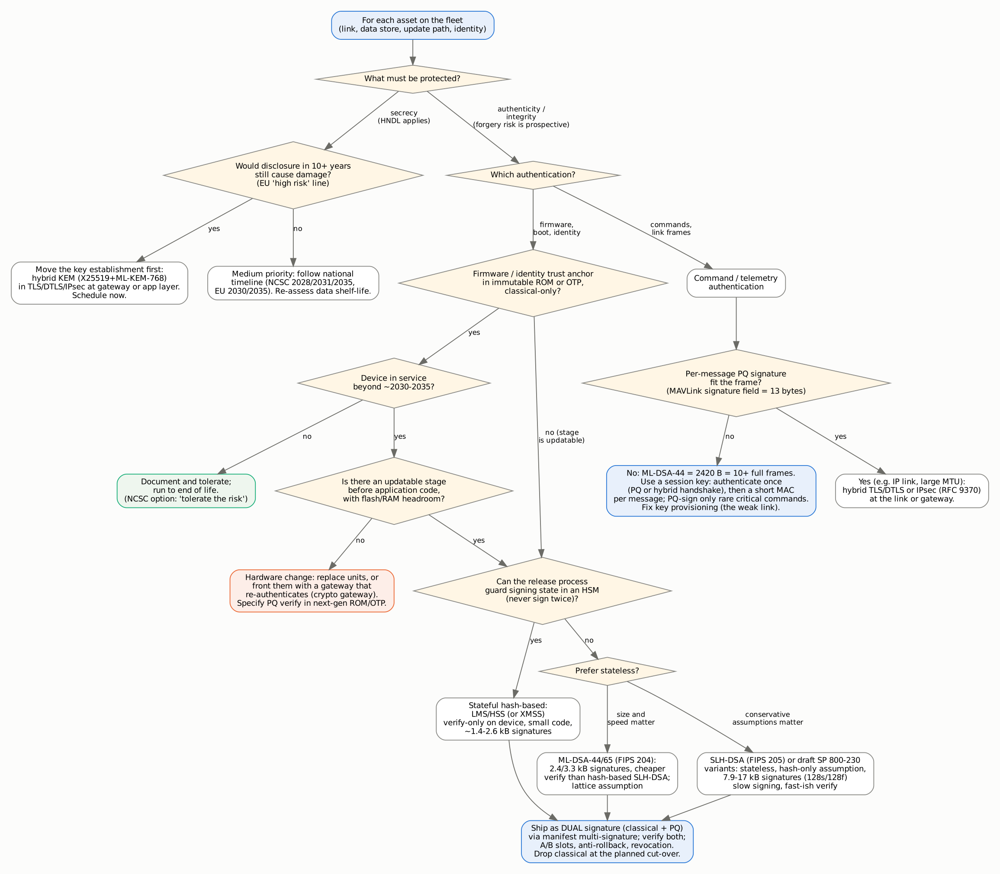

> **How to read the labels.** **Published** = a number or fact copied from a source that was actually retrieved during this review (source and retrieval date in `data/evidence.csv` and Appendix A). **Host-measured** = run on a PC (the first round on an x86 server, the second round on a laptop virtual machine); never comparable to a microcontroller. **Emulated** = run in QEMU on a Cortex-M4 or Cortex-M33 model, cross checked in Renode on an STM32F4 model: correctness, stack and image size only, never cycles (`docs/EMULATOR_RESULTS.md`). **Estimated** (derived) = my arithmetic, formula shown. *Inference* is not a label for numbers: it marks a sentence that is my reasoning, not stated by a source. **Planned** = to be measured on your hardware. No number in this report was measured on a microcontroller, and no estimate is presented as a measurement. Standards and guidance marked *in flux* may have changed after 2026-10-11.

# 1. Summary

**The question.** What does it cost to move the computers inside small drones and robots (Cortex-M4/M33-class microcontrollers and similar) to post quantum cryptography (PQC), and how can fleets already in the field migrate?

**Headline findings** (each is developed and sourced below):

1. **The hard problem is signatures and the frozen trust anchor, not key exchange.** Secrecy is exposed retroactively (harvest-now-decrypt-later), but authenticity is exposed prospectively: a forged firmware image only matters once a capable quantum computer exists *and* devices still trust the classical key. Where the verification key and algorithm sit in an immutable boot ROM or fuses, the scheme must outlive the device (NIST CSWP 39, RFC 9019, draft IR 8547, SP 800-208).
2. **Compute cost on Cortex-M4F is moderate for ML-KEM and ML-DSA verification, large for ML-DSA signing and very large for SLH-DSA signing.** Published pqm4 figures (board and clock ambiguous, see 4.1): ML-KEM-768 decapsulation takes 707,827 cycles in the speed optimised M4F code (derived: 29.5 ms at 24 MHz or 35.4 ms at 20 MHz) and ML-DSA-44 verification 1,421,623 cycles (derived: 59.2 ms at 24 MHz or 71.1 ms at 20 MHz). ML-DSA-44 signing averages 3,943,121 cycles with a long tail. Round-3 SPHINCS+ SHA2-128s signing, the predecessor of SLH-DSA, takes 7,657,558,168 cycles (derived: 319,064.9 ms at 24 MHz or 382,877.9 ms at 20 MHz).
3. **Memory and flash decide feasibility more than cycles.** ML-DSA-44 signing needs 44,816 bytes of stack in the fast M4F code but 5,080 bytes in the stack optimised code, which is 12,134,284 cycles. Verification can be done in 2,712 bytes of stack. Code is 19,592 to 24,844 bytes for the M4F-specific ML-DSA-44 variants.
4. **Sizes, not speed, break the radio links.** An ML-DSA-44 signature is 2,420 bytes; MAVLink 2's signature field is 13 bytes (6-byte tag) and its largest payload is 255 bytes, so one ML-DSA-44 signature fills 10 full frames (derived). Per message PQ signatures on MAVLink-class telemetry are not workable; session key designs are.
5. **No upstream support in the drone/robot stack yet.** I found no PQC in MAVLink, PX4/ArduPilot signing, the DDS-Security specification, mainline SROS2 or upstream MCUboot. wolfBoot (ML-DSA, LMS/HSS, XMSS, hybrid) and TF-M BL1 (LMS) implement PQ verification, and some vendors claim PQ or LMS verification in parts (press statements, unverified, see 4.7); the PSA Crypto API has a PQC extension (1.4 final, January 2026).
6. **Planning dates already exist.** UK NCSC 2028/2031/2035; EU end-2026 first steps, end-2030 high risk use cases, 2035 broad, and an explicit EU roadmap line that products with a life beyond 2030 should be upgradable to PQC with a post quantum signature path for firmware updates; NIST's *draft* IR 8547 proposes deprecating 112-bit-strength RSA/ECC after 2030 and disallowing all quantum vulnerable public key algorithms after 2035. **No UAE or Gulf algorithm level or embedded device level guidance was found**; the UAE National Encryption Policy (version 1.0, September 2025, Cyber Security Council) was read in full and its post quantum section names no algorithm, date or device class (section 3.3).
7. **Big evidence holes remain** (section 6): Cortex-M33 cycle counts exist only for ML-DSA-44 and ML-DSA-87 key generation and signing, from one paper on an STM32U5A5 (rows S10C-001 to S10C-036); none for ML-KEM, ML-DSA verification or SLH-DSA. No final parameter SLH-DSA cycles on any MCU; no measured energy for the final standards on a Cortex-M; nothing from a flight controller running its flight stack. *Correction (2026-10-16): earlier versions said there were no published ML-KEM, ML-DSA or SLH-DSA cycles on a named Cortex-M33; the S10C rows added that day contradict this, so the statement was narrowed.* The benchmark plan (docs/BENCHMARK_PLAN.md) is built to fill exactly these.

**Recommendations in one paragraph.** Inventory every cryptographic use and each product's root of trust now; make signature algorithms and sizes configurable (crypto agility); put a PQ-capable verifier (stateful hash based LMS/HSS if you can run an HSM-backed single signer, otherwise ML-DSA) into the *updatable* stage of each bootloader and ship dual (classical plus PQ) signatures; move long secrecy links to hybrid ML-KEM key establishment; for MAVLink-class links authenticate sessions with a PQ/hybrid handshake and keep short symmetric tags per message; treat units with classical only immutable roots as a hardware replacement or gateway decision with a date; and measure before committing hardware.

# 2. Scope, method and evidence discipline

The protocol was written before any evidence was collected (`docs/PROTOCOL.md`). Four research streams (standards, benchmarks, drone/robot specifics, migration/HNDL) plus two supporting streams (benchmark plan facts, host measurement) were run as separate research passes. Primary sources were preferred; search results were used only to locate sources, and no number comes from a search snippet.

**Evidence table.** `data/evidence.csv` has 1328 rows (431 benchmark and size rows from phase 1, 46 protocol and size rows, 46 benchmark and size rows added in phase 2 from the author supplied PDFs of ePrint 2025/366 and 2020/470, 45 cycle and stack rows from the 2020/470 PDF found by a second, independent run of the brief and rechecked against the PDF, and 403 rows added on 2026-10-16 from the author supplied PDFs of ePrint 2022/323, 2019/844, 2026/1333, 2021/781, 2026/312 and 2026/2343, each rechecked by a fresh reader, `docs/VERIFICATION3.md`), each with source title, URL, retrieval date, location in the source, and a comparability warning. It is summarised in Appendices A and B. **Comparability rules**: rows share an axis only if operation, parameter set and core family agree; differences in library, compiler, statistic, RAM definition and pre standard versus final parameters are flagged.

**Second run.** The brief was run twice in separate sessions and the results merged here. Of the second run's 582 rows, 299 match a row in this table by value and source, 245 appear only in the second run, and 38 carry no number; the 210 comparable pqm4 rows all matched. Rows only in the second run are not used until their source is read (`docs/CROSSCHECK.md`).

**Verification.** A separate verification pass that did not collect the data drew 50 rows with a seeded random draw (seed 20261011) and re-opened each source. Of the 50, 48 could be checked against their source and **0 had a wrong numeric field (0/48 rows; 0/487 fields)**; three location citations were corrected; two rows and 31 field lines could not be verified because the source was blocked from the work environment. With zero errors in 48 rows the upper 95% bound on the row error rate is about 6% (rule of three: 3/48), so this is evidence of good copying accuracy, not proof of none. Details: `docs/VERIFICATION.md`. Phase 2 checked all 157 rows behind a headline number and a stratified random sample of 120 more: 15 of 269 verifiable rows had an error, 1 a wrong value and 14 a rounded size the table had left empty (`docs/VERIFICATION2.md`). Phase 3 rechecked every one of the 403 rows added on 2026-10-16: 0 transcription errors, but 41 rows (10.2 percent) needed a column mapping or warning fix (`docs/VERIFICATION3.md`). A fourth pass on 2026-10-18 rechecked a seeded sample of those rows field by field with new readers and ran a column lint over the whole table; its results are in the same file.

**Deviations** (full log in PROTOCOL section 10): the research passes used `curl` through the configured network proxy because interactive fetch approvals went unanswered (TLS verification on, no workaround of any explicit denial); several hosts (eprint.iacr.org, nsa.gov, cisa.gov, some vendor pages) were unreachable and nothing from them is used; one non numeric cell was moved into the warning column and three location only fixes were applied.

**Safety scope.** Side channel and fault topics are conceptual and defensive. No attack procedures. No cryptographic primitive was implemented here; the benchmark harness calls pinned, reviewed libraries.

# 3. Standards status and timelines

*All rows retrieved 2026-10-11 unless a later date is given; the BSI, ASD, Canada and Singapore items were rechecked on 2026-10-17 (`data/raw/S11_standards_recheck.md`). "In flux" marks drafts or items moving at the date read.*

## 3.1 NIST and the United States

| Item | Status as retrieved | Notes |
|---|---|---|
| FIPS 203 (ML-KEM), 204 (ML-DSA), 205 (SLH-DSA) | Final, 2024-08-13; errata lists exist for 203 and 204 (**in flux**) | NIST says they "can and should be put into use now" |
| HQC | Selected 2025-03-11 as a backup KEM; no FIPS yet (**in flux**) | rationale in NIST IR 8545 |
| FN-DSA / FIPS 206 (Falcon) | **No draft published** as of a NIST post dated 2026-09-28 (**in flux**) | NIST still consulting on fixed point arithmetic for signing and key generation; verification does not need floating point |
| SP 800-208 (LMS/HSS, XMSS/XMSS^MT) | Final, October 2020 | names firmware authentication for long lived constrained devices as a use case; key and signature generation only in FIPS 140 Level 3+ hardware modules; "not suitable for general use" because of state management |
| Draft SP 800-230 | Initial public draft, 2026-04-13 (**in flux**) | extra SLH-DSA parameter sets limited to 2^24 signatures per key, aimed at firmware, software and certificate signing |
| NIST IR 8547 (transition) | Initial public draft, November 2024; still presented as a draft (**in flux**) | 112-bit classical signatures deprecated after 2030, all quantum vulnerable public key algorithms disallowed after 2035 |
| SP 800-227 (KEM recommendations) | Final, September 2025 | |
| CSWP 39 (crypto agility) | Final 2025-12-19; update 2026-06-29 | defines crypto agility; describes crypto gateways for legacy systems |
| NSM-10 / OMB M-23-02 | Final policy, 2022 | 2035 goal; prioritised cryptographic inventory |
| CISA PQC Initiative page (printed 2026-10-12, supplied by the author) | Read by OCR, 11 pages | The page describes CISA work since July 2022 on federal migration, a product category list, cryptographic discovery tools and a guidance document on post quantum considerations for operational technology; it states that NIST approved FIPS 203, 204 and 205 on 2024-08-13. It also cites a June 2026 executive order and OMB memorandum M-26-15; those cited documents were not read, so nothing is claimed about their content |
| NSA CNSA 2.0 | FAQ, Ver. 2.1 (December 2024), read 2026-10-16 (`data/raw/S10_cnsa_faq.md`); the separate algorithms advisory is missing | For US national security systems only: ML-KEM-1024, ML-DSA-87, LMS or XMSS for firmware signing, SLH-DSA not approved; new acquisitions compliant from 2027-01-01 and non compliant equipment phased out by 2030-12-31, unless otherwise noted (rows 4, 5, 7, 10, 24, 25); several points marked *in flux* in the note |

## 3.2 United Kingdom, European Union and others

- **UK NCSC** (v1.0, 2025-03-20): finish discovery and plan by **2028**, highest priority migration by **2031**, complete by **2035**. It flags industrial IoT as possibly resource constrained and non upgradeable, and notes some vendors already ship LMS/XMSS secure boot.
- **EU Coordinated Implementation Roadmap, Part 1 v1.1** (dated 2025-06-11; page updated 2026-09-03): national strategies and first steps by **end-2026**; high risk use cases by **end-2030**; as many systems as feasible by **2035**; hybrids "whenever feasible and suitable"; **products with an expected lifetime beyond 2030 should be upgradable to PQC, with post quantum signatures on the update mechanism, linked to the Cyber Resilience Act from December 2027**; a use case with transition effort above about 8 years and high impact (securing software updates is the example) is high risk. This is the single most relevant government statement found for drone and robot makers.
- **Germany BSI** (rechecked 2026-10-17, S11 rows 13 to 15): hybrid preferred; TR-02102 is still at version 2026-01; SecP256r1MLKEM768 and SecP384r1MLKEM1024 from RFC 10024 will be recommended in the next TR-02102-2, for which no date is given, and BSI says they may already be used in a TR compliant way in TLS 1.3, as may X25519MLKEM768 (*in flux*). **France ANSSI**: hybrid recommended; "not reasonable" to buy non-PQC products after 2030. **Australia ASD**: stop traditional asymmetric cryptography by end-2030, does not recommend hybrids (retrieved via summary on 2026-10-11; the 2026-10-17 recheck failed because every request to cyber.gov.au timed out, and search results show that the page has moved and that a September 2026 ISM edition exists, so this item may be stale; S11 row 16; *in flux*). **Canada** (rechecked 2026-10-17, S11 rows 1 to 5): the Cyber Centre roadmap is unchanged since June 2025, and a Treasury Board implementation notice effective 2025-10-09 makes it binding for federal departments: plans, annual reporting and PQC procurement clauses from 1 April 2026, plan updates by 1 April 2027 and 1 April 2028, transitions under way by 1 April 2028, high priority systems by end-2031 and the rest by end-2035. Neither source reports whether the April 2026 plans were delivered. **Japan**: government target about 2035 (interim report, Nov 2025). **Singapore** (rechecked 2026-10-17, S11 rows 6 to 12): Version 1 of the handbook and the readiness index (CSA, GovTech and IMDA, 16 July 2026) replaced the consultation drafts. It states milestones for CII owners (a migration plan to CSA by 31 March 2027, new systems quantum safe or quantum safe ready from 1 January 2028, migration complete by 31 December 2031), recommends ML-KEM, ML-DSA and SLH-DSA with LMS and XMSS for firmware signing only, and calls itself not mandatory; detailed guidance for the milestones is still being developed (*in flux*). **South Korea**: KpqC selected HAETAE and SMAUG-T (Jan 2025).
- **IETF**: RFC 10024 (hybrid TLS 1.3 groups X25519MLKEM768, SecP256r1MLKEM768, SecP384r1MLKEM1024; Proposed Standard, August 2026); draft-ietf-tls-mlkem in the RFC Editor queue (**in flux**); RFC 9881 (ML-DSA in X.509); RFC 9964 (ML-DSA in COSE: -48/-49/-50); RFC 8778 (HSS-LMS in COSE: -46); RFC 8554/8391 (LMS, XMSS; Informational); RFC 10033 (state management for stateful hash based signatures); draft SUIT mandatory-to-implement algorithms recommends an HSS/LMS profile and has no ML-DSA profile in the revision read (**in flux**).

## 3.3 UAE and the Gulf (stated plainly)

*Primary text read.* The author supplied the National Encryption Policy of the UAE Cyber Security Council (version 1.0, September 2025, 51 pages, classification Open) and a printed copy of its summary page on uaelegislation.gov.ae (published 17 September 2025). Section 6, "Post Quantum Cryptography", has one subsection of six statements. In paraphrase, an entity must: keep an inventory of systems and applications that use public key cryptography (6.1.1); test the new post quantum standard in a lab before production (6.1.2); plan the transition, including dependency analysis, decommissioning of unsupported technology, and validation of products (6.1.3); write acquisition policies for post quantum cryptography (6.1.4); alert IT departments and vendors (6.1.5); and train its workforce (6.1.6). The scope clause covers federal government entities and critical information infrastructure entities, with emirate level bodies handled by an emirate lead where an emirate programme exists. **The section names no algorithm, no deadline, no hybrid requirement and no rule for embedded or unmanned devices.** The earlier press reports (a policy and executive regulation approved in November 2025, overseen by the Cybersecurity Council) were not checked against this text and the executive regulation was not supplied [unverified].

*Other UAE items, from press and vendor reports:* a **National Post-Quantum Migration Program** announced the same week (QuantumGate, ATRC); and a **May 2026 agreement** to deploy a Crypto Discovery Tool to requirements set by the UAE National Cryptography Center, using TII libraries. TII also launched a PQC C library and reports co-developing HQC.

*Rest of the Gulf:* a Saudi central bank (SAMA) circular with inventory deadlines (2026-12-31) and risk assessment deadlines (2027-03-31) is reported only by secondary sources and is **unverified**. For Qatar, Oman, Kuwait and Bahrain no migration guidance was found (Bahrain: a vendor press release about a tooling procurement only). CBUAE, ADGM, DIFC, Dubai Electronic Security Center and TDRA: nothing PQC-specific found.
*Implication for you* [inference]: for UAE research and industry partners the practical anchors are the national policy (inventory, lab testing, plan, acquisition policy), the EU/UK dates when exporting, and the NIST algorithms; ask the UAE National Cryptography Center which algorithm profile applies to embedded and unmanned systems.

# 4. What the published numbers say

*Everything in this section is published (not measured here) unless it says derived. Setups differ; read the warnings before comparing.*

## 4.1 The comparability warning that matters most

The only maintained benchmark with the final ML-KEM/ML-DSA names on Cortex-M4F is **pqm4** (`benchmarks.csv`, last changed 2025-05-22). Its README says all cycle counts were taken at 24 MHz to avoid flash wait states, but its default board's (NUCLEO-L4R5ZI) benchmark clock path in code is 20 MHz and the CSV does not name the board; two other papers say the pqm4 reference numbers came from an L4R5ZI. **I therefore treat the pqm4 clock as unresolved**; every time figure here is derived at both candidate clocks (24 MHz from the README, 20 MHz from the code of the default board) and is not a claim about any particular board. The board and clock were checked in the project's own files (`data/raw/S6_pqm4_config.md`): the README default board is the NUCLEO-L4R5ZI, the benchmarks.py default platform is the STM32F4 Discovery, and the result files record neither. pqm4 itself carries a notice that it will be archived read only in or after January 2027. pqm4 times with SysTick, not the DWT counter. Its ML-DSA rows are means of 1000 runs and its KEM rows means of 10.

## 4.2 ML-KEM (FIPS 203) on Cortex-M4F

For ML-KEM-768 the reference-C ("clean") code needs 988,722 / 1,138,225 / 1,387,984 cycles for keygen / encaps / decaps with 14,480 bytes of stack on decapsulation; the M4F-specific speed optimised code needs 642,096 / 658,754 / 707,827 cycles (6,452 bytes stack, 16,016 bytes code), and the stack optimised variant 644,195 / 664,654 / 714,194 cycles in only 2,844 bytes of stack. So the stack optimised variant costs about 1.01x the cycles of the speed variant for under half the stack. (ratio of published cycle counts, same benchmark.)

Other published context (different setups, never on one axis with pqm4): wolfCrypt on a Cortex-M4 NUCLEO-F439ZI at 168 MHz reports ML-KEM-768 decaps average 8.333 ms (vendor blog, ML-KEM in assembly); the RP2040 (Cortex-M0+, 125 MHz, preprint) 22.02 ms for decaps from a timer, with cycles derived as time x 125.

## 4.3 ML-DSA (FIPS 204) and firmware signature verification

For ML-DSA-44 verification, the operation a secure bootloader performs: 2,063,096 cycles in reference C, 1,421,623 in the M4F-specific code (8,912 bytes of stack) and 3,242,333 in the stack optimised code (2,712 bytes). Signing is far costlier and variable: 3,943,121 cycles (mean) in the M4F code with 44,816 bytes of stack; 12,134,284 cycles in 5,080 bytes in the stack optimised code. ML-DSA-65 verification: 2,415,944 cycles (M4F code).

**The tail matters.** ML-DSA signing repeats until a candidate passes checks, so its time depends on the data. The RP2040 preprint reports a coefficient of variation near 66-73% for signing, and for its 10,000-run campaign p95 of 421.3 ms and max of 1156.79 ms against a mean of 182.7 ms for ML-DSA-44 (published, Cortex-M0+). A methodology paper (Riou et al., ePrint 2026/1333, full text read 2026-10-16) argues min/average/max are unsuitable for migration planning and reports best, average and worst observed cycles for three ML-DSA libraries on a Cortex-M33 (rows S10C-001 to S10C-036). [Inference] For a drone, signing on board therefore needs a worst case budget, not an average, and verification only designs avoid the problem. mldsa native ships a restartable signing example for bounding run time.

**Other published points.** wolfSSL's blog (Cortex-M4, 168 MHz): ML-DSA-44 verify average 21.913 ms, sign 60.333 ms. On the RP2040 (Cortex-M0+ at 125 MHz): ML-DSA-44 verify 44.0 ms against ECDSA P-256 verify 321.4 ms and RSA-2048 private operation 3393 ms (mbedTLS built with SDK defaults, not tuned, so the classical side is not a fair optimum). The CHERIoT blog (simulated Ibex RISC-V core) gives ML-DSA-44 verify 3,674,071 cycles.

## 4.4 SLH-DSA (FIPS 205) and stateful hash based signatures

*No final parameter SLH-DSA or LMS cycle count on any microcontroller was found.* What exists:

- **pqm4's SPHINCS+ rows are round-3 "simple" parameter sets, not FIPS 205**, reference C only. SHA2-128s: sign 7,657,558,168 cycles, verify 7,471,794; SHA2-128f: sign 368,575,228, verify 21,923,628. Signatures are 7,856 (128s) and 17,088 (128f) bytes in FIPS 205 (published sizes). [Derived] verification takes 311.3 ms at 24 MHz or 373.6 ms at 20 MHz (128s) and 913.5 ms at 24 MHz or 1,096.2 ms at 20 MHz (128f); [inference] signing on-device is impractical.
- **LMS/XMSS on Cortex-M4** come from the full paper of Campos et al. (ePrint 2020/470, read from the supplied PDF; rows S7 and S8, SHA-256 variants) and from their conference *slides* (STM32F4DISCOVERY, clock not stated, pre-RFC-final variants). From the slides: LMS h5 SHA-256 verify 2,576,515 cycles with 1,044 bytes of stack; LMS h10 verify 2,650,000; XMSS ROBUST h10 verify 13,070,000. The XMSS paper of Bos et al. (FRDM-K64F, 120 MHz) reports 13,850,000 cycles for reference XMSS-SHA2_10_256 verification and 7,870,000 with its speed-up techniques.
- **Boot time measurements** (wolfSSL blog, STM32H563 at 320 MHz, ~100 KB image, *total boot time, not verification only*; vendor, unverified): SHA2-only baseline 55.662 ms; ECDSA P-256 75.611 ms; ML-DSA-44 82.791 ms; ML-DSA-87 127.807 ms; LMS 1-10-8 207.703 ms; XMSS-SHA2_10_256 189.553 ms; hybrid ECC+ML-DSA-65 341.706 ms. The blog gives 320 MHz for the STM32H563, above the 250 MHz maximum that Zephyr's board page lists for the NUCLEO-H563ZI, so the clock or part naming is doubtful. The same table lists Ed25519 at 1589.512 ms, which shows how much an unoptimised configuration can distort comparisons.
- **TF-M BL1** states its LMS software verifier is about 3 KiB versus at least 6.5 KiB for RSA (vendor documentation claim).

## 4.5 Sizes

ML-DSA-44/65/87 signatures are 2,420 / 3,309 / 4,627 bytes and public keys 1,312 / 1,952 / 2,592 bytes (FIPS 204). ML-KEM-768 encapsulation key 1,184 and ciphertext 1,088 bytes (FIPS 203). Ed25519 signature: 64 bytes (PX4 docs). X25519MLKEM768 key shares: 1,216 (client) and 1,120 (server) bytes (RFC 10024).

## 4.6 Energy

Published *measured* energy exists only for **pre standard** Kyber/Dilithium on a Cortex-M4 at 96 MHz (Saarinen 2020) and on an ESP32 (2026 paper). Example on the Cortex-M4 (NUCLEO-F411RE, 96 MHz): Kyber768 decaps 876.3 uJ; Dilithium2 verify 1,121 uJ; Dilithium2 sign 3,777 uJ; ECDSA P-256 verify 4,142 uJ (same paper). On the ESP32 (240 MHz): Dilithium2 sign 18,040 uJ. The RP2040 energy figures (for example 19,220 uJ for ML-DSA-44 keygen+sign+verify) are **a datasheet model estimate, not a measurement**, by the source's own statement. **No measured energy for the final ML-KEM/ML-DSA/SLH-DSA on a Cortex-M was found.**

## 4.7 Hardware acceleration

Only FPGA and ASIC results were found (RISQrypt on an Artix-7 co-design: Kyber768 decaps 35 thousand cycles, 109 thousand masked; Dilithium3 verify 126 thousand cycles; Adams Bridge in 5 nm synthesis; a PQShield NTT block at 258 cycles per 256-point transform). Vendors claim PQC acceleration or verification in ST (X-CUBE-PQC with the STM32 crypto accelerator), Microchip (MEC175xB: ML-DSA, LMS verification and ML-KEM "in immutable hardware"; Cortex-M4F at 96 MHz) and Infineon (PSOC Control C3: LMS verification with SHA hardware). **None of these vendor pages gives cycle counts or a verifiable device list**; treat them as leads to ask suppliers about. A 2025 Mbed TLS vulnerability (CVE-2025-49600, an LMS-verification bug with unchecked hash return values) is a reminder that offload paths must fail closed: a failing hash accelerator could let an invalid LMS signature be accepted.

## 4.8 Classical baselines

Published classical numbers on matching devices exist (ECDSA/ECDH on the F411RE at 96 MHz; wolfCrypt RSA/ECC on the F439ZI; RP2040 mbedTLS). Round 4 added double read Cortex-M4 cycle rows for X25519 and Ed25519 (stream S12; for example S12A-330 to S12A-332 and S12A-317 to S12A-328), and pqm4 still has no classical baselines. Cross paper ratios are computed only in `docs/ENERGY_STUDY.md`, with the published range shown beside each, because setups differ.

# 5. Drone and robot constraints

## 5.1 MAVLink signing

MAVLink 2 signing sets an incompatibility flag and appends **13 bytes**: 1 link ID, 6-byte timestamp (10 microsecond units since 2015-01-01) and a 6-byte tag, the first 48 bits of a SHA-256 over the secret key, header, payload, CRC, link ID and timestamp. The key is **32 bytes, shared by all parties**; provisioning is out of band or via `SETUP_SIGNING` over a secure link such as USB. Maximum payload 255 bytes; maximum signed packet 280 bytes. PX4 documents that signing gives no confidentiality, no per party identity, and no automatic key rotation, that a few messages (HEARTBEAT, RADIO_STATUS, ADSB_VEHICLE, COLLISION) are always accepted unsigned, and that without a key everything is accepted. ArduPilot's page says telemetry downlink and USB are unaffected by signing. A 2026 CVE record notes the baseline problem: MAVLink needs no authentication by default.
[Inference] A symmetric 256-bit-key MAC is not what a quantum computer breaks directly; what is exposed is the **provisioning path** and any asymmetric steps around it, and the fact that nothing in the protocol can carry a PQ signature.
*Found absent:* no PQC-specific MAVLink standard, no PX4/ArduPilot documentation of PQC signing, no peer reviewed measurement of PQC on a MAVLink flight controller. Community and preprint items exist (an ArduPilot forum RFC proposing authentication as first class messages and a KpqC feasibility preprint, ePrint 2026/2343, full text read 2026-10-16, rows S10F; its measurements are on a PC, not a flight controller); the forum author's numbers are unverified and are not used. Phase 2 addition: the MAVLink issue tracker records the maintainers' stated position. In mavlink/mavlink issue 2525 (closed 2026-06-30, https://github.com/mavlink/mavlink/issues/2525) a maintainer said there is no post quantum roadmap and the project does not think it needs one, that signatures recorded now are not a harvest risk, and that carrying about 4.6 kB per message is not acceptable; issue 2527 (closed 2026-06-24) was a third party wire format proposal that maintainers said falls outside the existing extension mechanisms. This is a project statement as read on 2026-10-12, not a standard.

## 5.2 Secure boot and OTA

- **PX4**: Ed25519 (monocypher), 32-byte key, 64-byte signature, fits a 128 KB bootloader sector; **ArduPilot**: bootloader can embed up to 10 public keys (the docs read do not name the algorithm; its tooling depends on monocypher, so an Ed25519-class scheme is likely, an inference). Both are classical signature checks in a fixed size bootloader region, which is the immutable-first-stage case.
- **MCUboot**: signature types listed are RSA, ECDSA and Ed25519; **no PQC identifier found** in the main branch design doc and release notes (issue and PR search was blocked, so absence is not proof).
- **wolfBoot** v2.0.0 added LMS/HSS and XMSS (2023-11-07), v2.3.0 ML-DSA and hybrid (2024-10-31), v2.10.0 (2026-10-01) lists an NXP i.MX RT700 ML-DSA-87 configuration; example headers: 4,840 bytes (ML-DSA-44), 5,288 bytes (2-level LMS). **TF-M BL1** verifies with LMS; **PSA Certified Crypto API** has a PQC extension (1.4 final, 2026-01-28) covering LMS, HSS, XMSS, ML-DSA, SLH-DSA and ML-KEM. **Zephyr 4.4.2** ships only experimental mldsa native (ML-DSA-87, internal) and Mbed TLS LMS verification.
- **SUIT/COSE/Uptane**: identifiers exist (HSS-LMS -46; ML-DSA -48/-49/-50); the SUIT mandatory-to-implement draft recommends an HSS/LMS profile; Uptane 2.1.0 (as read) shows RSA, ECDSA, Ed25519 and no PQC text.
- **Caliptra** (an open source silicon root of trust, datacenter oriented, used here only as a documented pattern): release 1.3 adds a software only ML-DSA-87 identity chain via runtime firmware without ROM change, while the ROM-rooted classical chain stays and the PQ chain does not attest the ROM.

## 5.3 ROS 2, DDS-Security, micro-ROS

DDS-Security 1.2 (cover marks it not yet final) specifies RSASSA-PSS/PKCS#1 v1.5 (2048-bit), ECDSA P-256/P-384, DHE MODP-2048 and ECDHE P-256/P-384 with AES-GCM/GMAC; a text search found **no post quantum algorithm**. ROS 2 uses it through SROS2 (security off by default; vendor interoperability of secure communication not supported per the tutorial). Research forks exist (PQSec-DDS plugin for Cyclone DDS; a Dilithium3 SROS2 fork and a hybrid Zenoh fork in a thesis; AXON, a non-DDS RMW with X25519MLKEM768 over QUIC whose own authors say peer authentication is not post quantum or even validated in the shipped mode) with **no benchmarks on robot or MCU hardware**. micro-ROS: official security pages could not be fetched; one paper built a classical TLS 1.3 transport (about 20% time overhead for single value messages). I found no PQC micro-ROS work.

## 5.4 Why sizes break links (derived estimates)

All figures here are **derived**: `chunks = ceil(N / C)`, `t = 8N / R_eff`, with N from published sizes and C, R from published link limits; they ignore headers, retransmission, acknowledgements and contention.

Chunk capacities (published): MAVLink payload 255 B; FTP data 239 B per message (251-byte payload minus a 12-byte header); ENCAPSULATED_DATA 253 B; TUNNEL 128 B; LoRaWAN EU868 DR0-DR2 51 B; US915 DR0 11 B; IEEE 802.15.4 about 81 B worst case with AES-CCM; BLE default 23 B.

| Object | Bytes | MAVLink 255 B | FTP 239 B | TUNNEL 128 B | LoRaWAN EU DR0 51 B | 802.15.4 81 B | BLE 23 B |
|---|---|---|---|---|---|---|---|
| ML-DSA-44 signature | 2420 | 10 | 11 | 19 | 48 | 30 | 106 |
| ML-DSA-65 signature | 3309 | 13 | 14 | 26 | 65 | 41 | 144 |
| ML-DSA-87 signature | 4627 | 19 | 20 | 37 | 91 | 58 | 202 |
| LMS H10/W8 signature (computed from RFC 8554) | 1452 | 6 | 7 | 12 | 29 | 18 | 64 |
| HSS 2x H5/W8 (wolfBoot docs) | 2644 | 11 | 12 | 21 | 52 | 33 | 115 |
| SLH-DSA-128s signature | 7856 | 31 | 33 | 62 | 155 | 97 | 342 |
| Ed25519 signature (reference) | 64 | 1 | 1 | 1 | 2 | 1 | 3 |

Serial airtime (SiK default 64 kbps; about 90% usable without error correction, about half with it): an ML-DSA-44 signature takes about 0.34 s, ML-DSA-65 0.46 s and ML-DSA-87 0.64 s with ECC off, double with ECC on; at LoRaWAN EU868 DR0 (250 bit/s nominal) the same signatures need about 77 s, 106 s and 148 s, and a 1% duty cycle then enforces hours of silence. Plot (derived, not measured):

**Conclusion** [derived + inference]: per message PQ signatures are impossible in a 13-byte field and wasteful elsewhere; occasional large objects (a firmware manifest signature, a certificate chain, a hybrid handshake of 2,336 bytes of key shares) can be chunked on slow links but need reassembly state and loss handling that MAVLink has no standard service for.

## 5.5 Side channel and fault considerations (conceptual, defensive)

Structured lattice schemes can leak through timing, power or EM and can be disturbed by faults; protecting an implementation needs scheme specific countermeasures (constant time coding, masking, shuffling, redundancy and validity checks, isolation) [Ravi et al. survey]. Published masking costs: first order masked Kyber decapsulation about 3.1 million cycles on Cortex-M4F, a factor 3.5 over the unprotected optimised code (Bos et al.); masked Kyber768 decaps 2,978,441 cycles including RNG (Heinz et al.); in an FPGA co-design masked Kyber768 decaps is 3.1x and masked Dilithium3 signing 2.6x the unmasked cost (RISQrypt Table 8, ratio derived). For stateful hash based signatures the danger is operational (reusing a one time key); SP 800-208 requires the state to be committed to non volatile memory before a signature is exported. [Inference] A captured drone is physically accessible, so these classes matter mainly for keys that live on the vehicle; a verify only device holding public keys has a smaller exposure than one that signs.

# 6. What is not known (and what that means)

| Gap | Consequence | Where addressed |
|---|---|---|
| Cortex-M33 cycles only for ML-DSA keygen and sign (S10C, STM32U5A5); none for ML-KEM, ML-DSA verify or SLH-DSA | cannot say what moving from M4F to M33 changes for key exchange or verification | E1 on NUCLEO-U575ZI-Q |
| No **final parameter SLH-DSA** cycles on any MCU; LMS and XMSS cycles come mainly from Campos et al. (ePrint 2020/470, rows S7, S8), plus the Bos et al. XMSS paper and conference slides (S2) | firmware signing choice rests on that paper, slides and round-3 data | E2 |
| No **measured energy** for final standards on a Cortex-M | battery impact unquantified | E3 |
| **pqm4 board/clock unresolved**; project to be archived | no stable maintained baseline | E1 reproduces pqm4 rows on the L4R5ZI |
| Cortex-M7 numbers exist on a Nucleo-F767ZI (rows S7-001 to S7-024) but none on a flight controller running its flight stack | | later E1 on a Pixhawk-class board |
| No PQC in MAVLink/DDS-Security/MCUboot upstream | migration needs wrappers or forks | playbook phases 2-3 |
| Vendor ROM/accelerator claims unverified | hardware replacement decisions need written vendor answers | playbook phase 0/4 |

# 7. Harvest-now-decrypt-later: what needs secrecy and what needs authenticity

**Sourced framing.** NIST draft IR 8547 and the CISA/NSA/NIST fact sheet describe harvest-now-decrypt-later for confidentiality; IR 8547 says authentication has no harvest analogue because it stays secure as long as the algorithms and keys are secure when authentication is performed; Banegas et al. state that a quantum breakthrough at time T does not affect signatures made before T but allows forging after T. The Mosca inequality (from GRI 2025 and IR 8547): trouble if shelf life X plus migration time Y exceeds the time Z to a cryptographically relevant quantum computer. The EU roadmap treats confidentiality needs beyond about 10 years as high risk. NCSC notes that for field OT sensors integrity is likely critical while confidentiality may not need strong protection.

**Timeline uncertainty (no date asserted).** The Global Risk Institute 2025 survey of 26 experts put a cryptographically relevant quantum computer as "quite possible (28-49%)" within 10 years and likely (51-70%) within 15 (expert opinion, broad bins). Resource estimates keep falling: Gidney 2025 estimates RSA-2048 factoring in under a week with under one million noisy qubits (under stated hardware assumptions); a 2026 Google whitepaper (abstract only) reports fewer than about 1,200 logical qubits for 256-bit ECDLP. These are engineering estimates, not forecasts; use agency dates (NCSC, EU, NIST draft) as planning deadlines.

**Classification of drone/robot data (inference; replace the lifetimes with your own).**

| Asset | Confidentiality lifetime | Authenticity lifetime | Priority |
|---|---|---|---|
| Telemetry (attitude, battery, position) | short; long if it reveals people or sensitive sites | short | low (secrecy), medium if tracks are sensitive |
| Video / imagery | medium to long (people, facilities, infrastructure) | short to medium (evidence needs provenance) | **high secrecy** |
| Mission plans, geofences | medium to long for sensitive operations | short per mission | medium |
| Maps / point clouds / site models | **long** | medium to long (poisoned maps) | **high** |
| Customer and site data | **long** (contractual, 10+ years) | medium to long | **high** |
| Firmware images | medium (low if public) | **very long**: the verification key outlives the device | **high authenticity** |
| Commands | short | short per command; key trusted for long | medium, via key provisioning |
| Long term keys and provisioning secrets | lifetime of what they protect | fleet lifetime | **high** |
| Logs | short to long | medium to long (forensics) | medium |
| Device identity / attestation certificates | low (public) | **very long** if ROM- or fuse rooted | **high authenticity** |

The practical rule: **move secrecy to hybrid KEM early because delay costs you retroactively; move authenticity where the trust anchor outlives the device, because that is where delay becomes unfixable.**

# 8. Hybrid, crypto agility and hardware acceleration in practice

- **Hybrid key exchange** is standardised for TLS 1.3 (RFC 10024) and IKEv2 (RFC 9370). Cost: X25519MLKEM768 key shares total 2,336 bytes versus 64 for X25519 (about 36.5x, derived). NIST leaves hybrid use to applications; BSI and ANSSI favour it; ASD does not.
- **Hybrid signatures for firmware**: carry two signatures and verify both (simple, fits current boot designs, cost dominated by the PQ part). wolfBoot, Infineon and Microchip describe this. NIST expects hybrids to be temporary, implying a second transition.
- **Crypto-agility** (NIST CSWP 39): the ability to replace algorithms in protocols, software, hardware and firmware while preserving operations; buffers and storage should not assume algorithm specific sizes; crypto gateways protect legacy components whose crypto cannot change; hardware functions cannot be changed in the field except in reconfigurable logic.
- **Hardware acceleration**: see 4.7; use it, but verify fail closed behaviour and ask vendors for numbers.

# 9. Decision framework

Tags: **[S1..S5, row]** = from the raw notes in `data/raw/` (each traces to a retrieved URL with retrieval date 2026-10-11); **[evidence S2-xxxx]** = row in `data/evidence.csv`; **[inference]** = my reasoning, not stated by a source. Standards marked *in flux* may have changed since 2026-10-11.

(Source file `figures/decision_flow.dot`, also `decision_flow.svg`.)

## How to use it
Run the flowchart once per asset class, not once per fleet. A drone has at least five: the **firmware trust anchor** (ROM/OTP key and verifier), the **update path** (manifest, signer), the **command link**, the **data links** (video, telemetry, cloud uplink) and the **device identity**. They get different answers.

## The two questions that decide most outcomes
1. **Is the risk retroactive or prospective?** Secrecy has a harvest-now-decrypt-later (HNDL) problem: traffic recorded today can be read later. Authenticity does not: an authentication system stays secure as long as the algorithms and keys are secure when the authentication is performed [S4 A4, IR 8547 ipd 3.1.2]. The authenticity risk is *forgery after a break*, so it matters for keys that stay trusted for a long time, above all verification keys frozen in silicon [S4 A2 CSWP 39 s4.5; A8 RFC 9019; A5 SP 800-208 s1.1].
2. **Can the verifier be changed after shipping?** If the boot ROM or fused/OTP-hashed key and algorithm cannot be updated, the scheme there must stay secure for the device's whole life [S4 CSWP 39 s4.5], and NIST's draft IR 8547 says such devices should be designed to require quantum resistant signatures if they might still be in use when a cryptographically relevant quantum computer exists (draft, in flux) [S4 A4 s3.1.1].

## Choosing a firmware signature scheme (verify only device)

Sizes are standard values [evidence S2-0405..0413, S3-036..044]; cycle counts are *published, different setups, not comparable across rows* [evidence S2-0033, S2-0057, S2-0060, S2-0316, S2-0319]. Treat the cycle column as orientation, not a ranking.

| Criterion | LMS/HSS (SP 800-208) | XMSS/XMSS^MT (SP 800-208) | ML-DSA (FIPS 204) | SLH-DSA (FIPS 205) |
|---|---|---|---|---|
| State on signer | **Stateful**: signing a one time key twice allows forgery; key and signature generation only in FIPS 140 Level 3+ hardware modules per SP 800-208 s8.1 [S1 row 12, 13] | same | none | none |
| Signature size (bytes) | 1452 (1-level H10/W8, computed from RFC 8554 formula [S3 8.3]); 2644 (2-level H5/W8, wolfBoot docs) | 2500 (XMSS-SHA2_10_256, wolfBoot docs) | 2420 / 3309 / 4627 (-44/-65/-87) | 7856 (128s), 17088 (128f), 49856 (256f) |
| Public key | 56 B per LMS key (computed) | per RFC 8391 | 1312 / 1952 / 2592 | small (FIPS 205 Table 2) |
| Published verify cost on Cortex-M4 (setups differ) | 2,576,515 cycles LMS h5 SHA-256 (slides, S2-0316); 2,650,000 h10 (S2-0319) | 13,070,000 XMSS ROBUST h10 (S2-0322, slides) | 1,421,623 ML-DSA-44 (pqm4 m4f, mean, clock unresolved, 20 or 24 MHz; S2-0033) | 7,471,794 for round-3 SPHINCS+ SHA2-128s-simple, **not final SLH-DSA** (S2-0060) |
| Standards / ecosystem | RFC 8554; COSE -46 (RFC 8778); SUIT MTI draft recommends an HSS/LMS profile (in flux) [S3 4.6]; TF-M BL1 uses LMS; wolfBoot, Mbed TLS (verify) | RFC 8391; wolfBoot | RFC 9964 gives COSE -48/-49/-50, **but the SUIT MTI draft -23 has no ML-DSA profile** [S3 4.6]; wolfBoot supports it | draft SP 800-230 (2026-04, in flux) proposes 2^24-signature variants for firmware; wolfCrypt, slhdsa-c (work in progress) |
| Hardware/ROM claims (vendor, unverified) | Infineon PSOC Control C3 LMS verify; Microchip MEC175xB | -- | Microchip MEC175xB ML-DSA | -- |
| Best when | one release authority with an HSM; long lived ROM-adjacent verifier; smallest code and signature | like LMS | many signers or no HSM state discipline; moderate sizes | most conservative assumption; can tolerate large signatures |

[inference] For a fleet whose releases come from one build pipeline, LMS/HSS fits best because the state problem sits in the vendor's HSM, not on the airframe. ML-DSA fits where stateful discipline cannot be guaranteed. SLH-DSA is the conservative stateless choice but the heaviest on bytes (and, from the round-3 rows, on cycles).

## Hybrid (dual) signatures: do it with two signatures, not one composite
NIST leaves hybrid use to each application and will accommodate hybrids in FIPS 140 validation [S1 row 20]; BSI and ANSSI favour hybrids, ASD does not recommend them [S1 rows 43, 47, 51]. For firmware, the IETF constrained device draft says carrying two separate signatures is simple and fits current secure boot designs, while overall cost stays dominated by the PQ part [S3 5.2; in flux]. wolfBoot implements it (sequential verification, larger headers) [S3 4.2]. Rule: accept an image only if **both** verify, so authenticity holds while either holds. NIST expects hybrids to be temporary, implying a second transition [S4 IR 8547 3.2].

## Link and command authentication
- MAVLink 2 signing is a 13-byte field holding a 6-byte truncated SHA-256 tag over a 32-byte shared key [S3 1.1]; an ML-DSA-44 signature is 2420 bytes, i.e. 10 full 255-byte payloads [S3 8.1, derived]. So per message PQ signatures are not feasible; the design space is a PQ/hybrid *session setup* plus a short symmetric tag per message [inference, consistent with a community proposal S3 1.4]. A shared symmetric key is not directly broken by Shor's algorithm [inference]; what is exposed is how the key reaches the vehicle (manual, over USB/wired link per the guide) and any public key step in provisioning.
- ROS 2 / DDS-Security 1.2 specifies RSA/ECDSA/ECDH and AES-GCM only; no PQC [S3 3.1]. Research forks exist (PQSec-DDS, a Dilithium3 SROS2 fork) without benchmarks [S3 3.4]. [inference] Until the spec changes, protect the robot-to-ground path with a hybrid TLS/IPsec tunnel at the gateway, and keep DDS-Security inside.

## What can be done by firmware update vs what needs hardware [inference, built on sourced constraints]
| By firmware update (if flash/RAM headroom and an updatable bootloader) | Likely needs hardware change or a gateway |
|---|---|
| Hybrid KEM in the application link layer | Boot ROM / fused key hash with classical only algorithm and nothing updatable before it |
| PQ verifier in an updatable second stage bootloader (wolfBoot-class); dual manifest signatures | Secure elements with a fixed algorithm set |
| Larger headers and certificate chains | Units with no flash headroom: published PQ code is 8-25 kB flash for ML-DSA [S2-0028..0036] and a 5 kB image header for LMS/ML-DSA in wolfBoot examples [S3 4.2] |
Worked example of the pattern: Caliptra 1.3 adds a software only ML-DSA-87 identity chain via runtime firmware without ROM changes, but the ROM-rooted classical chain remains and the PQ chain does not attest the ROM [S4 A19]. Not a drone part; shows what a firmware only fix can and cannot cover.

**Fleet planner result (estimated, synthetic fleets).** How many devices need new hardware depends on which implementation the planner's memory thresholds assume. On a synthetic fleet of 1000 devices it ranges from 260 (thresholds from stack optimised assembly, published pqm4 rows) to 382 (reference C, published pqm4 rows), and 126 devices (12.6 percent) change class between the two; speed optimised assembly and this repository's portable C build fall in between (`docs/PLANNER_STUDY.md`). A plan should carry the range, not one of its ends. *Correction 2026-10-18: an earlier version of this paragraph gave 246 to 371; the signature memory thresholds were then corrected (ML-DSA-44 header size and the verifier's key and signature buffers, `docs/PLANNER_RULES.md`).*

# 10. Migration playbook

Tags as in DECISION_FRAMEWORK.md. Dates are planning anchors, not predictions: UK NCSC 2028 (discovery, plan) / 2031 (highest priority migrated) / 2035 (done) [S1 row 33]; EU roadmap end-2026 (national first steps) / end-2030 (high risk use cases) / 2035 [S1 row 37] and, for products with lifetime beyond 2030, upgradable to PQC with a post quantum signature path for firmware updates, tied to the Cyber Resilience Act from December 2027 [S1 row 39]; NIST IR 8547 *draft* proposes deprecating 112-bit classical public key algorithms after 2030 and disallowing all after 2035 [S1 row 15, in flux]. **No UAE algorithm level or embedded-device-level deadline was found**; UAE national policy exists (version 1.0, September 2025) and tasks government entities to prepare transition plans [S1 row 62-64].

## Phase 0: Inventory and classification (start now; 3-6 months)
Do: list every cryptographic use per product line: boot ROM verifier and key location (mask ROM, OTP hash, flash), bootloader (MCUboot, PX4 Ed25519 bootloader, wolfBoot, vendor), update format, MAVLink signing on/off, companion computer TLS/SSH/VPN, DDS-Security, cloud uplink, certificate lifetimes. Record per model: expected service life, free flash/RAM, radio MTU and rate, supplier of each crypto bearing chip. Fill the HNDL table (`docs/REPORT.md` section 7) with real shelf lives. The CISA/NSA/NIST fact sheet specifically warns that firmware/software-update and embedded crypto are missed by discovery tools, so ask suppliers [S4 A3].
Exit: a crypto bill of materials and a per model risk class. Risk: unknown ROM behaviour; mitigate by asking the SoC vendor in writing whether the verifier algorithm or key can change.
Rollback: n/a (read only).

## Phase 1: Crypto-agility groundwork (6-12 months)
Do: algorithm identifiers everywhere (COSE/SUIT codes exist: HSS-LMS -46, ML-DSA -48/-49/-50 [S3 4.6]); no fixed buffer sizes tied to Ed25519 (64 B) or ECDSA; manifests able to carry multiple signatures (SUIT requirement for multi authorisation [S4 RFC 9124]); signing keys as delegates of a trust anchor [S4 RFC 9124]; anti rollback counters; key revocation; logging without leaking signatures; contract language requiring PQ roadmaps [S4 A3]. CSWP 39 is the reference for agility; its "crypto gateway" is the pattern for legacy units [S4 A2 s4.6].
Exit: a test where a dummy second signature of a different size passes through build, OTA, device and logs. Risk: size assumptions in parsers; scope creep. Rollback: feature flag the new parsing; old path unchanged.

## Phase 2: Firmware-signing path (the long pole; 12-24 months)
Do: (a) choose scheme with the flowchart; stateful schemes need an HSM-backed signer, state committed before a signature leaves the module, no backup restore, no parallel signers (SP 800-208, RFC 10033 [S3 6]); (b) ship a PQ-capable verifier in the *updatable* stage (second stage bootloader or update agent) and keep the classical check; (c) dual sign every release; (d) A/B slots so a failed bootloader update cannot brick units (power loss mid update is the main fleet scale hazard [inference]); (e) staged rollout rings (bench, internal fleet, 1%, 10%, all); (f) hardware-fault-safe verification: verification must fail closed if an accelerator errors (an Mbed TLS verification bug in 2025 let an invalid signature pass when a hash accelerator failed [S3 4.4]).
Test on your boards using BENCHMARK_PLAN E2/E4 before committing; the published numbers do not cover your parts.
Exit: 100% of updatable units verify both signatures; classical only images rejected on pilot ring. Risks: boot time and flash growth (wolfBoot LMS example header 5288 B; vendor measured boot time adds in S2 are not transferable); HSM state error; unrecoverable bricks. Rollback: A/B revert to the last image carrying both signatures; keep the signer's *previous* key trusted until exit; never roll back by restoring a stateful key backup. Note the tension: anti rollback counters block downgrade, so "rollback" means rolling *forward* to a fixed image with a higher counter, or a pre planned signed rollback manifest [inference].

## Phase 3: Session keys and links (parallel to Phase 2; 6-18 months)
Do: hybrid key establishment (X25519MLKEM768 etc., RFC 10024, Proposed Standard Aug 2026 [S1 row 52]) on every TLS/DTLS link and gateway; IKEv2 with multiple key exchanges for IPsec (RFC 9370) [S4]; for MAVLink: provision the 32-byte key via a PQ/hybrid-protected channel instead of plain USB-only copying, rotate keys (PX4 documents no automatic rotation [S3 1.2]), keep signing *on* (without it the baseline problem is no authentication at all [S3 1.4 CVE record]); for chunked handshake data over low rate radios, budget airtime (REPORT 5.4). Prioritise long secrecy data (video of facilities, site maps, customer data) first.
Exit: all long-lived-secret flows use hybrid KEM; classical only fallback disabled where policy allows. Risk: MTU and fragmentation (X25519MLKEM768 shares total 2336 bytes [S3 8.4]); handshake time on slow radios. Rollback: negotiate, keep classical only as a configurable fallback until exit, log downgrades.

## Phase 4: Hardware and procurement (continuous)
New purchases: require verify only PQ in boot ROM or an updatable first stage, a hardware hash or PQ accelerator where vendors offer it (claims only so far: ST X-CUBE-PQC, Microchip MEC175xB, Infineon PSOC Control C3 [S3 4.5]; none verified), flash/RAM headroom (published pqm4 ML-DSA-44 code is 19.6-24.8 kB for the M4F-specific variants (8.2 kB for reference C) and stack 2.7-44.8 kB depending on operation and strategy [S2-0031..0036]). ANSSI says it would not be reasonable to buy products without PQC after 2030 [S1 row 48]. Units that cannot be updated: retire on schedule, gateway them, or document tolerated risk (NCSC lists these options [S4]). 

## Phase 5: Cut-over and retirement of classical algorithms
Criteria (set in advance): fleet coverage threshold, no classical only supplier left, regulator dates. Then stop accepting classical only signatures, revoke classical anchors, retire dual signing. NIST warns hybrids imply a second transition; plan it [S4 IR 8547 3.2]. Re-check in-flux items first: FIPS 206 (FN-DSA) draft, IR 8547 final, HQC FIPS, SP 800-230 final, FIPS 203/204 errata, SUIT MTI, EU roadmap updates.

## Cross-cutting risks
| Risk | Why | Mitigation |
|---|---|---|
| Stateful key reuse | one time key signing twice permits forgery [S3 6] | HSM, single signer, no restores, RFC 10033 procedures |
| Bricking at bootloader update | immutable first stage cannot be fixed [S4] | A/B, power fail tests, pilot ring |
| Standards move | FN-DSA, IR 8547, SUIT MTI in flux | agility, re-check list, avoid pre standard Kyber/Dilithium parameter sets |
| Side-channel/fault exposure on captured vehicles | keys on-vehicle are physically accessible; masking costs 3.5x for M4F Kyber decaps as published [S3 6] | keep long term signing keys off the vehicle; verify only on device; vendor reviewed libraries |
| Unmeasured costs | Cortex-M33 cycles only for ML-DSA keygen and sign (rows S10C-001 to S10C-036); none for ML-KEM or ML-DSA verification on M33; nothing from a flight controller running its flight stack; no final SLH-DSA cycles (*correction 2026-10-18: this cell earlier said there were no M33 numbers*) | BENCHMARK_PLAN before committing hardware |

# 11. Benchmark plan (summary; full plan in docs/BENCHMARK_PLAN.md)

No purchase is required (emulator first, then borrowed lab hardware; `docs/NO_PURCHASE_PLAN.md`). Reference boards that a lab may already own (approximate single unit prices seen 2026-10-11, for reference only): NUCLEO-U575ZI-Q (Cortex-M33, $26.35), NUCLEO-L4R5ZI (Cortex-M4F, pqm4's default board, $33.61), optional Raspberry Pi Pico 2 (M33, about $6, needs an SWD probe), Nordic PPK2 for energy ($99.95). Software pinned by commit: mlkem native and mldsa native v2.0.0 (`d1b2fe7...`, `834a90d...`), wolfSSL v5.9.4-stable, wolfBoot v2.10.0, TF-PSA-Crypto v1.2.0. Method: DWT cycle counter at a fixed 0-wait state clock, stack painting, baseline subtracted code size, deterministic APIs so the RNG is outside the timed region; at least 3 power cycles, medians and percentiles with bootstrap CIs, ML-DSA signing reported as a distribution. Experiments: **E1** ML-KEM/ML-DSA cycles, stack and flash on M33 and M4F (first); **E2** hash based verification (specification only); **E3** energy; **E4** boot time impact in wolfBoot; **E5** link level transfer of signatures and handshakes over real radios.
**Status of the code**: the harness (`bench/mcu`) runs on a PC (*host measurement*) and in QEMU on Cortex-M4 and Cortex-M33 models (*emulated*: 36 builds pass their checks, stack and size in `bench/mcu/qemu_results/`, no cycles); its statistics script (`bench/stats`) was tested on that host output; the power script (`bench/power`) was tested on synthetic traces only. **None has been run on a microcontroller or a real power meter.** Host-measured examples (x86 Xeon VM, liboqs 0.16.0, portable-C variant): ML-KEM-768 decaps about 62 microseconds (median of 5 runs) and ML-DSA-44 verify about 106 microseconds, versus millions of cycles on a Cortex-M; these say nothing about MCU ranking.

# 12. Limitations

- Evidence is only as good as retrieval: some hosts (NSA, several vendor pages) were unreachable from the work environment; the author supplied several of the papers and the CISA page by hand, and only what is read from those copies is used.
- Many MCU figures come from vendor blogs, preprints and conference slides. They are labelled as such in the table.
- The pqm4 board and clock are unresolved; pre standard Kyber/Dilithium rows are kept out of final standard comparisons.
- Government pages change; items marked *in flux* must be rechecked before relying on them.
- UAE coverage now rests on the policy text for section 6, plus press reports for everything else; the executive regulation was not supplied and Arabic sources were not searched.
- The decision framework and classifications tagged *inference* are my reasoning and need review by a cryptographer before a product decision.
- The verification results (phase 1: 0 of 48 rows wrong; phase 2: 15 of 269; phase 3: 41 of 403 needing a mapping or warning fix, 0 transcription errors; pass 4, a second sampled reading and a column lint: `docs/VERIFICATION3.md`) bound copying errors in the table, not the correctness of the sources themselves.

# Appendix A. Source register (every source behind a table row)

Retrieved on the date shown; `rows` = number of table rows taken from that source. Per-row locations are in `data/evidence.csv`.

1. Adams Bridge Accelerator: Bridging the Post-Quantum Transition (2 rows; retrieved 2026-10-11) <https://eprint.iacr.org/2026/256>
2. Apples, Oranges, and Signatures: Pitfalls and Methodology in ML-DSA Benchmarking. Sebastien Riou, Jong-Yeon Park, Liga A (42 rows; retrieved 2026-10-16) <https://eprint.iacr.org/2026/1333.pdf>
3. Benchmarking and Analysing the NIST PQC Finalist Lattice-Based Signature Schemes on the ARM Cortex M7. James Howe and Ba (50 rows; retrieved 2026-10-20) <https://eprint.iacr.org/2022/405.pdf>
4. Benchmarking NIST-Standardised ML-KEM and ML-DSA on ARM Cortex-M0+: Latency, Rejection-Sampling Variance, and Memory on  (34 rows; retrieved 2026-10-11) <https://arxiv.org/pdf/2603.19340>
5. ChaCha20-Poly1305 Authenticated Encryption for High-Speed Embedded IoT Applications. Fabrizio De Santis, Andreas Schauer (4 rows; retrieved 2026-10-20) <https://past.date-conference.com/proceedings-archive/2017/pdf/0591.pdf>
6. Compact Dilithium Implementations on Cortex-M3 and Cortex-M4 (Greconici, Kannwischer, Sprenkels) (36 rows; retrieved 2026-10-11) <https://tches.iacr.org/index.php/TCHES/article/download/8725/8325>
7. Dilithium for Memory Constrained Devices. Joppe W. Bos, Joost Renes, and Amber Sprenkels (NXP Semiconductors) (48 rows; retrieved 2026-10-16) <https://eprint.iacr.org/2022/323.pdf>
8. Drop-In Masked Modular Reduction for ML-DSA: Cutting Side-Channel Cost in the Root-of-Trust (1 rows; retrieved 2026-10-11) <https://eprint.iacr.org/2026/711>
9. Efficient and Side-Channel Resistant Ed25519 on ARM Cortex-M4. Daniel Owens, Rabih El Khatib, Mojtaba Bisheh-Niasar, Rez (3 rows; retrieved 2026-10-20) <https://par.nsf.gov/servlets/purl/10507285>
10. Efficient Curve25519 Implementation for ARM Microcontrollers. Hayato Fujii and Diego F. Aranha (University of Campinas), (12 rows; retrieved 2026-10-20) <https://sol.sbc.org.br/index.php/sbseg_estendido/article/download/4142/4071>
11. Enabling Microarchitectural Agility: Taking ML-KEM & ML-DSA from Cortex-M4 to M7 with SLOTHY (Abdulrahman, Kannwischer,  (24 rows; retrieved 2026-10-12) <https://eprint.iacr.org/2025/366.pdf>
12. Enabling Microarchitectural Agility: Taking ML-KEM & ML-DSA from Cortex-M4 to M7 with SLOTHY (Abdulrahman, Kannwischer,  (97 rows; retrieved 2026-10-20) <https://eprint.iacr.org/2025/366.pdf>
13. Falcon on ARM Cortex-M4: an Update. Thomas Pornin (NCC Group), 29 January 2025 (8 rows; retrieved 2026-10-20) <https://eprint.iacr.org/2025/123.pdf>
14. FIPS 203 Module-Lattice-Based Key-Encapsulation Mechanism Standard (NIST) (9 rows; retrieved 2026-10-11) <https://nvlpubs.nist.gov/nistpubs/FIPS/NIST.FIPS.203.pdf>
15. FIPS 203 Module-Lattice-Based Key-Encapsulation Mechanism Standard (published 2024-08-13) (6 rows; retrieved 2026-10-11) <https://nvlpubs.nist.gov/nistpubs/FIPS/NIST.FIPS.203.pdf>
16. FIPS 204 Module-Lattice-Based Digital Signature Standard (NIST) (9 rows; retrieved 2026-10-11) <https://nvlpubs.nist.gov/nistpubs/FIPS/NIST.FIPS.204.pdf>
17. FIPS 204 Module-Lattice-Based Digital Signature Standard (published 2024-08-13) (6 rows; retrieved 2026-10-11) <https://nvlpubs.nist.gov/nistpubs/FIPS/NIST.FIPS.204.pdf>
18. FIPS 205 Stateless Hash-Based Digital Signature Standard (NIST) (12 rows; retrieved 2026-10-11) <https://nvlpubs.nist.gov/nistpubs/FIPS/NIST.FIPS.205.pdf>
19. FIPS 205 Stateless Hash-Based Digital Signature Standard (published 2024-08-13) (6 rows; retrieved 2026-10-11) <https://nvlpubs.nist.gov/nistpubs/FIPS/NIST.FIPS.205.pdf>
20. First-Order Masked Kyber on ARM Cortex-M4 (1 rows; retrieved 2026-10-11) <https://eprint.iacr.org/2022/058>
21. High-Performance NTT Hardware Accelerator to Support ML-KEM and ML-DSA (ASHES 2024) (1 rows; retrieved 2026-10-11) <https://pqshield.com/wp-content/uploads/2024/10/High-Performance-NTT-Hardware-Accelerator-to-Support-ML-KEM-and-ML-DSA.pdf>
22. LMS vs XMSS: Comparison of Stateful Hash-Based Signature Schemes on ARM Cortex-M4 (Campos, Kohlstadt, Reith, Stoettinger (67 rows; retrieved 2026-10-12) <https://eprint.iacr.org/2020/470.pdf>
23. LMS vs XMSS: Comparison of Stateful Hash-Based Signature Schemes on ARM Cortex-M4 (Campos, Kohlstadt, Reith, Stoettinger (45 rows; retrieved 2026-10-20) <https://eprint.iacr.org/2020/470.pdf>
24. LMS vs XMSS: Comparison of Stateful Hash-Based Signature Schemes on ARM Cortex-M4 (Campos, Kohlstadt, Reith, Stoettinger (63 rows; retrieved 2026-10-11) <https://www.sopmac.de/wp-content/uploads/2021/01/LMS_vs_XMSS.pdf>
25. Low-Stack HAETAE for Memory-Constrained Microcontrollers (Banegas, Kim, Seo, van Vredendaal) (18 rows; retrieved 2026-10-11) <https://arxiv.org/pdf/2604.15868>
26. Masking Dilithium: Efficient Implementation and Side-Channel Evaluation (ACNS 2019) (1 rows; retrieved 2026-10-11) <https://eprint.iacr.org/2019/394>
27. Masking Kyber: First- and Higher-Order Implementations (TCHES 2021) (1 rows; retrieved 2026-10-11) <https://eprint.iacr.org/2021/483>
28. MAVLink Guide: Message Signing (Authentication) (1 rows; retrieved 2026-10-11) <https://mavlink.io/en/guide/message_signing.html>
29. ML-DSA masking sweetened with SUCRE (TCHES 2026) (1 rows; retrieved 2026-10-11) <https://eprint.iacr.org/2026/2248>
30. Mobile Energy Requirements of the Upcoming NIST Post-Quantum Cryptography Standards (Saarinen) (24 rows; retrieved 2026-10-11) <https://arxiv.org/pdf/1912.00916>
31. p256-m repository README (Manuel Pegourie-Gonnard) (20 rows; retrieved 2026-10-20) <https://github.com/mpg/p256-m>
32. Post-Quantum Command Authentication for Unmanned Systems: A KpqC Feasibility Study under Real-Time and Bandwidth Constra (150 rows; retrieved 2026-10-16) <https://eprint.iacr.org/2026/2343.pdf>
33. Post-Quantum Cryptography on CHERIoT (David Chisnall, CHERIoT Platform blog) (6 rows; retrieved 2026-10-11) <https://cheriot.org/pqc/2025/12/12/pqc-on-cheriot.html>
34. Post-Quantum Cryptography on ESP32 (Espressif developer blog, 14 October 2026) (3 rows; retrieved 2026-10-20) <https://developer.espressif.com/blog/2026/10/esp32-post-quantum-cryptography/>
35. Post-Quantum Secure Boot (Kumar, Gupta, Chattopadhyay, Kasper, Krauss, Niederhagen) (4 rows; retrieved 2026-10-11) <https://www.date-conference.com/proceedings-archive/2020/pdf/0438.pdf>
36. Post-Quantum Signatures on RISC-V with Hardware Acceleration (slides). Patrick Karl, Jonas Schupp, Tim Fritzmann, Georg  (8 rows; retrieved 2026-10-20) <https://www.ce.cit.tum.de/fileadmin/w00cgn/eisec/pdf/pq_signatures_riscv.pdf>
37. pqm4 benchmark results: benchmarks.csv (mupq/pqm4, GitHub) (90 rows; retrieved 2026-10-11) <https://raw.githubusercontent.com/mupq/pqm4/master/benchmarks.csv>
38. pqm4: Testing and Benchmarking NIST PQC on ARM Cortex-M4. Matthias J. Kannwischer, Joost Rijneveld, Peter Schwabe, and K (40 rows; retrieved 2026-10-16) <https://eprint.iacr.org/2019/844.pdf>
39. pqm4: Testing and Benchmarking NIST PQC on ARM Cortex-M4. Matthias J. Kannwischer, Joost Rijneveld, Peter Schwabe, and K (90 rows; retrieved 2026-10-20) <https://eprint.iacr.org/2019/844.pdf>
40. PX4 Guide: Bootloader Secure Boot (1 rows; retrieved 2026-10-11) <https://docs.px4.io/main/en/advanced_config/bootloader_secure_boot>
41. Quantum-Resistant Software Update Security on Low-power Networked Embedded Devices. Gustavo Banegas, Koen Zandberg, Emma (83 rows; retrieved 2026-10-16) <https://eprint.iacr.org/2021/781.pdf>
42. Rapidly Verifiable XMSS Signatures (Bos, Huelsing, Renes, van Vredendaal) (6 rows; retrieved 2026-10-11) <https://bmt.ub.rub.de/index.php/TCHES/article/download/8730/8330/5451>
43. Revisiting Keccak and Dilithium Implementations on ARMv7-M (Huang, Adomnicai, Zhang, Dai, Liu, Cheung, Koc, Chen) (45 rows; retrieved 2026-10-11) <https://bmt.ub.rub.de/index.php/TCHES/article/download/11419/10922/11688>
44. RFC 10024 Post-Quantum Traditional (PQ/T) Hybrid Key Agreement Mechanisms for TLS 1.3 (6 rows; retrieved 2026-10-11) <https://datatracker.ietf.org/doc/rfc10024/>
45. RFC 8391 XMSS: eXtended Merkle Signature Scheme (IETF) (6 rows; retrieved 2026-10-11) <https://www.rfc-editor.org/rfc/rfc8391.txt>
46. RISQrypt - Fast, Secure and Agile Hardware-Software Co-Design for Post-Quantum Cryptography; Tolun Tosun, Atıl Utku Ay,  (40 rows; retrieved 2026-10-16) <https://eprint.iacr.org/2026/312.pdf>
47. RISQrypt: Fast, Secure and Agile Hardware-Software Co-Design for Post-Quantum Cryptography (8 rows; retrieved 2026-10-11) <https://eprint.iacr.org/2026/312>
48. Secure integration of extremely resource-constrained nodes on distributed ROS2 applications (Open Research Europe 2023) (1 rows; retrieved 2026-10-11) <https://cister.isep.ipp.pt/docs/secure_integration_of_extremely_resource_constrained_nodes_on_distributed_ros2_applications/1863/>
49. Simultaneous Integration of Kyber and Dilithium on Embedded Microcontrollers: Towards Quantum-Resistant IoT Systems (Do, (6 rows; retrieved 2026-10-11) <https://mail.etasr.com/index.php/ETASR/article/download/17148/6422/84641>
50. Stateful Hash-Based Signature (SHBS) Benchmark Data for XMSS and LMS (Romansky, Mazzuchi, Sarkani) (19 rows; retrieved 2026-10-11) <https://arxiv.org/pdf/2502.06033>
51. Trusted Firmware-M BL1 Immutable bootloader (1 rows; retrieved 2026-10-11) <https://trustedfirmware-m.readthedocs.io/en/latest/design_docs/booting/bl1.html>
52. Updated Post-Quantum Benchmarks for ML-KEM and ML-DSA on STM32 (wolfSSL blog) (24 rows; retrieved 2026-10-11) <https://www.wolfssl.com/updated-post-quantum-benchmarks-for-ml-kem-and-ml-dsa-on-stm32/>
53. wolfBoot Cipher and Hash Algorithm Benchmarks on STM32H5 (wolfSSL blog) (11 rows; retrieved 2026-10-11) <https://www.wolfssl.com/wolfboot-cipher-and-hash-algorithm-benchmarks-on-stm32h5/>
54. wolfBoot docs/PQ.md (Post-Quantum Signatures) (2 rows; retrieved 2026-10-11) <https://raw.githubusercontent.com/wolfSSL/wolfBoot/master/docs/PQ.md>
55. X25519-Cortex-M4 repository README (Emil Lenngren) (2 rows; retrieved 2026-10-20) <https://github.com/Emill/X25519-Cortex-M4>
56. XMSS and Embedded Systems: XMSS Hardware Accelerators for RISC-V (Wang, Jungk, Waelde, Deng, Gupta, Szefer, Niederhagen) (9 rows; retrieved 2026-10-11) <https://par.nsf.gov//servlets/purl/10112210>
57. Yet another Improvement of Plantard Arithmetic for Faster Kyber on Low-end 32-bit IoT Devices. Junhao Huang, Haosong Zha (15 rows; retrieved 2026-10-20) <https://arxiv.org/pdf/2309.00440>

# Appendix B. Key evidence rows (selected; all 1328 rows are in data/evidence.csv)

All rows are **published** numbers. Cycles are copied as published; `sz` = key/signature/share bytes. **Do not compare rows with different core, clock, library, statistic or standard status** (see the comparability_warning column in the CSV; `pre-standard` = round-2/3 Kyber/Dilithium/SPHINCS+, not the final FIPS parameter sets).

| id | scheme / parameter / op | device, core, MHz | cycles | stack B | code B | sz B | status |
|---|---|---|---|---|---|---|---|
| S2-0019 | ML-KEM ML-KEM-768 keygen | Board not recorded for, Cortex-M4F,  | 988722 | 10248 | 5120 |  | final-FIPS-name |
| S2-0020 | ML-KEM ML-KEM-768 encaps | Board not recorded for, Cortex-M4F,  | 1138225 | 13384 | 5120 |  | final-FIPS-name |
| S2-0021 | ML-KEM ML-KEM-768 decaps | Board not recorded for, Cortex-M4F,  | 1387984 | 14480 | 5120 |  | final-FIPS-name |
| S2-0022 | ML-KEM ML-KEM-768 keygen | Board not recorded for, Cortex-M4F,  | 642096 | 5396 | 16016 |  | final-FIPS-name |
| S2-0023 | ML-KEM ML-KEM-768 encaps | Board not recorded for, Cortex-M4F,  | 658754 | 6468 | 16016 |  | final-FIPS-name |
| S2-0024 | ML-KEM ML-KEM-768 decaps | Board not recorded for, Cortex-M4F,  | 707827 | 6452 | 16016 |  | final-FIPS-name |
| S2-0025 | ML-KEM ML-KEM-768 keygen | Board not recorded for, Cortex-M4F,  | 644195 | 2820 | 13320 |  | final-FIPS-name |
| S2-0026 | ML-KEM ML-KEM-768 encaps | Board not recorded for, Cortex-M4F,  | 664654 | 2860 | 13320 |  | final-FIPS-name |
| S2-0027 | ML-KEM ML-KEM-768 decaps | Board not recorded for, Cortex-M4F,  | 714194 | 2844 | 13320 |  | final-FIPS-name |
| S2-0028 | ML-DSA ML-DSA-44 keygen | Board not recorded for, Cortex-M4F,  | 1874405 | 38304 | 8212 |  | final-FIPS-name |
| S2-0029 | ML-DSA ML-DSA-44 sign | Board not recorded for, Cortex-M4F,  | 7925955 | 51976 | 8212 |  | final-FIPS-name |
| S2-0030 | ML-DSA ML-DSA-44 verify | Board not recorded for, Cortex-M4F,  | 2063096 | 36308 | 8212 |  | final-FIPS-name |
| S2-0031 | ML-DSA ML-DSA-44 keygen | Board not recorded for, Cortex-M4F,  | 1426025 | 38296 | 19592 |  | final-FIPS-name |
| S2-0032 | ML-DSA ML-DSA-44 sign | Board not recorded for, Cortex-M4F,  | 3943121 | 44816 | 19592 |  | final-FIPS-name |
| S2-0033 | ML-DSA ML-DSA-44 verify | Board not recorded for, Cortex-M4F,  | 1421623 | 8912 | 19592 |  | final-FIPS-name |
| S2-0034 | ML-DSA ML-DSA-44 keygen | Board not recorded for, Cortex-M4F,  | 1799062 | 4408 | 24844 |  | final-FIPS-name |
| S2-0035 | ML-DSA ML-DSA-44 sign | Board not recorded for, Cortex-M4F,  | 12134284 | 5080 | 24844 |  | final-FIPS-name |
| S2-0036 | ML-DSA ML-DSA-44 verify | Board not recorded for, Cortex-M4F,  | 3242333 | 2712 | 24844 |  | final-FIPS-name |
| S2-0037 | ML-DSA ML-DSA-65 keygen | Board not recorded for, Cortex-M4F,  | 3205533 | 60832 | 7724 |  | final-FIPS-name |
| S2-0038 | ML-DSA ML-DSA-65 sign | Board not recorded for, Cortex-M4F,  | 12359056 | 79624 | 7724 |  | final-FIPS-name |
| S2-0039 | ML-DSA ML-DSA-65 verify | Board not recorded for, Cortex-M4F,  | 3377305 | 57736 | 7724 |  | final-FIPS-name |
| S2-0040 | ML-DSA ML-DSA-65 keygen | Board not recorded for, Cortex-M4F,  | 2516006 | 60824 | 19328 |  | final-FIPS-name |
| S2-0041 | ML-DSA ML-DSA-65 sign | Board not recorded for, Cortex-M4F,  | 6193171 | 68872 | 19328 |  | final-FIPS-name |
| S2-0042 | ML-DSA ML-DSA-65 verify | Board not recorded for, Cortex-M4F,  | 2415944 | 9888 | 19328 |  | final-FIPS-name |
| S2-0043 | ML-DSA ML-DSA-65 keygen | Board not recorded for, Cortex-M4F,  | 3412622 | 4408 | 24120 |  | final-FIPS-name |
| S2-0044 | ML-DSA ML-DSA-65 sign | Board not recorded for, Cortex-M4F,  | 24421526 | 6616 | 24120 |  | final-FIPS-name |
| S2-0045 | ML-DSA ML-DSA-65 verify | Board not recorded for, Cortex-M4F,  | 5732397 | 2712 | 24120 |  | final-FIPS-name |
| S2-0055 | SPHINCS+ (round-3 'sim sphincs-sha2-128f-simple keygen | Board not recorded for, Cortex-M4F,  | 15742990 | 2856 | 4956 |  | pre-standard |
| S2-0056 | SPHINCS+ (round-3 'sim sphincs-sha2-128f-simple sign | Board not recorded for, Cortex-M4F,  | 368575228 | 2468 | 4956 |  | pre-standard |
| S2-0057 | SPHINCS+ (round-3 'sim sphincs-sha2-128f-simple verify | Board not recorded for, Cortex-M4F,  | 21923628 | 2664 | 4956 |  | pre-standard |
| S2-0058 | SPHINCS+ (round-3 'sim sphincs-sha2-128s-simple keygen | Board not recorded for, Cortex-M4F,  | 1007731522 | 3084 | 5264 |  | pre-standard |
| S2-0059 | SPHINCS+ (round-3 'sim sphincs-sha2-128s-simple sign | Board not recorded for, Cortex-M4F,  | 7657558168 | 2556 | 5264 |  | pre-standard |
| S2-0060 | SPHINCS+ (round-3 'sim sphincs-sha2-128s-simple verify | Board not recorded for, Cortex-M4F,  | 7471794 | 1968 | 5264 |  | pre-standard |
| S2-0254 | XMSS XMSS-SHA2_10_256 verify (reference ve | NXP FRDM-K64F (Kinetis, Cortex-M4, 120 | 13850000 |  |  |  | n/a |
| S2-0257 | XMSS XMSS-SHA2_10_256 verify (TMTO + ctr t | NXP FRDM-K64F (Kinetis, Cortex-M4, 120 | 7870000 |  |  |  | n/a |
| S2-0316 | LMS LMS w=16 h=5 n=256 hash=SH verify | STM32F4DISCOVERY, Cortex-M4,  | 2576515 | 1044 |  |  | n/a |
| S2-0319 | LMS LMS w=16 h=10 n=256 hash=S verify | STM32F4DISCOVERY, Cortex-M4,  | 2650000 |  |  |  | n/a |
| S2-0322 | XMSS XMSS ROBUST w=16 h=10 n=25 verify | STM32F4DISCOVERY, Cortex-M4,  | 13070000 |  |  |  | n/a |
| S2-0347 | none (hash only) SHA2 only, SIGN=NONE secure boot total bo | STM32H563 (NUCLEO/dev , , 320 |  | 1216 | 10600 |  | n/a |
| S2-0349 | ECDSA ECDSA P-256, SIGN=ECC256 secure boot total bo | STM32H563 (NUCLEO/dev , , 320 |  | 7632 | 24784 |  | n/a |
| S2-0351 | ML-DSA ML_DSA-44 (ML_DSA_LEVEL=2) secure boot total bo | STM32H563 (NUCLEO/dev , , 320 |  | 25000 | 21524 | 2420 | final-FIPS-name |
| S2-0353 | ML-DSA ML_DSA-87 (ML_DSA_LEVEL=5) secure boot total bo | STM32H563 (NUCLEO/dev , , 320 |  | 25000 | 22804 | 4627 | final-FIPS-name |
| S2-0354 | LMS LMS 1-10-8 (LMS_LEVELS=1 L secure boot total bo | STM32H563 (NUCLEO/dev , , 320 |  | 1320 | 13416 | 1456 | n/a |
| S2-0355 | XMSS XMSS-SHA2_10_256 secure boot total bo | STM32H563 (NUCLEO/dev , , 320 |  | 9352 | 14236 | 2500 | n/a |
| S2-0356 | hybrid ML-DSA + ECDSA ML_DSA-65 hybrid with ECDS secure boot total bo | STM32H563 (NUCLEO/dev , , 320 |  | 25000 | 38820 | 3309 | n/a |
| S2-0399 | ML-KEM ML-KEM-768 encapsulation key si | n/a (standard), ,  |  |  |  | 1184 | final-FIPS-name |
| S2-0400 | ML-KEM ML-KEM-768 decapsulation key si | n/a (standard), ,  |  |  |  | 2400 | final-FIPS-name |
| S2-0401 | ML-KEM ML-KEM-768 ciphertext size | n/a (standard), ,  |  |  |  | 1088 | final-FIPS-name |
| S2-0405 | ML-DSA ML-DSA-44 private key size | n/a (standard), ,  |  |  |  | 2560 | final-FIPS-name |
| S2-0406 | ML-DSA ML-DSA-44 public key size | n/a (standard), ,  |  |  |  | 1312 | final-FIPS-name |
| S2-0407 | ML-DSA ML-DSA-44 signature size | n/a (standard), ,  |  |  |  | 2420 | final-FIPS-name |
| S2-0408 | ML-DSA ML-DSA-65 private key size | n/a (standard), ,  |  |  |  | 4032 | final-FIPS-name |
| S2-0409 | ML-DSA ML-DSA-65 public key size | n/a (standard), ,  |  |  |  | 1952 | final-FIPS-name |
| S2-0410 | ML-DSA ML-DSA-65 signature size | n/a (standard), ,  |  |  |  | 3309 | final-FIPS-name |
| S2-0411 | ML-DSA ML-DSA-87 private key size | n/a (standard), ,  |  |  |  | 4896 | final-FIPS-name |
| S2-0412 | ML-DSA ML-DSA-87 public key size | n/a (standard), ,  |  |  |  | 2592 | final-FIPS-name |
| S2-0413 | ML-DSA ML-DSA-87 signature size | n/a (standard), ,  |  |  |  | 4627 | final-FIPS-name |
| S3-001 | Kyber (round-3, pre-st Kyber768 CCA decapsulation, f | not stated in abstract, Cortex-M4,  | 2978441 |  |  |  | pre-standard |
| S3-002 | Kyber (round-3, pre-st not stated in abstract CCA decapsulation, f | not stated in abstract, Cortex-M4F,  | 3100000 |  |  |  | pre-standard |
| S3-003 | Dilithium (2019 era NI not stated in abstract masked operations (m | not stated in abstract, Cortex-M3,  |  |  |  |  | pre-standard |
| S3-004 | ML-DSA not stated in abstract rejection sampling s | not stated in abstract, ,  |  |  |  |  | final-FIPS-name |
| S3-005 | ML-KEM (published as K Kyber768 KeyGen | Artix-7 XC7A100T-1CSG3, HORNET RIS,  | 23000 |  |  |  | check-source |
| S3-006 | ML-KEM (published as K Kyber768 Enc | Artix-7 XC7A100T-1CSG3, HORNET RIS,  | 28000 |  |  |  | check-source |
| S3-007 | ML-KEM (published as K Kyber768 Dec | Artix-7 XC7A100T-1CSG3, HORNET RIS,  | 35000 |  |  |  | check-source |
| S3-008 | ML-KEM (published as K Kyber768 MaskedDec | Artix-7 XC7A100T-1CSG3, HORNET RIS,  | 109000 |  |  |  | check-source |
| S3-009 | ML-DSA (published as D Dilithium3 KeyGen | Artix-7 XC7A100T-1CSG3, HORNET RIS,  | 120000 |  |  |  | check-source |
| S3-010 | ML-DSA (published as D Dilithium3 Sign | Artix-7 XC7A100T-1CSG3, HORNET RIS,  | 480000 |  |  |  | check-source |
| S3-011 | ML-DSA (published as D Dilithium3 Verify | Artix-7 XC7A100T-1CSG3, HORNET RIS,  | 126000 |  |  |  | check-source |
| S3-012 | ML-DSA (published as D Dilithium3 MaskedSign | Artix-7 XC7A100T-1CSG3, HORNET RIS,  | 1230000 |  |  |  | check-source |
| S3-013 | ML-DSA not stated in abstract three phases of ML-D | 5 nm synthesis (Calipt, , 600 |  |  |  |  | final-FIPS-name |
| S3-014 | ML-KEM not stated in abstract three stages of ML-K | 5 nm synthesis (Calipt, , 600 |  |  |  |  | final-FIPS-name |
| S3-015 | ML-KEM and ML-DSA (sha n=256; q 12-bit (ML-KEM) a NTT/iNTT of one 256- | AMD Zynq UltraScale+ M, , 322 | 258 |  |  |  | final-FIPS-name |
| S3-016 | ML-DSA not stated in abstract first-order masked M | FPGA/area-delay study , ,  |  |  |  |  | final-FIPS-name |
| S3-017 | TLS 1.3 (classical, no not stated in abstract encrypted single-val | not stated in abstract, ,  |  |  |  |  | n/a |
| S3-018 | PQ/T hybrid key agreem X25519MLKEM768 handshake key share  | , ,  |  |  |  | 1216 | n/a |
| S3-019 | PQ/T hybrid key agreem X25519MLKEM768 handshake key share  | , ,  |  |  |  | 1120 | n/a |
| S3-020 | PQ/T hybrid key agreem SecP256r1MLKEM768 handshake key share  | , ,  |  |  |  | 1249 | n/a |
| S3-021 | PQ/T hybrid key agreem SecP256r1MLKEM768 handshake key share  | , ,  |  |  |  | 1153 | n/a |
| S3-022 | PQ/T hybrid key agreem SecP384r1MLKEM1024 handshake key share  | , ,  |  |  |  | 1665 | n/a |
| S3-023 | PQ/T hybrid key agreem SecP384r1MLKEM1024 handshake key share  | , ,  |  |  |  | 1665 | n/a |
| S3-024 | ML-DSA ML-DSA-44 size | , ,  |  |  |  | 2420 | final-FIPS-name |
| S3-025 | ML-DSA ML-DSA-44 size | , ,  |  |  |  | 1312 | final-FIPS-name |
| S3-026 | ML-DSA ML-DSA-65 size | , ,  |  |  |  | 3309 | final-FIPS-name |
| S3-027 | ML-DSA ML-DSA-65 size | , ,  |  |  |  | 1952 | final-FIPS-name |
| S3-028 | ML-DSA ML-DSA-87 size | , ,  |  |  |  | 4627 | final-FIPS-name |
| S3-029 | ML-DSA ML-DSA-87 size | , ,  |  |  |  | 2592 | final-FIPS-name |
| S3-030 | ML-KEM ML-KEM-512 size | , ,  |  |  |  | 800 | final-FIPS-name |
| S3-031 | ML-KEM ML-KEM-512 size | , ,  |  |  |  | 768 | final-FIPS-name |
| S3-032 | ML-KEM ML-KEM-768 size | , ,  |  |  |  | 1184 | final-FIPS-name |
| S3-033 | ML-KEM ML-KEM-768 size | , ,  |  |  |  | 1088 | final-FIPS-name |
| S3-034 | ML-KEM ML-KEM-1024 size | , ,  |  |  |  | 1568 | final-FIPS-name |
| S3-035 | ML-KEM ML-KEM-1024 size | , ,  |  |  |  | 1568 | final-FIPS-name |
| S3-036 | SLH-DSA SLH-DSA-SHA2-128s size | , ,  |  |  |  | 7856 | final-FIPS-name |
| S3-037 | SLH-DSA SLH-DSA-SHA2-128f size | , ,  |  |  |  | 17088 | final-FIPS-name |
| S3-038 | SLH-DSA SLH-DSA-SHA2-192s size | , ,  |  |  |  | 16224 | final-FIPS-name |
| S3-039 | SLH-DSA SLH-DSA-SHA2-192f size | , ,  |  |  |  | 35664 | final-FIPS-name |
| S3-040 | SLH-DSA SLH-DSA-SHA2-256s size | , ,  |  |  |  | 29792 | final-FIPS-name |
| S3-041 | SLH-DSA SLH-DSA-SHA2-256f size | , ,  |  |  |  | 49856 | final-FIPS-name |
| S3-042 | HSS/LMS LMS_LEVELS=2, LMS_HEIGHT=5 size | , ,  |  |  |  | 2644 | n/a |
| S3-043 | XMSS XMSS-SHA2_10_256 size | , ,  |  |  |  | 2500 | n/a |
| S3-044 | LMS SHA256_H10 (Winternitz par size | , ,  |  |  |  | 1912 | n/a |
| S3-045 | Ed25519 monocypher size | , ,  |  |  |  | 64 | n/a |
| S3-046 | MAVLink 2 signing (SHA 32-byte secret key; 48-bit size | , ,  |  |  |  | 13 | n/a |
| S2-0195 | Kyber (pre-standard, N Kyber768 decaps | NUCLEO-F411RE (STM32F4, Cortex-M4, 96 | 1100000 |  |  | 1088 | pre-standard |
| S2-0203 | Dilithium (pre-standar Dilithium2 sign | NUCLEO-F411RE (STM32F4, Cortex-M4, 96 | 4663000 |  |  | 2044 | pre-standard |
| S2-0204 | Dilithium (pre-standar Dilithium2 verify | NUCLEO-F411RE (STM32F4, Cortex-M4, 96 | 1389000 |  |  | 2044 | pre-standard |
| S2-0213 | ECDSA secp256r1 (class secp256r1 verify | NUCLEO-F411RE (STM32F4, Cortex-M4, 96 | 6639000 |  |  | 64 | n/a |
| S2-0218 | Dilithium (pre-standar Dilithium2 sign | ESP32 DevKit v1, Xtensa LX6, 240 |  |  |  |  | pre-standard |
| S2-0234 | ML-DSA ML-DSA-44 verify | Raspberry Pi Pico H (R, Cortex-M0+, 125 | 5497000 |  |  |  | final-FIPS-name |
| S2-0244 | ECDSA P-256 (classical P-256 verify | Raspberry Pi Pico H (R, Cortex-M0+, 125 | 40170000 |  |  |  | n/a |
| S2-0248 | ML-DSA ML-DSA-44 keygen+sign+verify ( | Raspberry Pi Pico H (R, Cortex-M0+, 125 |  |  |  |  | final-FIPS-name |
| S2-0328 | ML-KEM ML-KEM-768 decaps | STM32 NUCLEO-F439ZI, Cortex-M4, 168 |  |  |  |  | final-FIPS-name |
| S2-0333 | ML-DSA ML-DSA-44 sign | STM32 NUCLEO-F439ZI, Cortex-M4, 168 |  |  |  |  | final-FIPS-name |
| S2-0334 | ML-DSA ML-DSA-44 verify | STM32 NUCLEO-F439ZI, Cortex-M4, 168 |  |  |  |  | final-FIPS-name |
| S2-0363 | ML-DSA ML-DSA-44 verify | CHERIoT Ibex (Verilato, Ibex RISC-,  | 3674071 | 44672 |  |  | final-FIPS-name |

# Appendix C. Sources not yet used for a table row

On 2026-10-12 the author supplied PDFs of ePrint 2019/844, 2020/470, 2021/781, 2022/323, 2025/366, 2026/312, 2026/1333 and 2026/2343, the NSA CNSA 2.0 FAQ, two UAE National Encryption Policy documents and a CISA quantum readiness document (docs/SOURCES_TO_UPLOAD.md). Rows from 2025/366 and 2020/470 are in the table (streams S7 and S8, each value found in the PDF). Rows from 2019/844, 2021/781, 2022/323, 2026/312, 2026/1333 and 2026/2343 were added on 2026-10-16 (stream S10, each rechecked by a fresh reader, docs/VERIFICATION3.md). The CNSA 2.0 FAQ is summarised in data/raw/S10_cnsa_faq.md. Two supplied files (CISA, uaelegislation.gov.ae) are image only and were read by OCR on 2026-10-15. The items below are still unretrieved.

| Source | Why it matters | Note |
|---|---|---|
| NSA CNSA 2.0 algorithms advisory (separate from the FAQ) | algorithm set, dates, LMS/XMSS firmware-signing guidance | HTTP 403; only the FAQ was supplied |
| UAE National Cryptography Center algorithm list; Arabic-language sources; executive regulation text | UAE requirements for embedded systems | not found |
| NIST CAVP / CMVP PQC validation lists | which libraries are validated | JavaScript pages not extractable |
| Nordic, ST, NXP, Infineon, Arm product and documentation pages; Bluetooth Core spec; LoRa RP002; IEEE 802.15.4 | exact device specs and PQC accelerator claims | blocked, JavaScript-only or paywalled |
| micro-ROS security documentation; DDS-XRCE specification | micro-ROS security status | guessed paths 404 |
| MCUboot, PX4, ArduPilot GitHub issues and pull requests | whether PQC work is in progress | github.com HTML and API blocked |
| China ICCS; SAMA circular primary; NCA standards; Netherlands TNO handbook; ASD ISM cryptography chapter | other jurisdictions | blocked or 404 |
| Uptane 2.1.0 and later; ISO/SAE 21434; Noise PQ variants | automotive/OTA PQC statements | not retrieved |

# Appendix D. Glossary for a newcomer

**Authenticity / integrity**: assurance that a message or file really came from the claimed party and was not altered. Different from secrecy.
**Confidentiality / secrecy**: keeping content unreadable to outsiders.
**Public-key cryptography**: schemes with a public key anyone can use and a private key held by one party. RSA, ECDH, ECDSA and Ed25519 are the classical ones; a large quantum computer running Shor's algorithm would break them.
**Symmetric cryptography**: one shared secret key (AES, HMAC, SHA-256). Not broken outright by quantum computers; Grover's algorithm only weakens key strength (I rely on general knowledge here; the retrieved sources I used do not quantify this).
**PQC (post quantum cryptography)**: ordinary algorithms, run on ordinary computers, designed to resist quantum attacks.
**CRQC**: cryptographically relevant quantum computer, one big enough to break today's public key schemes. No date is asserted in this report.
**KEM (key encapsulation mechanism)**: a way for two parties to agree on a shared secret key using public key methods. **ML-KEM (FIPS 203)** is the NIST standard KEM (formerly Kyber); sizes 512/768/1024.
**Digital signature**: a value that proves who produced a message. **ML-DSA (FIPS 204)** (formerly Dilithium; levels 44/65/87) and **SLH-DSA (FIPS 205)** (formerly SPHINCS+) are NIST signature standards. **FN-DSA / FIPS 206** (Falcon) is not yet drafted as of the retrieval date.
**Hash-based signatures**: signatures whose security relies only on hash functions. **LMS/HSS** and **XMSS/XMSS^MT** (NIST SP 800-208; RFC 8554, RFC 8391) are *stateful*; SLH-DSA is *stateless*.
**Stateful**: the signer must remember which one time keys it has used and never use one twice, or forgeries become possible. The state lives with the signer (a build server or hardware security module), not the verifying device.
**HSM**: hardware security module, a tamper resistant box that holds keys and performs signing.
**Hybrid (PQ/T) / dual signature**: combining a classical and a post quantum algorithm so security holds if either survives.
**Crypto-agility**: designing systems so algorithms can be swapped without rebuilding everything (NIST CSWP 39).
**HNDL (harvest now, decrypt later)**: recording encrypted traffic today to decrypt after a quantum computer exists. Applies to secrecy, not to authenticity.
**Mosca inequality**: if how long data must stay secret (X) plus how long migration takes (Y) exceeds the time until a CRQC (Z), you are already late.
**Root of trust / boot ROM / OTP**: the first code and key a chip trusts; stored in mask ROM or one-time-programmable fuses, so it usually cannot be changed after manufacture.
**Secure boot**: the chip refuses to run firmware whose signature does not verify.
**OTA / SUIT / Uptane**: over-the-air firmware update; SUIT (IETF) and Uptane are update security frameworks and manifest formats.
**COSE / X.509 / CMS**: formats for carrying signatures and keys; each has registered identifiers for LMS and ML-DSA.
**MAVLink 2 signing**: a 13-byte trailer on drone messages holding a link ID, timestamp and a truncated 48-bit tag from a shared 32-byte key.
**PX4 / ArduPilot**: the two main open source flight controller firmwares.
**ROS 2 / SROS2 / DDS-Security**: robot middleware and its security layer; DDS-Security specifies RSA/ECC-based authentication.
**micro-ROS**: ROS 2 for microcontrollers.
**Cortex-M4F / M33 / M7 / M0+**: Arm microcontroller cores. M4F has hardware floating point; M33 adds Armv8-M features and TrustZone; M7 is faster; M0+ is the smallest and lacks the DWT cycle counter.
**DWT CYCCNT**: a 32-bit hardware counter of CPU cycles on M3/M4/M33/M7, used for timing.
**pqm4**: a benchmarking framework and results for PQC on Cortex-M4 (to be archived read only in or after January 2027).
**mlkem native / mldsa native**: maintained portable C libraries for ML-KEM and ML-DSA; used by the benchmark plan.
**Stack / flash / RAM**: stack = temporary working memory during a call; flash = program storage; RAM = data memory. Often the limiting resource.
**Cycles**: processor clock ticks; time = cycles / clock frequency.
**Masking**: a defensive technique that splits secret values into random shares so single measurements of power or timing reveal nothing; it multiplies cost.
**Side-channel / fault attack**: attacks on an implementation's physical behaviour (timing, power, glitches) rather than the maths. This report covers only the defensive concept.
**Evidence labels**: *published* (from a retrieved source), *host measured* (run on a PC/server in the work environment, not an MCU), *derived/estimated* (my arithmetic), *inference* (my reasoning).

