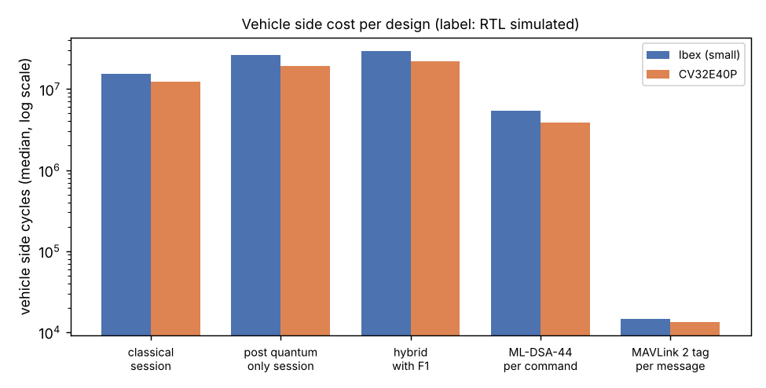

# Executed protocol baselines on open RISC-V cores (RTL simulated)

Author: Huda Mueen. Generated by `rtlsim/proto/make_doc.py`; do not edit by hand. Every number below is read by that script from `rtlsim/results/logs/proto/` (simulation logs and the section sizes written by `rtlsim/proto/build.sh`), `rtlsim/results/<core>_cycles.csv` (round 5) or `data/shared_inputs.csv`.

## What this is, and what it is not

This document closes limitation L1 of `docs/LIMITATIONS_AND_PLAN_R6.md` as far as free tools allow: the session protocols of `docs/REFERENCE_ARCHITECTURE.md` and `formal/models/session_b_fixed.pv` and the per message and per command alternatives were executed end to end with pinned libraries, with a correctness check in every run, on two open RISC-V core designs in cycle accurate simulation of their register transfer level descriptions (Verilator). Cycle counts and stack carry the label **RTL simulated**. They are not measurements of a Cortex-M microcontroller, of silicon or of a board. Both testbenches have no cache and no wait states, so a microcontroller that fetches from flash with wait states would take more cycles. Times at a clock are **estimated** (cycles divided by the clock). Code sizes come from the toolchain on the host (**host measured**).

## Method

- Cores and testbenches (unchanged from round 5, `docs/RTL_SIM_RESULTS.md`): Ibex, named configuration small, commit `1b29dae8866e6c0f0a3cd9dead53a77b4f45e357`, simple system with a single 1 MB RAM shared by instruction and data ports that answers in the next cycle (no wait states, no cache); CV32E40P, tag cv32e40p_v1.8.3, example testbench with a 4 MB RAM (mm_ram and dp_ram), random stall and interrupt generators present but not enabled by the program (no wait states, no cache). Ibex runs with the instruction trace off.
- Compiler and flags (as round 5): `riscv64-unknown-elf-gcc (13.2.0-11ubuntu1+12) 13.2.0`, `-march=rv32imc_zicsr -mabi=ilp32 -O3 -fomit-frame-pointer -static -mcmodel=medany -ffreestanding -fno-builtin-printf -std=gnu99 -isystem /usr/lib/picolibc/riscv64-unknown-elf/include`, picolibc for memcpy, memset and memcmp. The same object files of the libraries are linked for both cores; only the start up code and the output functions differ.
- Libraries, used as benchmark subjects only (no cryptographic primitive is written in this repository): mlkem-native `d1b2fe782888bdb761a50336012923180be7f502` (ML-KEM-768), mldsa-native `834a90d5e846ffa1e1611bd24e160bb2e9b86d35` (ML-DSA-44 and its SHAKE256), both with their portable C backends; Monocypher `ab2b16dd619ad5f6979a4fbe69cfa324a6fcc35f` (tag 4.0.3; X25519, and Ed25519 with SHA-512 from its optional module); the MAVLink 2 C library (generated headers, c_library_v2) `6b4243f0e54b42ddb1e65df7a3a5e8c99d15ec1f` for message signing and the SHA-256 it uses. Classical library and MAVLink library are fetched by `rtlsim/proto/fetch.sh` at these commits and never committed.
- Protocol glue (benchmark code, `rtlsim/proto/sw/proto_bench.c`): flights as in the formal model of design B with F1. F1 carries the ground X25519 share and the ML-KEM-768 encapsulation key; F2 the vehicle X25519 share and the ciphertext; F3 the ground signature over (flight 3, ground identity, vehicle identity, transcript hash) and a 16 B ground confirmation tag; F4 the vehicle signature over (flight 4, vehicle identity, ground identity, transcript hash) and a 16 B vehicle confirmation tag. The transcript hash is SHAKE256 over a label and the full bytes of F1 and F2; the session key is SHAKE256 over a label, the X25519 secret, the ML-KEM secret and the transcript hash; each confirmation tag is SHAKE256 over the session key, a label and the transcript hash; identities are SHAKE256 of the long term public keys, pinned at the other side. The signature input is therefore 97 B. The classical design drops the ML-KEM parts and signs with Ed25519; the post quantum only design drops the X25519 parts. The architecture names no concrete key derivation; SHAKE256 is used for every design so that the designs differ only in the parts under comparison. A rekey is not timed.
- KEM authenticated design (added after the review, in the spirit of post quantum WireGuard and of KEMTLS with pre distributed keys): each side holds a static ML-KEM-768 key pair whose encapsulation key is pinned at the other side; there are no signatures. F1 (ground to vehicle) carries the ground ephemeral X25519 share, a ground ephemeral ML-KEM-768 encapsulation key and a ciphertext encapsulated to the vehicle static key; F2 (vehicle to ground) carries the vehicle X25519 share, a ciphertext to the ground ephemeral key, a ciphertext to the ground static key and a 16 B vehicle confirmation tag; F3 (ground to vehicle) carries a 16 B ground confirmation tag. The session key is SHAKE256 over a label, the X25519 secret, the three ML-KEM secrets (vehicle static, ground ephemeral, ground static) and the transcript hash. The ground accepts after checking the vehicle tag, which only the holder of the vehicle static key can compute; the vehicle accepts after checking the ground tag, which only the holder of the ground static key can compute. One change against the flights first proposed: the transcript hash also covers both pinned identities, as the signed input of the signature designs does, so that each key is bound to the pair of parties and not only through the KEM secrets. No flaw was found in the proposed flights otherwise; as in every design here, the vehicle does its F2 work on an F1 it cannot yet authenticate, so an outsider can make it spend that work. Its formal model is in `docs/FORMAL_VERIFICATION.md` section 10. Its steps: ground F1; vehicle F2 processing; ground F2 check, acceptance and F3; vehicle F3 check and acceptance.
- Vehicle and ground are computed separately in one image per design: each step is timed on its own (ground F1; vehicle F2 processing; ground F3; vehicle F3 check and F4; ground acceptance), and a side's cost is the sum of its steps in that run. Long term keys and identities are provisioned untimed before each run.
- Per command design: the ground signs a MAVLink 2 COMMAND_LONG frame (built with the MAVLink C library) with ML-DSA-44 and the vehicle verifies it. Per message design: the MAVLink 2 signing tag of the shipped library, timed both alone (`mavlink_sign_packet` on the ground, `mavlink_signature_check` on the vehicle) and on the full path (pack with checksum and tag; byte parser with checksum, tag and timestamp check), for a COMMAND_LONG frame and for a frame of 60 B before the signature field (10 B header, 48 B payload, 2 B checksum). The tag follows the MAVLink message signing guide (https://mavlink.io/en/guide/message_signing.html, read 2026-10-28): the first 48 bits of SHA-256 over secret key, header, payload, checksum, link id and timestamp. A known answer test checks the library tag against that formula computed on the host.
- Runs and seeds: 15 runs per image (the MAVLink tag image 5, as it has no data dependent operation); run r reseeds the test generator with 20261021 + r (seed block 20261021 to 20261035). The generator (`rtlsim/sw/bench_rng.c`, splitmix64) is a deterministic test generator and is NOT a secure random number generator. Medians with a bootstrap 95 percent interval of the median (10,000 resamples, seed 20261021), and the smallest and largest run.
- Cycles: `mcycle` read before and after each timed call, the cost of two back to back reads removed (as round 5). Peak stack: before each timed call the harness fills 192 kB below the caller's stack pointer (after a 256 B gap) with a pattern and afterwards finds the lowest overwritten word; the value is the distance from the caller's stack pointer, so it includes the glue frames, and its resolution floor is 256 B. Session state and messages are static (bss), not stack.
- Correctness in every run: both sides derive the same session key and transcript hash, both signatures verify, both confirmation tags match, both sides accept; known answer tests for SHA-256, the MAVLink tag and the key derivation; ML-KEM shared secrets equal; X25519 secrets agree. First run only (untimed): a modified F3 signature, a modified F3 tag and a modified F4 signature are rejected; a modified signed input is rejected by Ed25519 and ML-DSA-44; a replayed MAVLink frame and a modified payload are rejected. KEM authenticated design, first run only: a modified F3 tag, a modified F2 tag and a modified ciphertext to the ground static key are rejected, and the ground rejects F2 when the ciphertext to the vehicle static key in F1 was replaced in transit by an encapsulation of a third party.
- Code size: text (code plus read only data), data and bss of each image, excluding the stack and heap reservations of the link scripts. Two link variants: the simulated image (whole library objects, as round 5) and a size only build with `-ffunction-sections -fdata-sections` and `--gc-sections` that drops library code the design never calls. Each image holds both the vehicle and the ground code of its design, the harness and the C library parts it uses.

## Correctness

- CV32E40P classical: 75 timed calls (0 failed), 63 checks (0 failed), log complete.
- CV32E40P hybrid_f1: 75 timed calls (0 failed), 63 checks (0 failed), log complete.
- CV32E40P kem_auth: 60 timed calls (0 failed), 97 checks (0 failed), log complete.
- CV32E40P mavlink_tag: 40 timed calls (0 failed), 14 checks (0 failed), log complete.
- CV32E40P per_command_mldsa44: 30 timed calls (0 failed), 16 checks (0 failed), log complete.
- CV32E40P pq_only: 75 timed calls (0 failed), 63 checks (0 failed), log complete.
- CV32E40P primitives: 300 timed calls (0 failed), 92 checks (0 failed), log complete.
- Ibex (small) classical: 75 timed calls (0 failed), 63 checks (0 failed), log complete.
- Ibex (small) hybrid_f1: 75 timed calls (0 failed), 63 checks (0 failed), log complete.
- Ibex (small) kem_auth: 60 timed calls (0 failed), 97 checks (0 failed), log complete.
- Ibex (small) mavlink_tag: 40 timed calls (0 failed), 14 checks (0 failed), log complete.
- Ibex (small) per_command_mldsa44: 30 timed calls (0 failed), 16 checks (0 failed), log complete.
- Ibex (small) pq_only: 75 timed calls (0 failed), 63 checks (0 failed), log complete.
- Ibex (small) primitives: 300 timed calls (0 failed), 92 checks (0 failed), log complete.

Failed calls, failed checks and incomplete logs in total: 0. Painted stack area used up in any call: no.

## Primitives alone (label: RTL simulated)

Median cycles (bootstrap 95 percent interval of the median) and the largest peak stack over the runs. Source: `rtlsim/results/proto_primitives.csv`.

| Operation | Library | Input | Ibex median | Ibex 95% CI | CV32E40P median | CV32E40P 95% CI | Peak stack Ibex / CV32E40P (B) |
|---|---|---|---|---|---|---|---|
| x25519_keygen | Monocypher | public key from a 32 B secret (crypto_x25519_public_key) | 3,920,681 | 3,920,681 to 3,920,681 | 3,159,793 | 3,159,793 to 3,159,793 | 808 / 808 |
| x25519_shared | Monocypher | shared secret, one scalar multiplication (crypto_x25519) | 3,920,680 | 3,920,680 to 3,920,680 | 3,159,792 | 3,159,792 to 3,159,792 | 808 / 808 |
| ed25519_keygen | Monocypher | key pair from a 32 B seed (crypto_ed25519_key_pair) | 1,760,743 | 1,760,743 to 1,760,743 | 1,393,011 | 1,393,011 to 1,393,011 | 1236 / 1236 |
| ed25519_sign | Monocypher | 97 B input (crypto_ed25519_sign) | 1,855,573 | 1,855,573 to 1,855,573 | 1,473,392 | 1,473,392 to 1,473,392 | 1348 / 1348 |
| ed25519_verify | Monocypher | 97 B input (crypto_ed25519_check) | 5,588,894 | 5,517,399 to 5,620,644 | 4,530,470 | 4,473,645 to 4,555,891 | 1752 / 1752 |
| sha256_60B | MAVLink C library | 60 B input, 48 bit output (mavlink_sha256) | 13,923 | 13,923 to 13,923 | 12,755 | 12,755 to 12,755 | 256 / 256 |
| mavlink_tag_frame60 | MAVLink C library | mavlink_sign_packet over a 60 B frame, fixed fields | 14,264 | 14,264 to 14,264 | 13,055 | 13,055 to 13,055 | 256 / 256 |
| shake256_kdf | mldsa-native FIPS 202 | session key derivation over 3 x 32 B plus label | 43,795 | 43,795 to 43,795 | 29,550 | 29,550 to 29,550 | 420 / 420 |
| shake256_confirm_tag | mldsa-native FIPS 202 | 16 B key confirmation tag | 42,971 | 42,971 to 42,971 | 28,912 | 28,912 to 28,912 | 420 / 420 |
| shake256_transcript_hybrid | mldsa-native FIPS 202 | transcript hash over F1 and F2 of the hybrid design (2,336 B) | 731,774 | 731,774 to 731,774 | 489,310 | 489,310 to 489,310 | 420 / 420 |
| shake256_transcript_classical | mldsa-native FIPS 202 | transcript hash over F1 and F2 of the classical design (64 B) | 43,313 | 43,313 to 43,313 | 29,175 | 29,175 to 29,175 | 420 / 420 |
| shake256_transcript_pq_only | mldsa-native FIPS 202 | transcript hash over F1 and F2 of the post quantum only design (2,272 B) | 692,189 | 692,189 to 692,189 | 462,949 | 462,949 to 462,949 | 420 / 420 |
| shake256_transcript_kem_auth | mldsa-native FIPS 202 | transcript hash over both identities, F1 and F2 without its tag, KEM authenticated design (4,576 B) | 1,381,173 | 1,381,173 to 1,381,173 | 923,491 | 923,491 to 923,491 | 420 / 420 |
| shake256_kdf_kem_auth | mldsa-native FIPS 202 | session key derivation over 5 x 32 B plus label (KEM authenticated design) | 83,503 | 83,503 to 83,503 | 56,016 | 56,016 to 56,016 | 420 / 420 |
| mlkem768_keygen | mlkem-native | keypair | 2,264,831 | 2,264,706 to 2,265,302 | 1,547,937 | 1,547,827 to 1,548,354 | 14212 / 14212 |
| mlkem768_encaps | mlkem-native | enc | 2,483,765 | 2,483,640 to 2,484,236 | 1,703,480 | 1,703,370 to 1,703,897 | 17348 / 17348 |
| mlkem768_decaps | mlkem-native | dec | 3,029,779 | 3,029,654 to 3,030,250 | 2,069,937 | 2,069,827 to 2,070,354 | 18404 / 18404 |
| mldsa44_keygen | mldsa-native | keypair | 5,434,708 | 5,434,643 to 5,434,778 | 3,789,397 | 3,789,337 to 3,789,454 | 32292 / 32292 |
| mldsa44_sign | mldsa-native | 97 B input, empty context | 16,711,118 | 12,617,655 to 19,086,282 | 12,384,925 | 9,355,215 to 14,176,444 | 50164 / 50164 |
| mldsa44_verify | mldsa-native | 97 B input, empty context | 5,497,567 | 5,497,523 to 5,497,654 | 3,904,623 | 3,904,586 to 3,904,698 | 30148 / 30148 |

Consistency with round 5 (same libraries, compiler and flags; round 5 signed a 64 B message, this round a 97 B input, and the link layout differs): this round over round 5 median, Ibex (small) mlkem768_keygen 0.998; Ibex (small) mlkem768_encaps 1.000; Ibex (small) mlkem768_decaps 0.999; Ibex (small) mldsa44_keygen 1.010; Ibex (small) mldsa44_sign 1.331; Ibex (small) mldsa44_verify 1.017; CV32E40P mlkem768_keygen 1.000; CV32E40P mlkem768_encaps 1.000; CV32E40P mlkem768_decaps 1.000; CV32E40P mldsa44_keygen 1.000; CV32E40P mldsa44_sign 1.316; CV32E40P mldsa44_verify 1.007.

## Designs, vehicle and ground side (label: RTL simulated)

One unit of work per design: a session start for the session designs, one command for the per command design, one message for the tag. Each cell gives the median cycles, the bootstrap 95 percent interval of the median in brackets and the smallest to largest run after it. Source: `rtlsim/results/proto_sessions.csv`.

| Design | Unit | Side | Ibex cycles: median [95% CI] (min to max) | CV32E40P cycles: median [95% CI] (min to max) | Runs correct Ibex / CV32E40P |
|---|---|---|---|---|---|
| Classical session (X25519, Ed25519 by both sides, key confirmation) | session start | vehicle | 15,454,894 [15,435,470 to 15,493,668] (15,311,975 to 15,542,431) | 12,436,582 [12,421,071 to 12,467,681] (12,323,526 to 12,506,679) | 15/15 / 15/15 |
| Classical session (X25519, Ed25519 by both sides, key confirmation) | session start | ground | 15,445,645 [15,400,281 to 15,478,454] (15,373,222 to 15,553,400) | 12,430,033 [12,393,370 to 12,455,602] (12,372,267 to 12,515,166) | 15/15 / 15/15 |
| Post quantum only session (ML-KEM-768, ML-DSA-44 by both sides, key confirmation) | session start | vehicle | 23,766,058 [21,577,479 to 26,310,313] (16,479,065 to 33,136,922) | 17,274,915 [15,641,236 to 19,207,545] (11,767,803 to 24,327,868) | 15/15 / 15/15 |
| Post quantum only session (ML-KEM-768, ML-DSA-44 by both sides, key confirmation) | session start | ground | 21,574,500 [19,298,550 to 26,118,630] (19,296,775 to 42,411,258) | 15,398,007 [13,690,815 to 18,805,735] (13,689,212 to 31,264,282) | 15/15 / 15/15 |
| Hybrid session with F1 (X25519 plus ML-KEM-768, ML-DSA-44 by both sides, key confirmation) | session start | vehicle | 29,185,877 [26,450,744 to 29,453,937] (24,360,848 to 43,742,657) | 21,758,082 [19,665,350 to 21,983,514] (18,114,375 to 32,758,343) | 15/15 / 15/15 |
| Hybrid session with F1 (X25519 plus ML-KEM-768, ML-DSA-44 by both sides, key confirmation) | session start | ground | 32,274,064 [27,181,090 to 38,827,417] (27,179,184 to 58,682,195) | 23,907,088 [20,038,040 to 28,797,783] (20,036,347 to 43,838,621) | 15/15 / 15/15 |
| KEM authenticated session (X25519 plus ML-KEM-768, static ML-KEM-768 keys pinned at the other side, no signatures, key confirmation) | session start | vehicle | 17,391,267 [17,390,603 to 17,391,690] (17,389,529 to 17,548,545) | 12,835,448 [12,834,871 to 12,835,832] (12,833,923 to 12,940,184) | 15/15 / 15/15 |
| KEM authenticated session (X25519 plus ML-KEM-768, static ML-KEM-768 keys pinned at the other side, no signatures, key confirmation) | session start | ground | 20,202,103 [20,201,512 to 20,202,754] (20,200,098 to 20,516,174) | 14,749,842 [14,749,311 to 14,750,418] (14,748,059 to 14,958,868) | 15/15 / 15/15 |
| ML-DSA-44 signature per command | per command, ML-DSA-44 signature | vehicle | 5,405,203 [5,405,050 to 5,405,263] (5,404,969 to 5,405,361) | 3,883,421 [3,883,331 to 3,883,461] (3,883,278 to 3,883,557) | 15/15 / 15/15 |
| ML-DSA-44 signature per command | per command, ML-DSA-44 signature | ground | 10,017,385 [9,638,746 to 26,747,099] (7,570,009 to 35,311,336) | 7,441,751 [7,128,096 to 20,153,842] (5,578,050 to 26,594,144) | 15/15 / 15/15 |
| MAVLink 2 signing tag per message | per message, tag alone, 60 B frame | vehicle | 14,705 [14,705 to 14,705] (14,705 to 14,705) | 13,426 [13,426 to 13,426] (13,426 to 13,426) | 5/5 / 5/5 |
| MAVLink 2 signing tag per message | per message, tag alone, 60 B frame | ground | 14,263 [14,263 to 14,263] (14,263 to 14,263) | 13,055 [13,055 to 13,055] (13,055 to 13,055) | 5/5 / 5/5 |
| MAVLink 2 signing tag per message | per message, tag alone, COMMAND_LONG | vehicle | 14,583 [14,583 to 14,583] (14,583 to 14,583) | 13,314 [13,314 to 13,314] (13,314 to 13,314) | 5/5 / 5/5 |
| MAVLink 2 signing tag per message | per message, tag alone, COMMAND_LONG | ground | 14,215 [14,215 to 14,215] (14,215 to 14,215) | 13,007 [13,007 to 13,007] (13,007 to 13,007) | 5/5 / 5/5 |
| MAVLink 2 signing tag per message | per message, full path, 60 B frame | vehicle | 22,610 [22,610 to 22,610] (22,610 to 22,610) | 19,818 [19,818 to 19,818] (19,818 to 19,818) | 5/5 / 5/5 |
| MAVLink 2 signing tag per message | per message, full path, 60 B frame | ground | 16,411 [16,411 to 16,411] (16,411 to 16,411) | 15,034 [15,034 to 15,034] (15,034 to 15,034) | 5/5 / 5/5 |
| MAVLink 2 signing tag per message | per message, full path, COMMAND_LONG | vehicle | 21,489 [21,489 to 21,490] (21,489 to 21,490) | 18,907 [18,906 to 18,907] (18,906 to 18,907) | 5/5 / 5/5 |
| MAVLink 2 signing tag per message | per message, full path, COMMAND_LONG | ground | 15,880 [15,849 to 15,892] (15,849 to 15,892) | 14,492 [14,461 to 14,504] (14,461 to 14,504) | 5/5 / 5/5 |

| Design | Unit | Peak stack Ibex / CV32E40P (B) | Bytes on air per unit | Bytes per flight |
|---|---|---|---|---|
| classical | session start | 2104 / 2104 | 224 | F1 ground_to_vehicle 32; F2 vehicle_to_ground 32; F3 ground_to_vehicle 80; F4 vehicle_to_ground 80 |
| pq_only | session start | 50532 / 50532 | 7144 | F1 ground_to_vehicle 1184; F2 vehicle_to_ground 1088; F3 ground_to_vehicle 2436; F4 vehicle_to_ground 2436 |
| hybrid_f1 | session start | 50564 / 50564 | 7208 | F1 ground_to_vehicle 1216; F2 vehicle_to_ground 1120; F3 ground_to_vehicle 2436; F4 vehicle_to_ground 2436 |
| kem_auth | session start | 18756 / 18756 | 4544 | F1 ground_to_vehicle 2304; F2 vehicle_to_ground 2224; F3 ground_to_vehicle 16 |
| per_command_mldsa44 | per command, ML-DSA-44 signature | 50164 / 50164 | 2464 | command_frame ground_to_vehicle 44; command_signature ground_to_vehicle 2420 |
| mavlink_tag | per message, tag alone, 60 B frame | 256 / 256 | 13 | signature field 13 |
| mavlink_tag | per message, tag alone, COMMAND_LONG | 256 / 256 | 13 | signature field 13 |
| mavlink_tag | per message, full path, 60 B frame | 296 / 296 | 13 | signature field 13 |
| mavlink_tag | per message, full path, COMMAND_LONG | 296 / 296 | 13 | signature field 13 |

Peak stack is the larger of the vehicle and ground values. Message bytes are the sizes of the buffers the program built (`MSG` lines of the logs).

## The 15 run rerun and the five run snapshot of round 6

The first runs of round 6 used 5 runs per image (seed block 20261021 to 20261025). After the review the images were run again with 15 runs whose seed block extends the first one, and the 15 run values replace the five run values in `rtlsim/results/proto_sessions.csv` and `rtlsim/results/proto_primitives.csv`. The five run tables are kept unchanged as frozen snapshots, `rtlsim/results/proto_sessions_runs5.csv` and `rtlsim/results/proto_primitives_runs5.csv`, because the software in the loop study of round 6 (`docs/SITL_STUDY_R6.md`) set its compute delays from the five run medians and recorded the SHA-256 of those two files in its raw outputs (`sitl/raw_r6/`); the snapshots are byte for byte the files it hashed. Their logs are those of the repository history before this rerun. Runs 0 to 4 of the rerun have the seeds of the snapshot, so the median of those five runs should reproduce it; the table checks this for the vehicle and ground totals.

| Design | Side | Core | Five run snapshot median | Median of runs 0 to 4 of the rerun | Same | Median of all runs |
|---|---|---|---|---|---|---|
| classical | vehicle | Ibex (small) | 15,430,181 | 15,430,181 | yes | 15,454,894 |
| classical | vehicle | CV32E40P | 12,417,768 | 12,417,768 | yes | 12,436,582 |
| classical | ground | Ibex (small) | 15,431,211 | 15,431,211 | yes | 15,445,645 |
| classical | ground | CV32E40P | 12,418,331 | 12,418,331 | yes | 12,430,033 |
| pq_only | vehicle | Ibex (small) | 26,310,313 | 26,310,313 | yes | 23,766,058 |
| pq_only | vehicle | CV32E40P | 19,207,545 | 19,207,545 | yes | 17,274,915 |
| pq_only | ground | Ibex (small) | 21,573,711 | 21,573,711 | yes | 21,574,500 |
| pq_only | ground | CV32E40P | 15,397,311 | 15,397,311 | yes | 15,398,007 |
| hybrid_f1 | vehicle | Ibex (small) | 29,373,796 | 29,373,796 | yes | 29,185,877 |
| hybrid_f1 | vehicle | CV32E40P | 21,915,978 | 21,915,978 | yes | 21,758,082 |
| hybrid_f1 | ground | Ibex (small) | 35,096,287 | 35,096,287 | yes | 32,274,064 |
| hybrid_f1 | ground | CV32E40P | 26,073,064 | 26,073,064 | yes | 23,907,088 |
| per_command_mldsa44 | vehicle | Ibex (small) | 5,405,110 | 5,405,110 | yes | 5,405,203 |
| per_command_mldsa44 | vehicle | CV32E40P | 3,883,354 | 3,883,354 | yes | 3,883,421 |
| per_command_mldsa44 | ground | Ibex (small) | 9,638,746 | 9,638,746 | yes | 10,017,385 |
| per_command_mldsa44 | ground | CV32E40P | 7,128,096 | 7,128,096 | yes | 7,441,751 |

Reproduced exactly: 16 of 16 rows. The KEM authenticated design is new and has no snapshot row.

Primitives image: 6 of 32 operation medians of runs 0 to 4 equal the snapshot; the largest difference is 6 cycles (0.0281 percent of that median). The primitives image gained the transcript hashes and the key derivation of the new design after the round 6 operations, which leaves their random stream, and so the ML-DSA-44 signing rounds per seed, unchanged but moves code in memory; we attribute the few cycles of difference per call to that layout change without having traced it further. The session images changed only in their run count.

## Where the cycles go: each side against its primitive costs (label: RTL simulated)

Each side of a session start is a fixed list of calls to the pinned libraries plus glue. The tables list those calls, each costed at its median in the primitives image (`rtlsim/results/proto_primitives.csv`), and compare their sum with the measured median of the side; the residual is glue (random bytes for the X25519 secrets, copies, comparisons, the signed input) and the difference between a call in the session and the same call in the primitives image. ML-DSA-44 signing has a data dependent number of rounds (rejection sampling), so its cost differs from seed to seed and the session image signs other messages with other keys than the primitives image: for the designs that sign, the sum is also given with the signing call at its smallest and largest run. Source: `rtlsim/results/proto_decomposition.csv`.

### Vehicle side

Classical session (X25519, Ed25519 by both sides, key confirmation):

| Call | Count | Ibex cycles | CV32E40P cycles | Share of the primitive sum, CV32E40P |
|---|---|---|---|---|
| x25519_keygen | 1 | 3,920,681 | 3,159,793 | 25.4 % |
| x25519_shared | 1 | 3,920,680 | 3,159,792 | 25.4 % |
| shake256_transcript_classical | 1 | 43,313 | 29,175 | 0.2 % |
| shake256_kdf | 1 | 43,795 | 29,550 | 0.2 % |
| ed25519_verify | 1 | 5,588,894 | 4,530,470 | 36.4 % |
| shake256_confirm_tag | 2 | 85,942 | 57,824 | 0.5 % |
| ed25519_sign | 1 | 1,855,573 | 1,473,392 | 11.8 % |
| sum of primitive medians | | 15,458,878 | 12,439,996 | |
| measured median of the side | | 15,454,894 | 12,436,582 | |
| sum over measured | | 1.000 | 1.000 | |

Post quantum only session (ML-KEM-768, ML-DSA-44 by both sides, key confirmation):

| Call | Count | Ibex cycles | CV32E40P cycles | Share of the primitive sum, CV32E40P |
|---|---|---|---|---|
| mlkem768_encaps | 1 | 2,483,765 | 1,703,480 | 9.2 % |
| shake256_transcript_pq_only | 1 | 692,189 | 462,949 | 2.5 % |
| shake256_kdf | 1 | 43,795 | 29,550 | 0.2 % |
| mldsa44_verify | 1 | 5,497,567 | 3,904,623 | 21.1 % |
| shake256_confirm_tag | 2 | 85,942 | 57,824 | 0.3 % |
| mldsa44_sign | 1 | 16,711,118 | 12,384,925 | 66.8 % |
| sum of primitive medians | | 25,514,376 | 18,543,351 | |
| measured median of the side | | 23,766,058 | 17,274,915 | |
| sum over measured | | 1.074 | 1.073 | |

Hybrid session with F1 (X25519 plus ML-KEM-768, ML-DSA-44 by both sides, key confirmation):

| Call | Count | Ibex cycles | CV32E40P cycles | Share of the primitive sum, CV32E40P |
|---|---|---|---|---|
| x25519_keygen | 1 | 3,920,681 | 3,159,793 | 12.7 % |
| x25519_shared | 1 | 3,920,680 | 3,159,792 | 12.7 % |
| mlkem768_encaps | 1 | 2,483,765 | 1,703,480 | 6.8 % |
| shake256_transcript_hybrid | 1 | 731,774 | 489,310 | 2.0 % |
| shake256_kdf | 1 | 43,795 | 29,550 | 0.1 % |
| mldsa44_verify | 1 | 5,497,567 | 3,904,623 | 15.7 % |
| shake256_confirm_tag | 2 | 85,942 | 57,824 | 0.2 % |
| mldsa44_sign | 1 | 16,711,118 | 12,384,925 | 49.8 % |
| sum of primitive medians | | 33,395,322 | 24,889,297 | |
| measured median of the side | | 29,185,877 | 21,758,082 | |
| sum over measured | | 1.144 | 1.144 | |

KEM authenticated session (X25519 plus ML-KEM-768, static ML-KEM-768 keys pinned at the other side, no signatures, key confirmation):

| Call | Count | Ibex cycles | CV32E40P cycles | Share of the primitive sum, CV32E40P |
|---|---|---|---|---|
| x25519_keygen | 1 | 3,920,681 | 3,159,793 | 24.6 % |
| x25519_shared | 1 | 3,920,680 | 3,159,792 | 24.6 % |
| mlkem768_decaps | 1 | 3,029,779 | 2,069,937 | 16.1 % |
| mlkem768_encaps | 2 | 4,967,530 | 3,406,960 | 26.5 % |
| shake256_transcript_kem_auth | 1 | 1,381,173 | 923,491 | 7.2 % |
| shake256_kdf_kem_auth | 1 | 83,503 | 56,016 | 0.4 % |
| shake256_confirm_tag | 2 | 85,942 | 57,824 | 0.5 % |
| sum of primitive medians | | 17,389,288 | 12,833,813 | |
| measured median of the side | | 17,391,267 | 12,835,448 | |
| sum over measured | | 1.000 | 1.000 | |

Summary, vehicle side:

| Design | Core | Sum of primitive medians | Sum, signing at its smallest / largest run | Measured median [95% CI] | Sum over measured |
|---|---|---|---|---|---|
| classical | Ibex (small) | 15,458,878 | no signing call | 15,454,894 [15,435,470 to 15,493,668] | 1.000 |
| classical | CV32E40P | 12,439,996 | no signing call | 12,436,582 [12,421,071 to 12,467,681] | 1.000 |
| pq_only | Ibex (small) | 25,514,376 | 16,486,711 / 60,783,169 | 23,766,058 [21,577,479 to 26,310,313] | 1.074 |
| pq_only | CV32E40P | 18,543,351 | 11,775,745 / 45,324,092 | 17,274,915 [15,641,236 to 19,207,545] | 1.073 |
| hybrid_f1 | Ibex (small) | 33,395,322 | 24,367,657 / 68,664,115 | 29,185,877 [26,450,744 to 29,453,937] | 1.144 |
| hybrid_f1 | CV32E40P | 24,889,297 | 18,121,691 / 51,670,038 | 21,758,082 [19,665,350 to 21,983,514] | 1.144 |
| kem_auth | Ibex (small) | 17,389,288 | no signing call | 17,391,267 [17,390,603 to 17,391,690] | 1.000 |
| kem_auth | CV32E40P | 12,833,813 | no signing call | 12,835,448 [12,834,871 to 12,835,832] | 1.000 |

### Ground side

Summary, ground side:

| Design | Core | Sum of primitive medians | Sum, signing at its smallest / largest run | Measured median [95% CI] | Sum over measured |
|---|---|---|---|---|---|
| classical | Ibex (small) | 15,458,878 | no signing call | 15,445,645 [15,400,281 to 15,478,454] | 1.001 |
| classical | CV32E40P | 12,439,996 | no signing call | 12,430,033 [12,393,370 to 12,455,602] | 1.001 |
| pq_only | Ibex (small) | 28,325,221 | 19,297,556 / 63,594,014 | 21,574,500 [19,298,550 to 26,118,630] | 1.313 |
| pq_only | CV32E40P | 20,457,745 | 13,690,139 / 47,238,486 | 15,398,007 [13,690,815 to 18,805,735] | 1.329 |
| hybrid_f1 | Ibex (small) | 36,206,167 | 27,178,502 / 71,474,960 | 32,274,064 [27,181,090 to 38,827,417] | 1.122 |
| hybrid_f1 | CV32E40P | 26,803,691 | 20,036,085 / 53,584,432 | 23,907,088 [20,038,040 to 28,797,783] | 1.121 |
| kem_auth | Ibex (small) | 20,200,133 | no signing call | 20,202,103 [20,201,512 to 20,202,754] | 1.000 |
| kem_auth | CV32E40P | 14,748,207 | no signing call | 14,749,842 [14,749,311 to 14,750,418] | 1.000 |

## Ratios between designs (label: RTL simulated)

Two readings of each ratio. From the session medians: the ratio of the two medians over the runs, with a bootstrap 95 percent interval of that ratio (the two designs run in separate images, so their runs are resampled independently). From the primitive sums: the ratio of the sums of the previous section, which does not depend on which seeds fell into which design but assumes the calls cost in the session what they cost alone; for designs that sign, the range uses the signing call at its smallest and at its largest run in both designs. ML-DSA-44 signing has a data dependent number of rounds, so ratios that involve a signing design move with the seeds; the KEM authenticated design has no data dependent call of that kind. Source: `rtlsim/results/proto_ratios.csv`.

| Ratio | Side | Core | From session medians [95% CI] | From primitive sums (signing at smallest to largest) |
|---|---|---|---|---|
| hybrid_f1 over classical | vehicle | Ibex (small) | 1.89 [1.72 to 1.91] | 2.16 (1.58 to 4.44) |
| hybrid_f1 over classical | vehicle | CV32E40P | 1.75 [1.59 to 1.77] | 2.00 (1.46 to 4.15) |
| hybrid_f1 over classical | ground | Ibex (small) | 2.09 [1.76 to 2.51] | 2.34 (1.76 to 4.62) |
| hybrid_f1 over classical | ground | CV32E40P | 1.92 [1.61 to 2.31] | 2.15 (1.61 to 4.31) |
| pq_only over classical | vehicle | Ibex (small) | 1.54 [1.40 to 1.68] | 1.65 (1.07 to 3.93) |
| pq_only over classical | vehicle | CV32E40P | 1.39 [1.26 to 1.52] | 1.49 (0.95 to 3.64) |
| pq_only over classical | ground | Ibex (small) | 1.40 [1.25 to 1.69] | 1.83 (1.25 to 4.11) |
| pq_only over classical | ground | CV32E40P | 1.24 [1.10 to 1.51] | 1.64 (1.10 to 3.80) |
| hybrid_f1 over pq_only | vehicle | Ibex (small) | 1.23 [1.03 to 1.36] | 1.31 (1.13 to 1.48) |
| hybrid_f1 over pq_only | vehicle | CV32E40P | 1.26 [1.05 to 1.41] | 1.34 (1.14 to 1.54) |
| hybrid_f1 over pq_only | ground | Ibex (small) | 1.50 [1.22 to 1.82] | 1.28 (1.12 to 1.41) |
| hybrid_f1 over pq_only | ground | CV32E40P | 1.55 [1.26 to 1.90] | 1.31 (1.13 to 1.46) |
| kem_auth over classical | vehicle | Ibex (small) | 1.13 [1.12 to 1.13] | 1.12 |
| kem_auth over classical | vehicle | CV32E40P | 1.03 [1.03 to 1.03] | 1.03 |
| kem_auth over classical | ground | Ibex (small) | 1.31 [1.31 to 1.31] | 1.31 |
| kem_auth over classical | ground | CV32E40P | 1.19 [1.18 to 1.19] | 1.19 |
| kem_auth over hybrid_f1 | vehicle | Ibex (small) | 0.60 [0.56 to 0.66] | 0.52 (0.25 to 0.71) |
| kem_auth over hybrid_f1 | vehicle | CV32E40P | 0.59 [0.55 to 0.65] | 0.52 (0.25 to 0.71) |
| kem_auth over hybrid_f1 | ground | Ibex (small) | 0.63 [0.52 to 0.74] | 0.56 (0.28 to 0.74) |
| kem_auth over hybrid_f1 | ground | CV32E40P | 0.62 [0.51 to 0.74] | 0.55 (0.28 to 0.74) |
| kem_auth over pq_only | vehicle | Ibex (small) | 0.73 [0.66 to 0.82] | 0.68 (0.29 to 1.05) |
| kem_auth over pq_only | vehicle | CV32E40P | 0.74 [0.67 to 0.83] | 0.69 (0.28 to 1.09) |
| kem_auth over pq_only | ground | Ibex (small) | 0.94 [0.77 to 1.05] | 0.71 (0.32 to 1.05) |
| kem_auth over pq_only | ground | CV32E40P | 0.96 [0.78 to 1.08] | 0.72 (0.31 to 1.08) |

- Ibex (small), vehicle side: the hybrid and the post quantum only designs differ by a fixed set of calls, the X25519 key generation and shared secret and the longer transcript, 7,880,946 cycles at the primitive medians; the signing call alone spans 7,683,453 to 51,979,911 cycles over its runs, so with few runs the ratio of session medians reflects the signing seeds as much as the designs.
- CV32E40P, vehicle side: the hybrid and the post quantum only designs differ by a fixed set of calls, the X25519 key generation and shared secret and the longer transcript, 6,345,946 cycles at the primitive medians; the signing call alone spans 5,617,319 to 39,165,666 cycles over its runs, so with few runs the ratio of session medians reflects the signing seeds as much as the designs.

| Design | Unit | Side | Ibex over CV32E40P |
|---|---|---|---|
| classical | session start | vehicle | 1.24 |
| classical | session start | ground | 1.24 |
| pq_only | session start | vehicle | 1.38 |
| pq_only | session start | ground | 1.40 |
| hybrid_f1 | session start | vehicle | 1.34 |
| hybrid_f1 | session start | ground | 1.35 |
| kem_auth | session start | vehicle | 1.35 |
| kem_auth | session start | ground | 1.37 |
| per_command_mldsa44 | per command, ML-DSA-44 signature | vehicle | 1.39 |
| per_command_mldsa44 | per command, ML-DSA-44 signature | ground | 1.35 |
| mavlink_tag | per message, tag alone, 60 B frame | vehicle | 1.10 |
| mavlink_tag | per message, tag alone, 60 B frame | ground | 1.09 |
| mavlink_tag | per message, tag alone, COMMAND_LONG | vehicle | 1.10 |
| mavlink_tag | per message, tag alone, COMMAND_LONG | ground | 1.09 |
| mavlink_tag | per message, full path, 60 B frame | vehicle | 1.14 |
| mavlink_tag | per message, full path, 60 B frame | ground | 1.09 |
| mavlink_tag | per message, full path, COMMAND_LONG | vehicle | 1.14 |
| mavlink_tag | per message, full path, COMMAND_LONG | ground | 1.10 |

## The classical baseline is one portable C library

The classical designs use Monocypher, a library written in portable C for size and simplicity, with no assembly on either core; the post quantum libraries also run their portable C backends. Monocypher computes the ephemeral X25519 public key with the same variable base ladder as the shared secret, so key generation costs as much as a scalar multiplication (3,159,793 against 3,159,792 cycles on CV32E40P). Every statement here that compares X25519 with ML-KEM-768 (for example one X25519 scalar multiplication at 3,159,792 cycles against 1,703,480 for an ML-KEM-768 encapsulation on CV32E40P) therefore holds for portable C on these two cores only. A speed oriented X25519 (assembly, or a fixed base key generation) would make the X25519 parts cheaper, lower the classical session and raise the hybrid over classical ratio; no second classical implementation was measured.

## Signature per command against a session with a tag per message (label: RTL simulated)

- Ibex (small): one ML-DSA-44 verification per command costs 5,405,203 cycles on the vehicle against 14,583 for the tag check of the same COMMAND_LONG frame, a factor of 371. The vehicle side of one hybrid session start (29,185,877 cycles) equals the extra cost of signatures on 5.4 commands (hybrid session cycles divided by the difference between verification and tag check).
- CV32E40P: one ML-DSA-44 verification per command costs 3,883,421 cycles on the vehicle against 13,314 for the tag check of the same COMMAND_LONG frame, a factor of 292. The vehicle side of one hybrid session start (21,758,082 cycles) equals the extra cost of signatures on 5.6 commands (hybrid session cycles divided by the difference between verification and tag check).

## Time at stated clocks (label: estimated)

Median cycles divided by the clock, for the vehicle side; 64 MHz and 168 MHz are clocks of microcontroller classes used elsewhere in this study (168 MHz: `clock_m4_ref_mhz` in `data/shared_inputs.csv`). This assumes the cycle counts of these open cores without wait states and caches, which a Cortex-M flight controller does not share. Source: `rtlsim/results/proto_time_estimated.csv`.

| Design | Unit | Ibex (small) at 64 MHz (ms) | Ibex (small) at 168 MHz (ms) | CV32E40P at 64 MHz (ms) | CV32E40P at 168 MHz (ms) |
|---|---|---|---|---|---|
| classical | session start | 241.483 | 91.993 | 194.322 | 74.027 |
| pq_only | session start | 371.345 | 141.465 | 269.921 | 102.827 |
| hybrid_f1 | session start | 456.029 | 173.726 | 339.970 | 129.512 |
| kem_auth | session start | 271.738 | 103.519 | 200.554 | 76.401 |
| per_command_mldsa44 | per command, ML-DSA-44 signature | 84.456 | 32.174 | 60.678 | 23.116 |
| mavlink_tag | per message, tag alone, 60 B frame | 0.230 | 0.087 | 0.210 | 0.080 |
| mavlink_tag | per message, tag alone, COMMAND_LONG | 0.228 | 0.087 | 0.208 | 0.079 |
| mavlink_tag | per message, full path, 60 B frame | 0.353 | 0.135 | 0.310 | 0.118 |
| mavlink_tag | per message, full path, COMMAND_LONG | 0.336 | 0.128 | 0.295 | 0.113 |

Energy: `data/shared_inputs.csv` holds no active current of a core, so no energy column is computed here (the plan asked for one only if such a current exists).

## Code size (label: host measured)

Bytes of each image; text includes read only data. Source: `rtlsim/results/proto_sizes.csv` and `rtlsim/results/logs/proto/object_sizes.txt` for the library objects.

Simulated images (whole library objects linked):

| Image | Ibex text | Ibex data | Ibex bss | CV32E40P text | CV32E40P data | CV32E40P bss |
|---|---|---|---|---|---|---|
| primitives | 175,202 | 0 | 20,360 | 175,624 | 110 | 20,729 |
| classical | 115,350 | 0 | 728 | 115,648 | 80 | 1,097 |
| pq_only | 72,509 | 3 | 17,536 | 72,920 | 9 | 17,905 |
| hybrid_f1 | 161,081 | 0 | 17,664 | 161,380 | 81 | 18,033 |
| kem_auth | 131,522 | 0 | 14,456 | 131,900 | 80 | 14,825 |
| per_command_mldsa44 | 49,497 | 3 | 6,744 | 49,988 | 37 | 7,113 |
| mavlink_tag | 21,618 | 2 | 2,280 | 21,964 | 36 | 2,645 |

Size only build with unused sections removed:

| Image | Ibex text | Ibex data | Ibex bss | CV32E40P text | CV32E40P data | CV32E40P bss |
|---|---|---|---|---|---|---|
| primitives | 89,424 | 0 | 20,360 | 89,848 | 102 | 20,729 |
| classical | 44,724 | 0 | 728 | 44,928 | 72 | 1,097 |
| pq_only | 55,620 | 0 | 17,536 | 56,080 | 9 | 17,905 |
| hybrid_f1 | 66,152 | 0 | 17,664 | 66,548 | 9 | 18,033 |
| kem_auth | 45,584 | 0 | 14,456 | 46,036 | 8 | 14,825 |
| per_command_mldsa44 | 37,332 | 0 | 6,744 | 37,796 | 37 | 7,113 |
| mavlink_tag | 21,388 | 0 | 2,280 | 21,676 | 36 | 2,645 |

- Ibex, simulated images: hybrid over classical text 1.40; post quantum only over classical 0.63; KEM authenticated over classical 1.14, over hybrid 0.82.
- Ibex, size only build with unused sections removed: hybrid over classical text 1.48; post quantum only over classical 1.24; KEM authenticated over classical 1.02, over hybrid 0.69.

The simulated classical, hybrid and KEM authenticated images link the whole Monocypher object, which also holds functions the protocol never calls (for example Argon2, BLAKE2b, ChaCha20 and Poly1305), so their text is large beside the post quantum only image; the size only build removes them. The bss of the session images holds the static session state and messages; the KEM authenticated image also holds both static ML-KEM-768 key pairs.

## Values for the metrics registered before the runs

Values only, computed from the files above; scoring against `docs/PREDICTIONS_V6.md` is left to the scoring script.

| ID | Metric as registered | Value | Basis |
|---|---|---|---|
| Q1 | X25519 scalar multiplication over ML-KEM-768 encaps, CV32E40P | 1.85 | x25519_shared over mlkem768_encaps medians; with x25519_keygen 1.85 |
| Q2 | vehicle side hybrid handshake cycles, CV32E40P | 21,758,082 | median of the vehicle steps per run |
| Q3 | vehicle hybrid over vehicle classical, CV32E40P | 1.75 | medians |
| Q4 | Ibex over CV32E40P, vehicle side hybrid | 1.34 | medians |
| Q5 | one MAVLink 2 signing tag over a 60 B message, CV32E40P | 13,055 | tag generation alone; tag check alone 13,426 |
| Q6 | peak stack, vehicle side hybrid | 50516 B (CV32E40P), 50516 B (Ibex) | largest over steps and runs |
| Q7 | text of the hybrid image over the classical image | 1.40 (simulated images); 1.48 (unused sections removed) | Ibex; both readings given |



## Limits

- Open RISC-V cores are not Cortex-M cores: instruction set, multiplier, pipeline and compiler back end differ, so these cycles do not transfer to a flight controller without a measurement there (`docs/BOARD_RUN_PROTOCOL.md`).
- No cache and no wait states in either testbench: Ibex reads a single RAM that answers in the next cycle; the CV32E40P example testbench RAM has no wait states unless its random stall generator is enabled, which the program does not do. Real flash wait states add cycles.
- Portable C backends only: no assembly backend of any library was used on either core; Monocypher is portable C by design.
- The X25519 secrets are not checked for the all zero output, nothing here is constant time reviewed, secrets are not wiped, and the random generator is a test generator: this is a cost benchmark, not an implementation for use.
- 15 runs per image (5 for the tag image); intervals of the median remain wide for every design that signs with ML-DSA-44, whose number of rejection rounds depends on the data, so its runs vary more than the other operations.
- The classical baseline is one portable C library (Monocypher); see the section on the classical baseline. The X25519 against ML-KEM-768 comparison holds for portable C on these cores only.
- The KEM authenticated design is executed here for cost and correctness; its security is checked in ProVerif in `docs/FORMAL_VERIFICATION.md` section 10 (keys not secret if ML-KEM is broken; authentication of the vehicle by the ground station proved only with typed static keys).
- Stack values include the benchmark glue frames and have a 256 B floor; the static session state (bss) is listed with the code size.
- The CV32E40P model was built with the BLKANDNBLK check of Verilator switched off for the counter registers (round 5); counts are checked only by repeatability and by the agreement with round 5 above.

## Reproduce

Set `WORK_DIR` (round 5 work folder with ibex, mlkem-native, mldsa-native), `CV32_WORK_DIR` (folder with cv32e40p and its Verilator build), `PROTO_TP` and `PROTO_BUILD` (folders outside the repository), then:

```
bash rtlsim/proto/fetch.sh
bash rtlsim/proto/build.sh ibex && bash rtlsim/proto/build.sh cv32e40p
bash rtlsim/proto/run.sh ibex && bash rtlsim/proto/run.sh cv32e40p   # about 100 minutes per core
python3 rtlsim/proto/make_doc.py
python3 -m unittest discover -s rtlsim -t .
```

## Sources and licences

- MAVLink message signing guide, https://mavlink.io/en/guide/message_signing.html (read 2026-10-28): tag formula, 13 B signature field, timestamp rules.
- MAVLink developer guide introduction, https://mavlink.io/en/ (read 2026-10-28): the message definitions and the generated C library are MIT licensed. `mavlink_sha256.h` carries a BSD 3 clause notice (Heimdal, Royal Institute of Technology, Stockholm).
- Monocypher, https://github.com/LoupVaillant/Monocypher, tag 4.0.3: dual licence BSD-2-Clause or CC0-1.0 (LICENCE.md at the tag).
- mlkem-native and mldsa-native: Apache-2.0 OR ISC OR MIT (as round 5).
